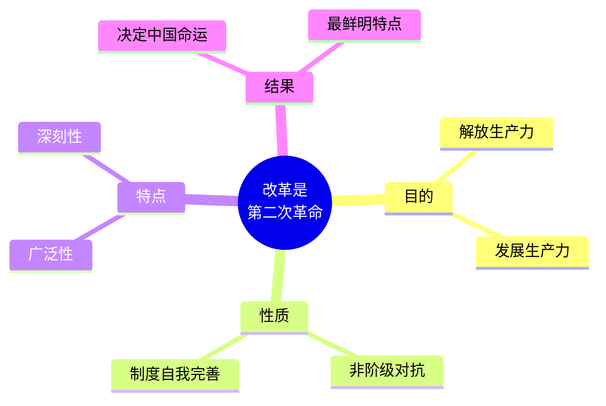

# 改革是中国的第二次革命的科学论断

## 改革是中国的第二次革命的科学论断

这一论断由邓小平提出，旨在阐明改革开放的**性质**与**深度**。很多同学容易困惑：既然叫“革命”，为什么不是暴力推翻政权？这里的“革命”是指**社会变革的深刻性**，而非阶级斗争意义上的政治革命。

> [!IMPORTANT]
> 核心定义：改革是社会主义制度的**自我完善和发展**，但在解放生产力、扫除体制障碍的广度和深度上，其作用等同于一次革命。

### 为什么称为“第二次革命”？

我们可以从两个维度来理解这个比喻：

1.  **第一次革命**：指新民主主义革命和社会主义革命，建立了社会主义基本制度，解决了“站起来”的问题。
2.  **第二次革命**：指改革开放，通过体制改革解放被束缚的生产力，解决“富起来”和“强起来”的问题。

### 与相近概念的区别

考试中常混淆“改革”与“传统革命”或“一般性政策调整”。请注意以下对比：

| 维度 | 传统政治革命 (如新民主主义革命) | 改革 (第二次革命) | 一般性修补 |
| :--- | :--- | :--- | :--- |
| **对象** | 旧的社会制度/政权 | 僵化的体制机制 | 局部细节 |
| **手段** | 暴力/阶级斗争 | 和平/渐进式试点 | 行政命令 |
| **性质** | 一个阶级推翻另一个阶级 | 社会主义制度**自我完善** | 维持现状的微调 |
| **深度** | 根本制度更替 | ==根本性变革== | 表面调整 |

> [!WARNING]
> 易错点：不要认为“革命”必须伴随流血或政权更迭。在《四史》语境下，==改革是对体制的根本性重构==，其冲击力不亚于一场革命。

### 常见误区与解题技巧

**误区 1**：认为改革是否定社会主义制度。
**正解**：改革是坚持社会主义前提下的体制创新，是“变”与“不变”的辩证统一。

**误区 2**：混淆“广义革命”与“狭义革命”。
题干中若提到“从广义上看，革命主要指社会革命和政治革命”，需注意语境。在改革开放史中，我们强调的是改革带来的**社会结构和社会生活的巨大变迁**。

> [!TIP]
> 记忆口诀：**一改二革三完善**。
> 一改（改变体制）、二革（解放生产力，等同革命）、三完善（社会主义制度自我完善）。

### 真题演练

回顾课件中的选择题：

> （C）是决定中国命运的重大决策，是我国新时期最显著、最鲜明的特点。
> A. 密切联系群众
> B. 领导工农运动
> C. 改革开放
> D. “一边倒”

**解析**：
*   A、B 属于建党初期或革命战争时期的特点。
*   D 是建国初期的外交方针。
*   ==C 是正确答案==。因为改革开放被称为“第二次革命”，它从根本上改变了中国的发展轨迹，是新时期最鲜明的标识。

再看判断题：
> 改革是中国的第二次革命。 [√]

此题直接考察对邓小平理论核心论断的记忆。只要看到“改革”与“第二次革命”搭配，且语境为肯定其历史地位，即为正确。
