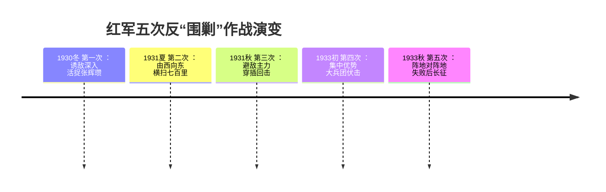

# 闪闪红星下红军的战斗方式与反围剿斗争

## 闪闪红星下的战斗方式与反“围剿”斗争

红军能够在重重封锁与绝对劣势中生存并壮大，关键在于找到了一套**以弱胜强、根植于人民**的作战体系。这不是凭空产生的，而是从血的教训中一步步摸索出来的。

### 红军凭什么打仗？——“十六字诀”的诞生

在井冈山斗争初期，面对大规模的正规军，红军从“朱毛会师”开始，就逐步抛弃了硬碰硬的阵地战，总结出一套流动游击战术，后来凝练为经典的 **“十六字诀”**：

> [!IMPORTANT]
> ==**敌进我退，敌驻我扰，敌疲我打，敌退我追。**==

**为什么需要这种打法？**
你可以设想一下：红军初期人均步枪都配不齐，子弹只有几发，靠什么打赢？答案就是把战争的“时空”彻底打乱。敌军大规模进山，我们就化整为零躲进深山；敌军刚驻扎吃饭，我们放冷枪打锣打鼓搞得他昼夜不宁；等敌人被拖得筋疲力尽、露出破绽，再集中绝对优势兵力吃掉一路。

这不仅是战术，更是一种**生存策略**。

### 反“围剿”的经典实战：从成功到失利

我们结合五次反“围剿”的演变，就能看清这套战术的生命力与最后的隐痛。

- **第一次到第三次**：毛泽东将“诱敌深入”发挥到极致。你不是要找我决战吗？我先退却，把你引入地形险恶、群众条件极好的苏区腹地，把你肥胖的阵线拉瘦，然后回头一口吃掉你一个师或一个旅。
- **第四次反“围剿”**：此时毛泽东虽受“左”倾路线排挤，但周恩来、朱德仍坚持运用伏击战术，利用山高林密，在黄陂、草台岗打了漂亮的大兵团伏击战。
- **第五次反“围剿”的深坑**：这是最重要的一个转折点。临时中央的博古和军事顾问李德搞起了**“御敌于国门之外”**，逼着红军与飞机大炮全覆盖的国民党军打碉堡对碉堡的阵地战。

> [!WARNING]
> **常见的坑：败在放弃了“运动战”**
> 学生特别容易误以为第五次失利是因为敌军太强。其实根本原因是**战术错了**。
> 红军的优势是机动灵活、官兵一致、群众报信（耳朵是通的，眼睛是亮的）；去死守阵地，等于拿刺刀去拼坦克，完全丧失了红军的特长。

**和之前战术的区别在哪里？**

| 阶段 | 核心战术 | 作战特征 | 结果 |
| :--- | :--- | :--- | :--- |
| 前四次反“围剿” | **运动战 / 游击战** | 避实击虚，在运动中消灭敌人 | 胜利 |
| 第五次反“围剿” | **阵地战 / 正规战** | 死守防线，分兵把口，短促突击 | 失败（被迫长征） |

### 算对了的例子：如何破解“历时”的坑

我们看一道容易错的真题：
**“下列关于红军长征的描述错误的是（）”**
- C 选项：`长征历时约 3 年`

你可以在纸上画一道粗线：
红一方面军 1934 年 10 月出发，1935 年 10 月到达陕北；全国三大主力红军会师是在 1936 年 10 月。
这样算来，长征满打满算历时**两年整**，而不是 3 年。这就是典型的掐头去尾算错了时间跨度。掌握了这个准确的跨度，未来再遇到“长征起止时间”的选择题，你就能瞬间定位错误选项。

> [!TIP]
> **记忆口诀**
> **“三四长征起，三六会宁齐”** ：1934 年 10 月开始长征，1936 年 10 月在会宁会师，正好两年。

### 为什么说这种战斗方式留下了“长征精神”？

长征走的不仅是路，更是这种战斗方式的最高形态。
翻雪山、过草地，靠的是坚定不移的信念 ==（崇高理想）==；通道转兵、遵义会议，靠的是不看本本看实际 ==（独立自主、实事求是）==；飞夺泸定桥、血战湘江，靠的是绝不退缩 ==（不怕牺牲）==；拒绝张国焘分裂，北上是正确的 ==（顾全大局、团结）==。

红军正是把这套灵活的战斗方式刻进了血脉，才能在长征中一次次化险为夷。理解了“为什么要这样打”，你才能真正读懂《长征组歌》里那句“毛主席用兵真如神”的神在哪里。
