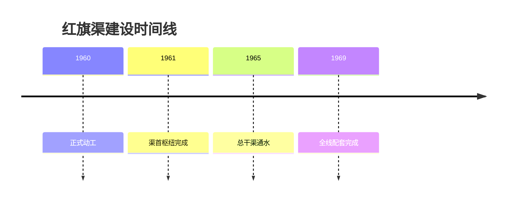
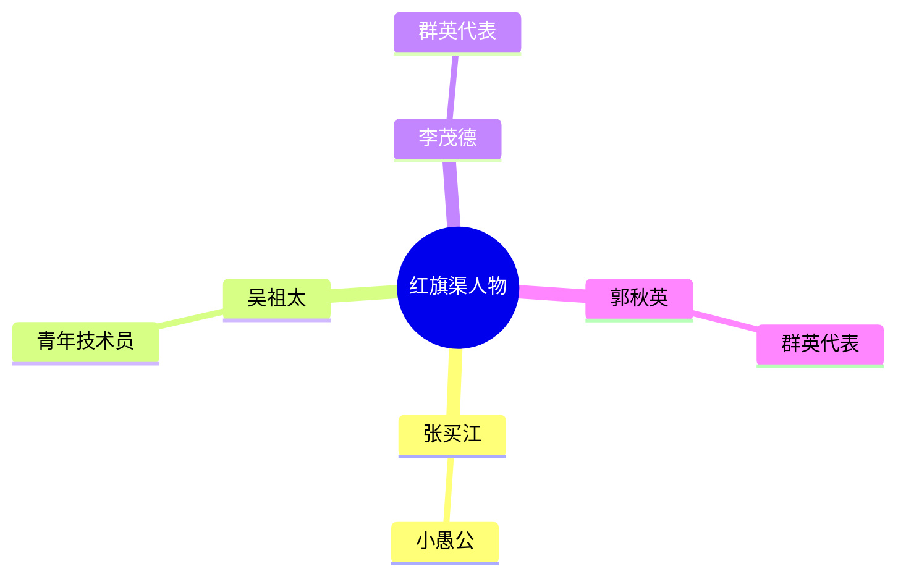

# 定叫山河换新装：林县红旗渠的修建与红旗渠精神

## 什么是红旗渠

==红旗渠==是 20 世纪 60 年代河南省林县（今林州市）人民在太行山腰"劈开太行山、引漳河水入林县"修建的大型引水灌溉工程，被称为==人工天河==，也是周恩来总理向国际友人自豪介绍的"新中国两大奇迹"之一（另一是南京长江大桥）。修建于 ==1960—1969 年==，前后历时近 ==十年==。全线包括总干渠、干渠、支渠等多级渠道，主要靠人力在悬崖峭壁上一锤一钎开凿而成。

> [!IMPORTANT]
> 红旗渠不是单纯的一项水利工程，而是中国共产党领导下人民群众自力更生解决生存用水困境的精神丰碑，由此提炼出的==红旗渠精神==已成为"四史"学习中的重要考点。

## 为什么要修——缺水之困

林县地处太行山区，历史上"十年九旱"，水源极其匮乏，群众为了挑水要翻山越岭数十里。不解决水的问题，农业与群众生活都无法改善。==根本出路只有跨流域引水==——把浊漳河的水引到林县。可水源地与林县之间是连绵的太行山，工程艰巨到当时几乎无人敢想。为什么要干？因为不干，"山河"就永远不会"换新装"。

## 怎么做到的——工程与人物

工程的组织方式可以概括为一句话：==在党的领导下，发动群众、自力更生==。当时正值三年经济困难时期，国家拿不出大规模资金与机械，林县人民靠双手、钢钎、锤子、自制炸药和土法施工技术，一寸一寸凿穿太行山。

建设中涌现出众多英雄人物，其中被誉为==“小愚公”==的是少年英雄 ==张买江==，他子承父志，小小年纪就奋战在渠上；青年技术员 ==吴祖太== 为测量设计献出年轻生命；还有 ==李茂德==、==郭秋英== 等典型人物，共同构成红旗渠精神的群像。

## 红旗渠精神的内涵

红旗渠精神包含四个关键词，必须==一字不差地记住==，常以多选题出现：

| 关键词 | 含义 |
|---|---|
| ==自力更生== | 不等不靠，靠自己双手解决工程所需 |
| ==艰苦创业== | 在极其艰难条件下开拓前进 |
| ==团结协作== | 全县干群、各公社协同作战 |
| ==无私奉献== | 干部群众不计报酬、舍小家为大家 |

> [!TIP]
> 记忆口诀：**"自—艰—团—无"**（自己肩扛，团结不散，无私奉献，攻坚克难）。考试遇到"红旗渠精神包括"这种题，==四项全选==。

## 名称与美誉辨析

红旗渠的常见别称容易混，重点记住两个官方认定的称号：

| 称号 | 是否正确 |
|---|---|
| ==人工天河== | ✓ 全国重点文物保护单位题词 |
| ==世界第八大奇迹== | ✓ 民间与国际友人赞誉 |
| 英雄渠 | ✗ 非通用称呼 |
| 生命之渠 | ✗ 意象化说法，非标准称谓 |

> [!WARNING]
> 判断"红旗渠被称为……"的题，只有 ==人工天河== 与 ==世界第八大奇迹== 是标准答案，其他属于干扰项。

## 和相近历史工程的区别

不少同学容易把红旗渠和新中国其他大工程混起来：

| 工程 | 性质 | 备注 |
|---|---|---|
| ==红旗渠== | 山区引水灌溉 | 河南林县，人工天河 |
| 南京长江大桥 | 铁路公路两用桥 | 新中国两大奇迹之一 |
| 佛子岭大坝 | 水库大坝 | 淮河流域治水 |
| 武汉长江大桥 | 长江上首座大桥 | 一五计划重点工程 |

> [!NOTE]
> 新中国"两大奇迹"这一提法特指 ==南京长江大桥== 与 ==林县红旗渠==，做题时不要被武汉长江大桥、佛子岭大坝带偏。

## 常见坑

> [!CAUTION]
> - 修建时长：题目常给"五年/十五年/二十年"干扰，正确答案是==近十年==。
> - “小愚公”指==张买江==，不是吴祖太（吴祖太是牺牲的技术员）。
> - 红旗渠精神四项内涵==必须全选==，漏选即错。
> - 红旗渠位于==河南省林县==，不在山西，也不在河北。

## 一个做对了的例子

题目：**周恩来总理曾自豪地告诉国际友人："新中国有两大奇迹，一个是南京长江大桥，一个是（ ）。"**

思路：先定位"新中国两大奇迹"这一固定提法，再排除武汉长江大桥（首座大桥，非"奇迹"提法）、佛子岭大坝（水利工程但非此提法）、成渝铁路（西南首条铁路），落到 ==林县红旗渠==。

> [!TIP]
> 抓关键词 **"两大奇迹 + 周恩来"**，一步锁定 ==选项 C 林县红旗渠==，不必纠结其他大工程。
