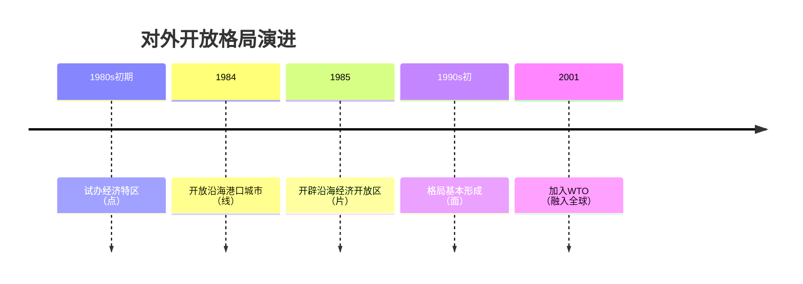

# 对外开放格局的形成与经济特区的建立

## 为什么需要“打开国门”？

1978年以前，我国长期处于相对封闭的状态，经济发展缓慢，技术落后，与发达国家的差距越拉越大。要改变这种局面，光靠内部改革还不够，必须引入外部的资金、技术和市场竞争。==对外开放，就是主动打开国门，融入世界经济体系，以开放促改革、促发展。==

## 对外开放格局：从点到面，层层推进

对外开放并非一下子全部放开，而是有计划、分步骤进行的，形成了一个==全方位、多层次、宽领域==的格局。

这个过程像一个同心圆，从中心向外辐射：
- **第一步（点）**：1980年，设立==深圳、珠海、汕头、厦门==四个经济特区。这是最前沿的“试验田”。
- **第二步（线）**：1984年，开放大连、天津、青岛、上海等14个沿海港口城市。
- **第三步（片）**：1985年后，将长三角、珠三角和闽南三角区开辟为沿海经济开放区。
- **第四步（面）**：1988年，海南建省并成为最大的经济特区。1990年开发开放上海浦东。至此，==全方位、多层次、宽领域的对外开放格局基本形成==，而非迟至2002年十六大才提出。

> [!IMPORTANT]
> 格局“基本形成”于20世纪90年代初。2001年加入WTO是“深化”与“融入”全球体系的关键一步，2002年十六大是“完善”而非“提出构建”。

## 经济特区：“杀出一条血路”

经济特区是开放的排头兵。在当时计划经济仍占主导的背景下，邓小平语重心长地说：“中央没有钱，可以给些政策，你们自己去搞，**杀出一条血路来**。”特区的“特”主要体现在：

1.  **经济成分特**：以“三资企业”（外商独资、中外合资、中外合作）为主，多种经济并存。
2.  **发展路径特**：实行“==外引内联==”，对外引进资金技术，对内联合国内企业。
3.  **政策管理特**：拥有更大的经济管理自主权，对外商投资给予税收等优惠。

> [!TIP]
> **记忆口诀**：四特选“深珠汕厦”，最大特区是“海南”。“亚洲四小龙”指：韩国、中国台湾、中国香港、新加坡。深圳作为成功的缩影，其居民人均可支配收入自1985年起增长了约32倍（至2019年），这就是“深圳奇迹”。

## 相近概念辨析

| 概念 | 特征 | 典型区域 |
| :--- | :--- | :--- |
| **经济特区** | 实行特殊经济政策与体制，综合发展 | 深圳、海南 |
| **沿海开放城市** | 扩大地方权限，给予外商优惠，不属特区 | 大连、青岛 |
| **沿海经济开放区** | 更大范围的区域性开放，以“贸-工-农”为导向 | 长三角、珠三角 |
| **自贸试验区** | 侧重制度创新，可复制推广，是开放的“升级版” | 上海、江苏 |

> [!WARNING]
> **常见坑**：容易混淆海南建省的决议机构。很多人会误选党的会议。实际上，设立海南省和建立海南经济特区的决议是由==第七届全国人民代表大会第一次会议==通过的。因为建省与行政区划调整属于国家最高权力机关的职权范围。
