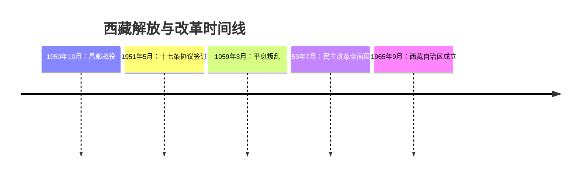
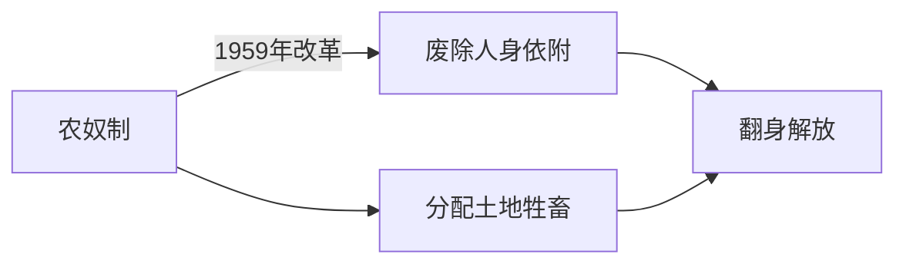

# 农奴翻身把歌唱：西藏和平解放及民主改革

## 一、从“解放”到“翻身”：两条时间线

西藏的变革分两步走：**军事解放**解决的是“赶走外来干涉、收回主权”；**民主改革**解决的是“废除农奴制、让农奴真正成为人”。考试最容易把这两步混在一起，先把时间线立起来。

==“和平解放”的标志不是解放军进拉萨，而是《十七条协议》的签订。==

---

## 二、昌都战役：为什么非打不可

1950 年，西藏地方当局中分裂势力拒绝和谈，还在昌都地区陈兵布防。中央决定**以打促和**，发动昌都战役。这场战役直接促成了次年《十七条协议》的签订。

> [!IMPORTANT]
> 昌都战役时间为 **1950 年 10 月**，属解放战争在西藏的延续，考试常出“昌都战役时间”。

几个易混点：

| 事件 | 时间 | 关键词 |
|---|---|---|
| 昌都战役 | **1950 年** | 以打促和 |
| 《十七条协议》 | **1951 年** | 和平解放 |
| 平息西藏上层叛乱 | **1959 年** | 改革契机 |
| 西藏自治区成立 | **1965 年** | 民族区域自治 |

---

## 三、“政治重于军事”与十八军进藏

进藏前，中央对十八军定下一条基本方针：**政治重于军事，补给重于战斗**。意思是：仗能打赢不算真赢，让藏族百姓真正了解、接受党的政策，才是根基。

> [!TIP]
> 记关键词：“==政治重于军事==”是十八军进藏的原则，人物题常考提出者，答案见讲义；同时“补给重于战斗”也是同一条方针的完整表述。

由此淬炼出的“老西藏精神”是选择题高频考点：

> [!IMPORTANT]
> “特别能吃苦、特别能忍耐、特别能战斗、特别能团结、特别能奉献”——五个“特别”，选 ABCD 时别漏“奉献”。

---

## 四、民主改革：农奴“翻身”的核心

1959 年平定叛乱后，中央趁势开展民主改革：**废除封建农奴主土地所有制，废除农奴人身依附关系**。百万农奴第一次拥有自己的土地和生产资料。

> [!WARNING]
> 民主改革 ≠ 社会主义改造。1959 年西藏是废除封建农奴制，不是直接搞农业合作化，两步不能跳。考试若出现“1959 年西藏完成社会主义改造”即为错误。

---

## 五、西藏自治区成立：法律地位的最终确认

1965 年，西藏自治区第一届人民代表大会召开，选举产生自治区人民委员会。这标志着**民族区域自治制度在西藏正式确立**。

> [!IMPORTANT]
> 时间上最易错的一条线：**1950 昌都战役 → 1951 十七条协议 → 1959 叛乱与民主改革 → 1965 自治区成立**。先后顺序不可颠倒，选择题常打乱顺序来考。

---

## 六、常见坑与自己验证一遍

**坑 1：把“和平解放”等同于“农奴翻身”。**
和平解放是政治军事事件（1951），农奴翻身是民主改革（1959）之后的事。

**坑 2：把“自治区筹备”当“自治区成立”。**
西藏自治区筹备委员会 1956 年成立，但自治区正式成立是在 **1965 年**，以第一届人民代表大会召开为标志。

**坑 3：把“老西藏精神”与“两路精神”混淆。**
两路精神是“一不怕苦、二不怕死，顽强拼搏、甘当路石，军民一家、民族团结”，考到西藏相关精神时先看题干问的是哪个路。

---

对照上面“考过它的题”：

1. 昌都战役 → **1950 年**，选 A。
2. 西藏自治区第一届人民代表大会 → **1965 年**，选 A。
3. 老西藏精神五个“特别” → **ABCD 全选**。

把时间线和两条精神记死，这组题就不会失分。
