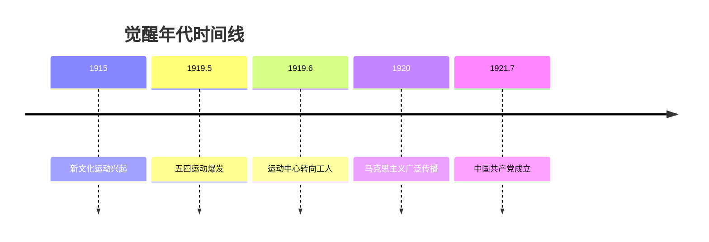
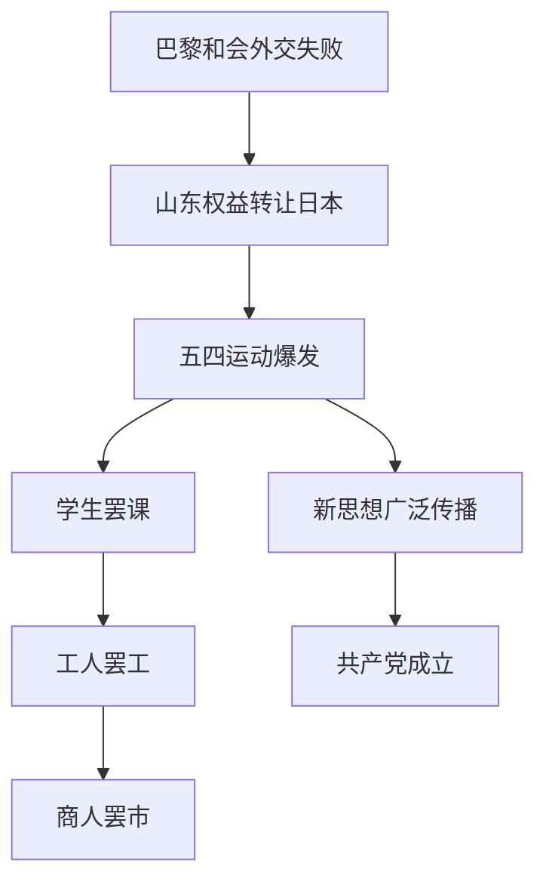

# 五四运动前后觉醒的年代与觉醒的中国

## 什么是“觉醒的年代”

“五四运动前后”通常指1919年前后至1921年中国共产党成立前后。这一时期，中国社会经历了新文化运动、五四运动、中共创建等重大事件，先进知识分子开始系统传播马克思主义，并逐步把民族救亡与无产阶级解放联系起来。

> [!IMPORTANT]
> “觉醒的中国”指中国共产党成立后，中国革命有了新的领导核心、明确的指导思想和较完整的奋斗目标。

## 为什么需要它

鸦片战争以后，旧有救国道路难以解决中国问题。辛亥革命推翻了清朝统治，却没有改变半殖民地半封建社会的基本矛盾。1919年巴黎和会中国外交失败，揭示了帝国主义强权政治的现实，促使青年学生和广大群众走上街头。

五四运动由此成为一次广泛而深刻的思想解放运动：它促进了马克思主义在中国的传播，推动了知识分子同工农群众的结合，为中国共产党成立作了思想上和干部上的准备。

## 事件是怎样衔接的

巴黎和会是关键导火索。1919年4月29日至30日，英、法、美三国代表秘密决定，将德国在中国山东的权益转让给日本；消息传回国内后，引发五四运动。

## 五四运动的关键考点

> [!IMPORTANT]
> 五四运动标志着中国==新民主主义革命==的伟大开端。

其参与群体主要包括学生、工人和商界人士。上海工人举行政治罢工， Tianjin 的觉悟社成为当地影响广泛、作用突出的青年团体。运动后期，工人阶级开始作为独立的政治力量登上历史舞台，这是它区别于以往学生运动的重要特征。

| 事件 | 主要特征 | 历史意义 |
|---|---|---|
| 新文化运动 | 提倡民主与科学，批判旧礼教 | 解放思想，奠定思想基础 |
| 五四运动 | 学生、工人、商人共同参与 | 推动新民主主义革命兴起 |
| 中共创建 | 马克思主义与中国实际结合 | 革命有了新的领导核心 |

## 与相近概念的区别

**新文化运动**重在思想启蒙，五四运动则由思想领域扩展到社会政治斗争；五四运动不是社会主义革命，而是中国新民主主义革命的开端。

**辛亥革命**属于旧民主主义革命，五四运动之后革命领导力量、指导思想和奋斗目标逐步发生变化，因此二者不能混为一谈。

## 常见易错点

> [!CAUTION]
> 巴黎和会不是华盛顿会议；决定将德国在山东权益转给日本的是英、法、美三国，不是中国。

> [!WARNING]
> “参加人数多”不等于“参与群体只有学生”。答主要参与群体时，应选学生、工人和商界人士。

## 例题

题目：五四运动标志着中国（　）的伟大开端。

A. 新民主主义　B. 三民主义　C. 社会主义　D. 共产主义

答案：**A**。五四运动发生于中国共产党成立之前，其推动了中国工人阶级作为独立政治力量登上舞台，因此标志着中国新民主主义革命的伟大开端。

另外，1921年中共一大后，邓恩铭、王尽美积极组织的是==山东==的工会，而不是山西。
