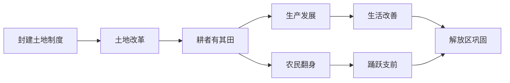

# 解放区土地改革与社会面貌的根本变化
**是什么**：解放战争时期，中国共产党在解放区领导农民开展土地改革。1946 年中共中央发布《五四指示》，1947 年制定《中国土地法大纲》，核心是==废除封建剥削的土地制度，实行耕者有其田==，按乡村人口平均分配土地。它不是简单的“分田”，而是把农民从封建土地关系中解放出来，使农村生产关系、政治权力和社会风气随之改变。

**为什么需要**：旧中国农村土地高度集中，广大农民少地、无地，承受地租和高利贷剥削。不解决土地问题，农民就难以真正发动，人民解放战争也缺少深厚的群众基础。土地改革使农民获得土地，激发生产积极性，并把“保田”与“保家、保乡、支援前线”联系起来，为战争胜利提供粮食、兵员和支前力量。

## 社会面貌怎样“根本变化”

| 方面 | 解放区 | 国统区 |
|---|---|---|
| 经济 | 生产发展，军民生活改善 | 通货膨胀，物价飞涨 |
| 政治 | 政治民主，政府廉洁 | 政治专制，吏治腐败 |
| 社会 | 农民翻身，群众支前 | 民不聊生，危机加深 |

> [!IMPORTANT]
> 两组对照要成组记：==解放区是“发展、改善、民主、廉洁”，国统区是“膨胀、飞涨、专制、腐败”==。选择题常把两组词交叉拼接。

## 和相近概念的区别

- **土地改革 vs 新中国成立后的土地改革**：这里讲的是解放战争时期的解放区土改；1950 年《中华人民共和国土地改革法》推动的是新解放区土改，时间、范围不同。
- **《解放区的天》 vs 新中国成立初期歌曲**：它反映的是解放区翻身解放的景象，广泛传唱于解放战争时期，不是“新中国建立初期”才广泛传唱；其原名也不是《十二月》。
- **“根本变化” vs 单纯经济增长**：根本在封建土地关系被废除、农民社会地位改变，经济发展和生活改善是重要表现。

> [!WARNING]
> 判断题爱考“时期错位”和“名称张冠李戴”。看到《解放区的天》，先锁定“解放区、解放战争时期”。

## 算对了的例子

题目：下列关于“解放区”和“国统区”的描述，正确的有哪些？  
A. 解放区经济不断发展，军民生活得到改善  
B. 国统区通货膨胀，物价飞涨  
C. 解放区政治民主，政府廉洁  
D. 国统区政治专制，吏治腐败  

**答案：ABCD。** 判断路径是：A、C 都属于解放区的积极面貌；B、D 都属于国统区的统治危机，四项方向均正确，没有交叉错位。
