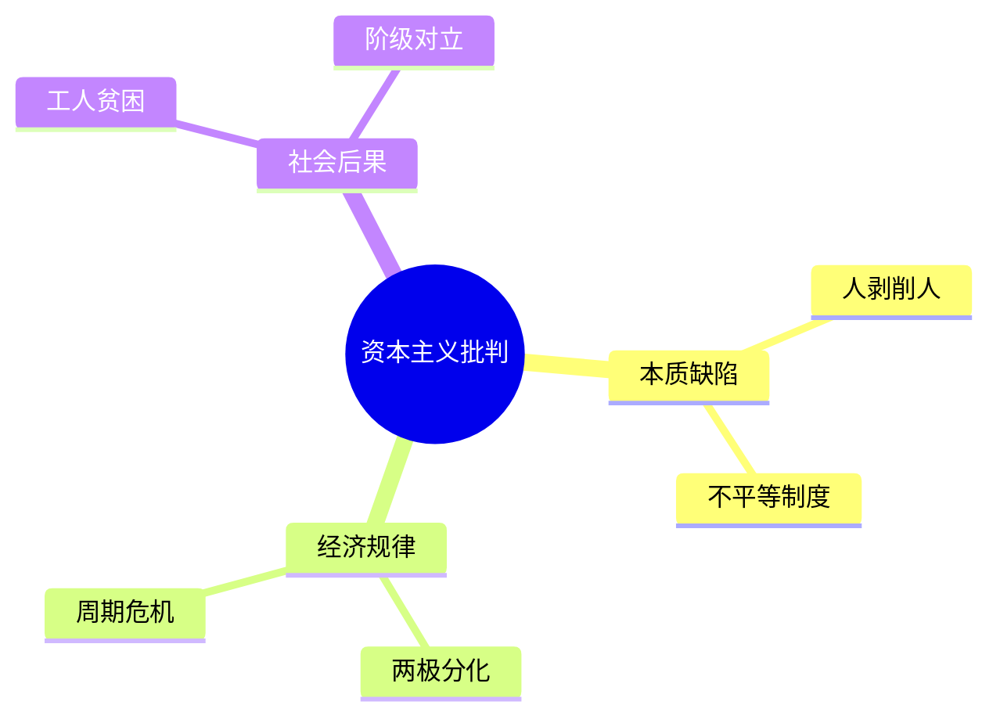

# 近代资产阶级革命与马克思、恩格斯对资产阶级的批判

## 近代资产阶级革命的历史进步与局限

资产阶级革命是指由==资产阶级领导==、反对封建制度的革命。17-18世纪，英国“光荣革命”、法国大革命及美国独立战争相继爆发，摧毁了封建专制，确立了资本主义制度。

> [!IMPORTANT]
> 历史定位：资本主义取代封建主义是历史的巨大进步，为生产力发展开辟了道路。

然而，这种进步具有鲜明的阶级局限性。资产阶级虽高举“自由、平等、人权”旗帜，但实质是用==资本剥削代替封建压迫==。19世纪上半叶的欧洲被称为“饥饿的欧洲”，广大工人并未获得真正的解放。

## 马克思、恩格斯对资产阶级的批判

面对资本主义社会的矛盾，马克思和恩格斯进行了深刻批判，揭示了其运行规律与本质缺陷。

### 核心批判观点

1.  **资本积累绝对规律**：马克思在《资本论》中指出，资本主义发展必然导致==两极分化==——一极是资本家财富的积累，另一极是劳动人民贫困的积累。正如杜甫诗句“朱门酒肉臭，路有冻死骨”所描绘的社会真实。
2.  **社会基本矛盾**：
    *   **阶级对立**：机器大工业使工人成为附庸，资本家通过延长工时、压低工资压榨工人，导致无产阶级与资产阶级矛盾激化。
    *   **经济危机**：资本主义无法克服生产社会化与生产资料私人占有之间的矛盾，导致周期性经济危机频繁爆发（如1825年英国第一次全国性经济危机）。

> [!TIP]
> 记忆要点：资本主义的“自由”是资本的自由，而非劳动者的自由；其“平等”掩盖了实质上的不平等。

## 早期工人运动的兴起

在矛盾激化的背景下，19世纪上半叶欧洲爆发了三大著名工人运动，标志着无产阶级作为独立政治力量登上历史舞台。

| 运动名称 | 国家 | 特点 |
| :--- | :--- | :--- |
| **法国里昂工人起义** | 法国 | 两次武装起义，提出政治要求 |
| **英国宪章运动** | 英国 | 争取普选权，规模宏大 |
| **德国西里西亚织工起义** | 德国 | 反对剥削，自觉意识觉醒 |

> [!WARNING]
> 易错点辨析：**山海关铁路工人大罢工**属于中国近代工人运动（1922年），不属于19世纪上半叶欧洲的三大工人运动。做题时需严格区分时间与地域。

## 科学社会主义的诞生

为解决“人类向何处去”的问题，马克思、恩格斯创立了科学社会主义。

*   **标志**：1848年《共产党宣言》的发表。
*   **意义**：标志着==马克思主义的诞生==，为无产阶级提供了科学的理论指导，使社会主义从空想走向科学。

> [!NOTE]
> 逻辑链条：资产阶级革命确立制度 -> 暴露资本主义矛盾 -> 工人运动兴起（实践基础） -> 马恩理论批判与升华 -> 《共产党宣言》发表（理论诞生）。
