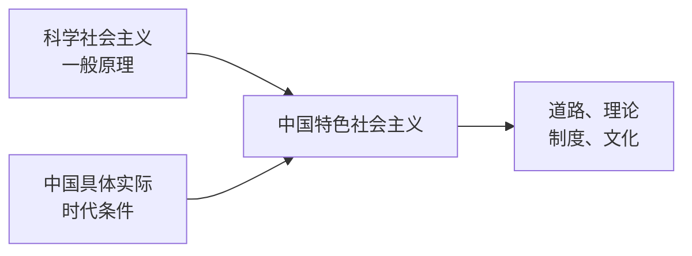

# 结合中国实际赋予社会主义以中国特色

## 从一般原理到具体实践

科学社会主义揭示了人类社会发展的普遍规律，但它提供的是一般原理，而不是具体方案。好比给你一张世界地图，你能看到山川海洋的大致方位，但真要走进某座城市，你还需要一张街道详图。

这就引出一个基本问题：在生产力落后、人口众多的东方大国，社会主义该怎么建？

答案是==把马克思主义基本原理同中国具体实际相结合==。

这个“结合”不是一次完成的拼图，而是一个在实践中不断深化的过程。它回答了四个层次的问题：

| 层次 | 要解决的问题 | 中国给出的方案 |
| :--- | :--- | :--- |
| **道路** | 走什么路？ | 中国特色社会主义道路 |
| **理论** | 用什么思想指导？ | 中国特色社会主义理论体系 |
| **制度** | 建立什么制度框架？ | 人民代表大会、公有制为主体等根本和基本制度 |
| **文化** | 以什么精神凝聚力量？ | 革命文化与中华优秀传统文化 |

> [!IMPORTANT]
> 核心结论：==中国特色社会主义既坚持了科学社会主义的基本原则，又根据时代条件赋予了鲜明的中国特色。==

这两层缺一不可——

**坚持基本原则，才能守住“社会主义”这个根。** 比如，坚持无产阶级政党的领导、坚持生产资料公有制为主体、坚持按劳分配为主、坚持共同富裕的目标。丢了这些，就偏离了方向。

**赋予中国特色，才能让理论落地生根。** 比如，在经济体制上，我们没有照搬单一公有制的设想，而是从生产力落后的实际出发，提出“公有制为主体、多种所有制经济共同发展”。在资源配置方式上，创造性地把社会主义制度与市场经济结合起来，发展“社会主义市场经济体制”——这在经典著作里没有现成答案，是立足国情的重大突破。

> [!WARNING]
> **常见误区：把“中国特色”当成什么都能装的筐。**
> 有些做法明明偏离了科学社会主义基本原则，却打着“中国特色”旗号；或者反过来，用一百多年前的具体设想来裁剪今天的现实。判断的根本标准只有一个——==是否符合中国国情、是否坚持了人民立场和共同富裕方向。==

以考题为例加深理解：

> **题目**：中国特色社会主义既坚持了科学社会主义的基本原则，又根据时代条件赋予了鲜明的中国特色。（√）

这道题之所以正确，正是因为==两者不是对立关系，而是“普遍原理”与“具体形式”的统一==。好比同一棵树，长在不同的土壤气候里，枝叶姿态各不相同，但它内在的生命基因是一致的。

> [!TIP]
> **记忆口诀**：“基本原则不能丢，具体国情要研究。道路理论加制度，文化自信立心头。”

归根结底，社会主义没有定于一尊的模板。它不是用理论框定现实，而是在现实探索中不断丰富和发展理论——这就是“结合中国实际赋予社会主义以中国特色”的深层逻辑。
