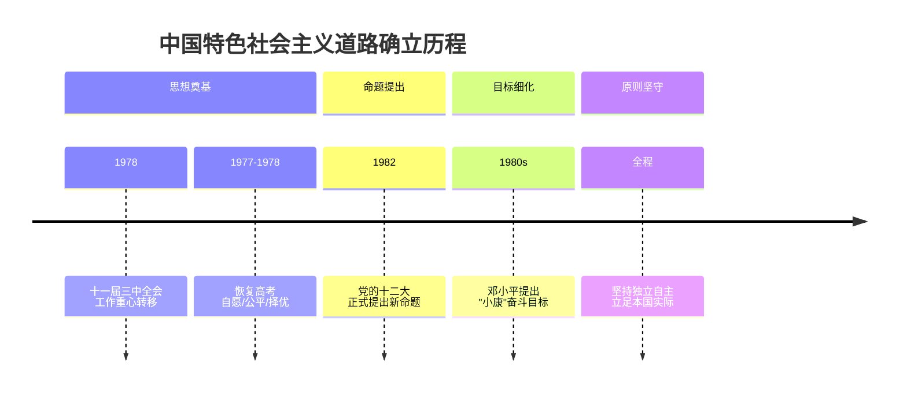

# 改革开放要走中国自己的道路（建设有中国特色的社会主义命题提出）

# 改革开放要走中国自己的道路（建设有中国特色的社会主义命题提出）

## 核心定义与历史背景

==建设有中国特色的社会主义==，是指在中国共产党的领导下，立足基本国情，以经济建设为中心，坚持四项基本原则，坚持改革开放，解放和发展社会生产力。这一命题的核心在于既坚持科学社会主义的基本原则，又根据时代条件赋予其鲜明的中国特色。

> [!IMPORTANT]
> **命题提出的标志性事件**：**党的十二大**（1982年）。邓小平在开幕词中明确提出了“把马克思主义的普遍真理同我国的具体实际结合起来，走自己的道路，建设有中国特色的社会主义”。

为什么需要走自己的路？因为照搬苏联模式或西方模式均不符合中国国情。只有将普遍真理与具体实际结合，才能解决中国的发展问题。

## 关键历程与逻辑演进

改革开放并非一蹴而就，而是一系列关键决策的累积。以下时间线展示了从思想解放到道路确立的过程：

> [!TIP]
> **记忆口诀**：十一转折十二提，小平小康指方向，独立自主是根基。

## 易混概念辨析

许多同学容易混淆不同会议的历史贡献，特别是关于“特色社会主义”命题的提出时间与“改革开放”起点的时间。

| 会议/事件 | 核心贡献/关键词 | 常见误区 |
| :--- | :--- | :--- |
| **十一届三中全会** | 改革开放起点，工作重心转移 | 误认为此处提出了“特色社会主义”命题 |
| **党的十二大** | ==正式提出==“建设有中国特色的社会主义” | 正确对应点 |
| **党的十三大** | 系统阐述社会主义初级阶段理论 | 非命题首次提出 |
| **恢复高考** | 方针：自愿报名、公平考试、择优录取 | 误选“领导批准” |

> [!WARNING]
> **高频陷阱**：选择题中若问“正式提出‘建设有中国特色的社会主义’新命题”的会议，必须选 **B. 党的十二大**。十一届三中全会是伟大的转折，但命题的明确表述是在十二大。

## 典型例题解析

**题目**：正式提出了“建设有中国特色的社会主义”的新命题的是？
*   A. 党的十一届三中全会
*   B. 党的十二大
*   C. 党的十三大
*   D. 党的十四大

**解析**：
1.  **定位知识点**：题干关键词为“正式提出”、“新命题”。
2.  **排除干扰**：A项是改革开放开端；C项阐述初级阶段；D项确立市场经济体制目标。
3.  **确认答案**：1982年党的十二大，邓小平致开幕词，首次明确提出该命题。故答案为 **B**。

**延伸思考**：
邓小平同志成功开创了中国特色社会主义，既坚持了科学社会主义基本原则，又结合了时代条件。例如，他将“小康”一词引入奋斗目标，体现了从中国实际出发的智慧。同时，坚持==独立自主==是改革开放的基本立场，这意味着国家发展必须根据自身实际情况，找到适合的政治经济发展道路。

> [!NOTE]
> **深层理解**：走自己的路，本质上是一种方法论。它要求我们在处理政治、经济制度时，不盲从、不教条，以实现国家治理效能为最终检验标准。
