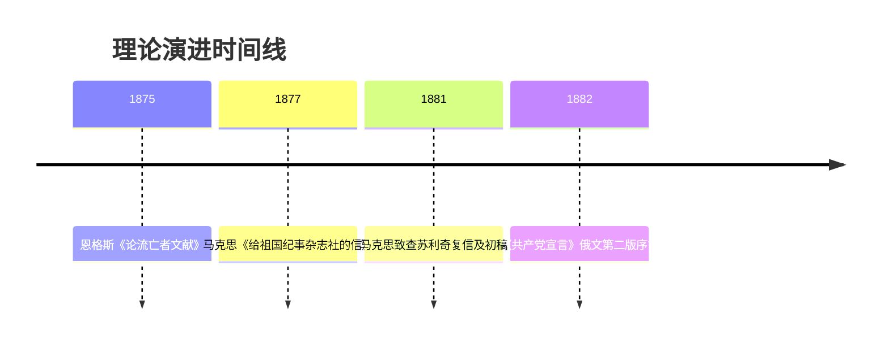
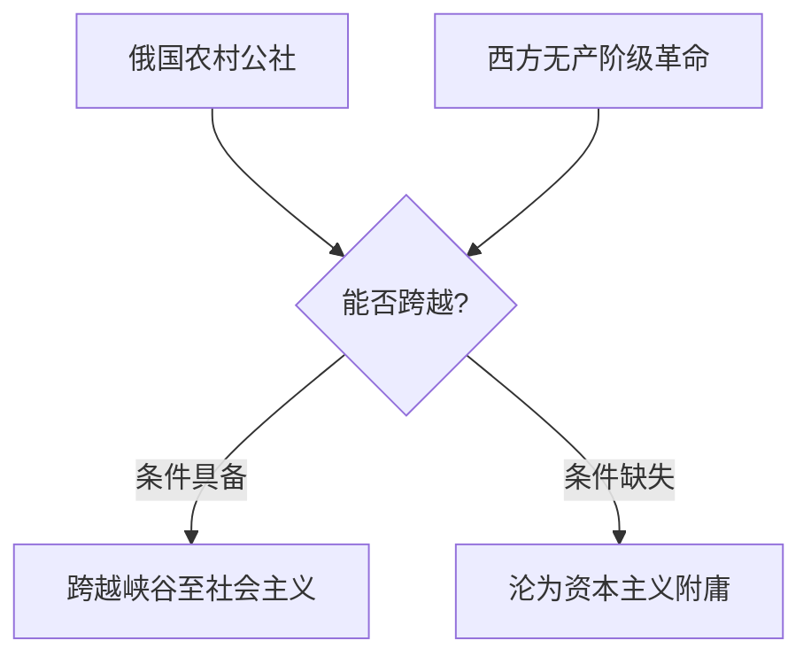

# 跨越资本主义“卡夫丁峡谷”设想与马克思东方社会发展理论

> [!IMPORTANT]
> 核心定义：跨越资本主义“卡夫丁峡谷”设想，是马克思晚年针对俄国等东方社会提出的理论——==落后国家在特定条件下，可以不经过资本主义制度的苦难阶段，直接过渡到社会主义==。

## “卡夫丁峡谷”是什么

典故出自古罗马史。公元前321年，萨姆尼特人在卡夫丁峡谷击败罗马军队，迫使战俘从长矛架起的“牛轭”下通过以示羞辱。后世以“卡夫丁峡谷”比喻==灾难性的历史经历==或发展中的极大困难与挑战。

在马克思语境中，“卡夫丁峡谷”特指资本主义制度带来的剥削、危机与社会阵痛。

思考一个问题：按照早期认识，所有国家都必须依次经历原始社会、奴隶社会、封建社会、资本主义社会再到社会主义社会吗？如果必须如此，当时的俄国就只能先承受资本主义的全部苦难，再谈未来。但现实真的只有一条单行道吗？

## 为什么需要这一设想

19世纪后期，东方殖民地、半殖民地社会正经历从前资本主义向资本主义转型的“阵痛”期。而废除农奴制后的俄国，仍保留着农村公社（土地公有制）。

马克思认为，既然俄国拥有土地公有制的传统，又面临西方资本主义已经暴露出的深刻危机，它完全有可能借助外部条件，避免重走西方充满血泪的老路。这就是提出该设想的现实动因。

> [!NOTE]
> 上述四份文献构成了马克思东方社会发展理论的核心文本载体，考试中常作为多选题选项出现。

## 怎么做：跨越的条件

跨越绝非无条件的“自动跳过”。马克思在给查苏利奇的复信及1882年《共产党宣言》俄文版序言中明确了前提：

1. **内部基础**：保存并改造俄国农村公社的土地公有制。
2. **外部条件**：与西方无产阶级革命互相补充，吸收资本主义创造的积极成果（如先进生产力与技术）。

> [!TIP]
> 记忆口诀：“内靠公社公有制，外借西方革命力，吸收资本好成果，跨越峡谷达目的。”

## 与相近概念的区别

| 比较维度 | 西欧社会发展道路 | 跨越“卡夫丁峡谷”设想 |
| :--- | :--- | :--- |
| **适用对象** | 英法等西欧国家 | 俄国等东方落后国家 |
| **发展路径** | 必经资本主义完整阶段 | 有条件地绕过资本主义制度 |
| **对资本主义态度** | 肯定其历史进步性 | 避免其灾难性经历，吸收其物质成果 |
| **理论阶段** | 马克思早中期研究重点 | 马克思晚年重点关注问题 |

> [!WARNING]
> 常见坑：跨越的是“资本主义制度”及其灾难，而不是跨越“生产力发展阶段”。马克思强调必须吸收资本主义的一切肯定成就。

## 真题演练

**题目**：简述马克思关于跨越资本主义“卡夫丁峡谷”设想的内涵及其主要文献依据。

**满分作答示范**：
1. **内涵**：“卡夫丁峡谷”喻指资本主义的灾难性经历。马克思认为，俄国等东方社会若保留农村公社公有制，并与西方无产阶级革命相互补充，便可吸收资本主义积极成果，不经过资本主义制度的苦难而直接过渡到社会主义。
2. **文献依据**：主要集中在1875年恩格斯《论流亡者文献》、1877年马克思《给祖国纪事杂志社的信》、1881年马克思给查苏利奇的复信及初稿、1882年《共产党宣言》俄文第二版序言中。

> [!CAUTION]
> 高危误区：切勿将“跨越设想”等同于“民粹派”的盲目乐观。马克思始终强调跨越必须具备严格的内外历史条件，脱离条件谈跨越是对唯物史观的曲解。
