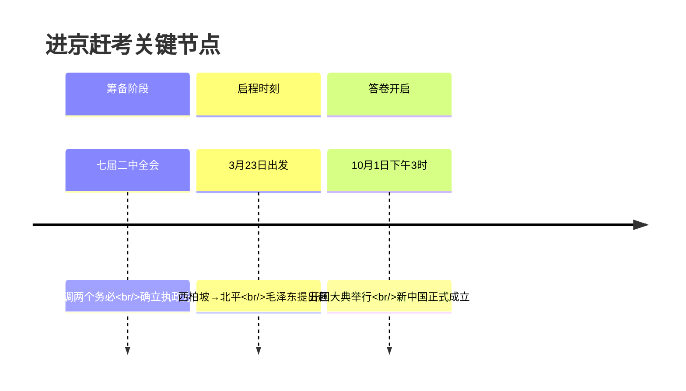

# 七届二中全会与革命胜利时的“进京赶考”意识

## 什么是“进京赶考”意识

1949年3月，随着三大战役胜利结束，党的工作重心即将由乡村转移到城市。在离开西柏坡前往北平之际，毛泽东同志将这一历史性转移比喻为“进京赶考”。这并非指军事上的攻城略地，而是指==中国共产党从革命党向执政党转变时，对能否经受住执政考验、避免重蹈历史覆辙的深刻警醒==。它标志着党在胜利面前保持了清醒头脑，确立了谦虚谨慎、不骄不躁的作风基调。

> [!IMPORTANT]
> “赶考”的本质是执政能力的自我审视，核心命题是“如何跳出治乱兴衰的历史周期率”。

## 为什么需要这种意识

夺取全国政权只是万里长征走完了第一步，真正的挑战才刚刚开始。结合真题考查内容，当时党主要面临三重严峻考验：

- **资产阶级的糖衣炮弹**：部分党员干部可能在和平环境中滋生骄傲自满、贪图享乐情绪，被腐蚀拉拢。
- **民主革命遗留任务**：土地改革、镇压反革命等未竟事业仍需完成，新旧制度交替期矛盾复杂。
- **百废待兴的民生困境**：中国社会千疮百孔，经济崩溃、民生困苦，恢复生产与建设新国家的任务极其艰巨。

> [!WARNING]
> 选择题常设陷阱：将“帝国主义压迫”列为建国初期党面临的*主要内部挑战*。实际上，此时外部威胁虽存，但“赶考”意识针对的核心是==党内自身建设与国内治理难题==，对应选项应为 ABD 而非 C。

## 七届二中全会如何部署“赶考”

1949年3月召开的七届二中全会，为“进京赶考”制定了行动纲领。会议明确提出“两个务必”：务必使同志们继续地保持谦虚、谨慎、不骄、不躁的作风，务必使同志们继续地保持艰苦奋斗的作风。同时规定禁止给领导人祝寿、禁止用领导人名字命名地名等六条规矩，从制度上防范特权思想。

> [!TIP]
> 记忆锚点：出发地==西柏坡==（非延安）、大典时间==下午3时==（非上午），这两个细节是高频考点。

## 与相近概念的辨析

| 概念 | 核心指向 | 时间节点 | 考查侧重 |
| :--- | :--- | :--- | :--- |
| 进京赶考 | 执政能力建设与作风警示 | 1949年3月 | 主观意识与自我革命 |
| 新民主主义革命胜利 | 推翻三座大山的客观成果 | 1949年10月前 | 历史事件与阶段划分 |
| 社会主义改造 | 生产关系变革与经济转型 | 1953–1956年 | 制度建立与经济建设 |

> [!NOTE]
> “赶考”强调的是主观精神状态和执政准备，而“革命胜利”是客观历史结果。答题时若问“比喻为什么”，选“赶考”；若问“标志是什么”，则对应新中国成立。

## 真题验证示例

以选择题1为例：“新中国成立前夕，毛泽东同志把前往北平建立新政权比喻为什么？”题干关键词是“比喻”和“建立新政权”。回顾上述脉络，该比喻特指执政考验下的自我警醒，而非军事行动（上战场）、日常事务（赶集）或荣誉授予（授勋）。因此正确答案为 ==C. 赶考==。此题直接检验对“进京赶考”意识内涵的精准理解，排除干扰项的关键在于把握其==政治隐喻属性==而非字面含义。
