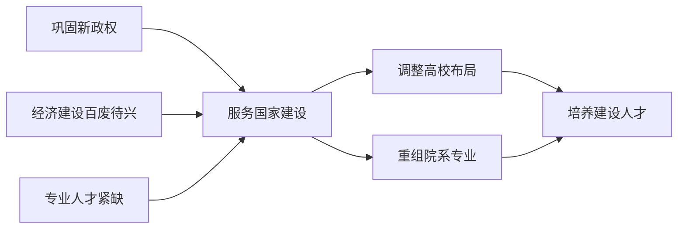

# 1952年全国高校院系调整的背景与影响（愿种繁花处处开）

## 它是什么

1952 年全国高校院系调整，是新中国成立初期对高等教育进行的一次系统性重组：以==效仿苏联式==的高校院系设置为方向，改变旧中国高校布局与系科结构，使人才培养更好服务国家建设。它不是简单的“学校改名、合并”，而是围绕国家需要重新配置高校、院系和专业资源。

## 为什么需要调整

新中国成立伊始，国家面临巩固新政权和进行大规模经济建设的任务，经济建设百废待兴，急需大批专业人才。但当时高等教育存在明显短板：

- 沿海及接近沿海地区的高校，与内地、边远地区高校分布严重失衡；
- 工程、师范、医药、农林等系科的办学数量和质量难以满足发展需求；
- 办学资源较分散，难以发挥集中优势和规模效益。

因此，调整的出发点是==专业人才供不应求==，而不是“供大于求”。

## 怎样推进

复习时可把过程概括为三个阶段：

先在部分高校探索，再在全国范围整体调整，随后针对新布局中的问题继续补充完善。调整加强了国家建设急需的系科，也推动高校布局发生变化。

## 影响与辨析

院系调整适应了当时大规模经济建设的需要，有利于集中办学力量、培养专业人才；同时也深刻改变了此后中国高校的格局。以南京大学为例，其源头包括==国立中央大学和金陵大学==，不能把京师大学堂、清华学堂混入其中。

| 易混内容 | 正确判断 |
|---|---|
| 调整式样 | 效仿苏联式，不是英式、法式或美式 |
| 人才状况 | 供不应求，不是供大于求 |
| 推进阶段 | 局部试点—整体调整—补充完善 |
| “塑造典型” | 不属于题目所列三个阶段 |
| 南京大学源头 | 国立中央大学、金陵大学 |

> [!WARNING]
> 不要把院系调整理解成单纯学习苏联教育形式，更不能忽略其现实背景：新政权巩固、经济建设和人才紧缺共同推动了这次调整。

> [!TIP]
> 记忆口诀：**建设急需人才，布局系科失衡；苏式调整三步，试点、整体、完善。**

## 例题示范

题目：以下哪项不属于我国 50 年代院系调整的背景？

A. 国家发展需要大批专业人才  
B. 国家经济建设百废待兴  
C. 新中国建设所需专业人才供大于求  
D. 国家面临巩固新政权和大规模经济建设的任务  

正确答案是 **C**。A、B、D 都说明国家建设需要高等教育提供人才支撑；C 把“供不应求”说成了“供大于求”，与当时急需专业人才的实际相反。
