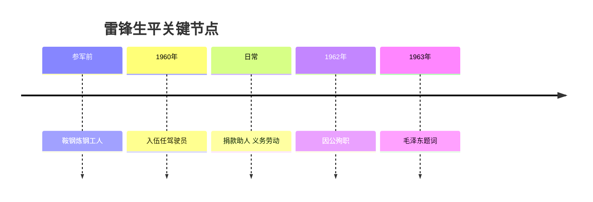

# 愿做革命螺丝钉：雷锋事迹与雷锋精神的时代内涵

雷锋（1940—1962），原名雷正兴，湖南长沙人。参军入伍前，他曾在鞍钢当**炼钢工人**；1960年入伍后成为运输连驾驶员。1962年8月15日因公殉职，年仅22岁。1963年3月5日，**毛泽东**题词“==向雷锋同志学习==”，此后每年3月5日成为学雷锋纪念日。

## 雷锋事迹速览

> [!IMPORTANT]
> 雷锋精神的核心是**全心全意为人民服务**，集中体现为“螺丝钉精神”——干一行、爱一行、钻一行，在平凡岗位上坚守奉献。

## 雷锋日记与螺丝钉精神

“如果你是一颗最小的螺丝钉，你是否永远坚守在你生活的岗位上？”这句名言出自**《雷锋日记》**。它用比喻说明：个人如螺丝钉，虽小却是机器运转不可缺少的部分；==岗位可以平凡，坚守与奉献绝不平庸==。

> [!TIP]
> 记忆口诀：**“鞍钢炼钢、部队开车、日记螺丝钉、主席题词六三年”**——一句话串起四道高频选择题。

## 新时代雷锋精神的践行者

雷锋精神在新时代并未过时，而是体现在各行各业的奉献者身上：

| 人物/群体 | 事迹 |
|---|---|
| 庄仕华 | 成功完成五万多例手术 |
| 袁辉 | 南大人，坚守山区支教 |
| 青年志愿者 | 战斗在新冠一线，达几十万人 |
| 郭明义 | 普通矿工，带动爱心队伍 |

> [!WARNING]
> 多选题常把四人混排设干扰项，记住：**四人皆为新时代雷锋精神的践行者**，遇到“以下都是”类题干可全选。

## 常见易混点辨析

- **题词者**：是毛泽东，不是周恩来或习近平；周恩来另有概括雷锋精神内涵的四句话题词。
- **参军前职业**：炼钢工人（鞍钢），不要与“矿山工人”“石油工人”混淆。
- **名言出处**：《雷锋日记》是雷锋生前所写日记的结集，不是后人编写的传记。

## 例题示范

**题目**：“如果你是一颗最小的螺丝钉，你是否永远坚守在你生活的岗位上？”节选自（ ）。
A.《共产党宣言》 B.《之江新语》 C.《邓小平文选》 D.《雷锋日记》

**解析**：抓住“螺丝钉”这一标志性意象——它正是雷锋在日记中对自身定位的经典比喻，与《共产党宣言》等文献无关。

**答案**：D。✔

> [!NOTE]
> 答题时先定位“关键词→人物→出处”三步：看到“螺丝钉”想到雷锋，想到雷锋自然锁定《雷锋日记》。
