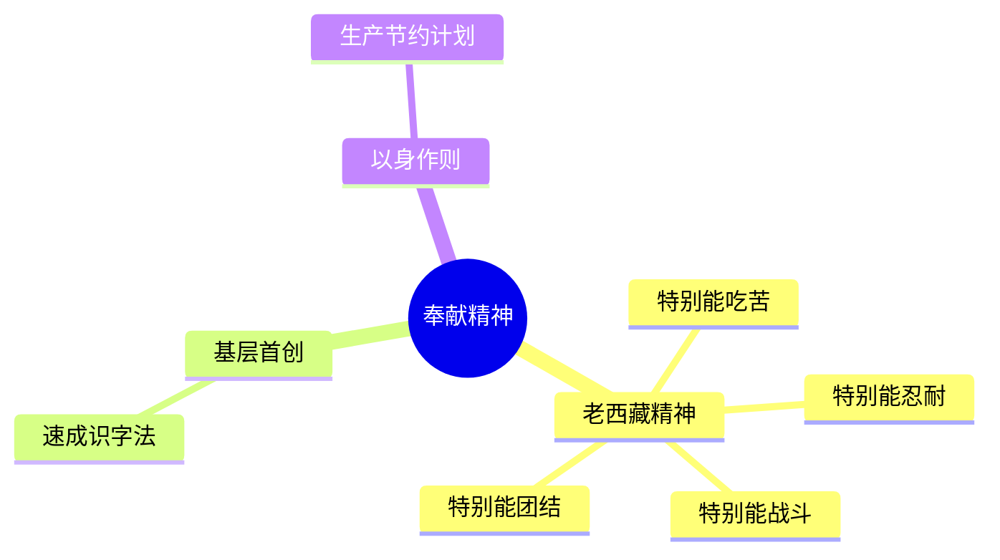

# 社会主义革命和建设时期先进人物的奉献精神

新中国成立后，中国共产党肩负的历史重任较之革命斗争时期要更为复杂、更为繁重。面对百废待兴的局面，科学社会主义理论如何从书本走向中国大地？靠的正是==社会主义革命和建设时期先进人物的奉献精神==。

## 它是什么

这一知识点指在1949年新中国成立后的社会主义革命与建设实践中，以共产党员、解放军战士和广大劳动群众为代表的先进人物，为巩固新生政权、推进国家建设而展现出的无私品格。

> [!IMPORTANT]
> 核心内涵：在科学社会主义理论指导下，无产阶级和劳动人民进行伟大实践时所体现的“吃苦、忍耐、战斗、团结”精神。

## 为什么需要

近代中国半殖民地半封建社会的性质决定了革命任务的艰巨性。新民主主义革命的前途是社会主义而不是资本主义，但要将蓝图变为现实，仅靠理论是不够的。

想一想：1954年川藏、青藏公路全线通车，在极其恶劣的自然条件下，靠什么把路修进西藏？靠的就是筑路军民的==老西藏精神==。没有这种精神，十月革命为中国开辟的民族解放新曙光就无法落地生根。

## 怎么做（具体表现）

先进人物的奉献并非空洞口号，而是体现在具体的历史行动中：

- **扎根边疆**：十八军等部队进军西藏，孕育了包含“特别能吃苦、特别能忍耐、特别能战斗、特别能团结”的老西藏精神。
- **立足本职创新**：西南军区文化干事祁建华发明==速成识字法==，以注音字母为辅助教常用字，极大提高了扫盲效率。
- **率先垂范**：领导干部带头制定个人生产节约计划，与群众同甘共苦。

## 与相近概念的区别

| 比较维度 | 革命战争时期的牺牲精神 | 建设时期的奉献精神 |
| :--- | :--- | :--- |
| **主要任务** | 推翻旧政权、夺取政权 | 巩固政权、恢复与发展经济 |
| **表现形式** | 流血牺牲、武装斗争 | 艰苦奋斗、技术攻关、基层服务 |
| **时代背景** | 新民主主义革命时期 | 社会主义革命和建设时期 |

> [!NOTE]
> 两者一脉相承，指导思想均为马克思列宁主义，领导力量均为中国共产党，但历史任务发生了转变。

## 常见的坑

> [!WARNING]
> 张冠李戴！毛泽东为刘胡兰题词“生的伟大，死的光荣”，而非张思德。毛泽东为张思德写的是《为人民服务》。

> [!CAUTION]
> 交通工程混淆。1954年全线通车的是==川藏公路==和==青藏公路==，不是铁路！青藏铁路全线通车是2006年的事。

## 真题实战

我们来看一道典型考题：

**题目**：西南军区的文化干事祁建华发明的（ ）以注音字母为辅助教常用字，极大提高了扫盲效率。
A. 三五教法  B. 速成识字法  C. 注音符号法  D. 劳动学习法

**解析**：
这道题考查建设时期基层先进人物的具体贡献。抓住题干关键词：“西南军区”“文化干事”“注音字母辅助”“扫盲”。这正是祁建华结合部队实际创造的==速成识字法==。

**答案**：B

> [!TIP]
> 记忆口诀：“祁建华，搞扫盲，速成识字帮大忙；修公路，进西藏，四个‘特别’记心上。”遇到此类细节题，直接锁定人物与事迹的唯一对应关系即可。
