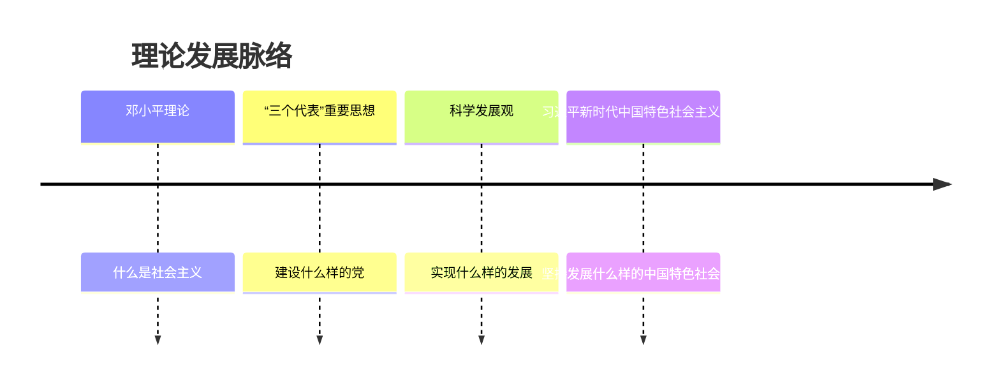

# 习近平新时代中国特色社会主义思想是马克思主义中国化的最新成果

## 是什么

习近平新时代中国特色社会主义思想，是==马克思主义中国化时代化的最新成果==，创立于中国特色社会主义进入新时代之后。它继承并发展了马克思列宁主义、毛泽东思想、邓小平理论、“三个代表”重要思想、科学发展观，回答了新时代坚持和发展什么样的中国特色社会主义、怎样坚持和发展中国特色社会主义的重大时代课题。

## 为什么需要

改革开放和中国特色社会主义的实践不断提出新问题。仅回答“怎样建设社会主义”，还不足以说明新时代中国特色社会主义的方向和道路。习近平新时代中国特色社会主义思想把坚持和发展中国特色社会主义统一起来，为推进中国式现代化提供理论指导。

可将其概括为：== answering 方向、道路以及如何继续前进 ==。

## 核心内容怎样理解

应把握“十个明确”“十四个坚持”“十三个方面成就”。其中，“十个明确”集中体现这一思想对新时代中国特色社会主义重大理论和实践问题的系统回答；“十四个坚持”明确新时代坚持和发展中国特色社会主义的基本方略；“十三个方面成就”概括新时代以来的历史性成就和历史性变革。

复习时可按“是什么—为什么—怎么办”理解：

- **是什么**：马克思主义中国化时代化的最新成果。
- **为什么**：新时代实践需要新的理论指导。
- **怎么办**：坚持和发展中国特色社会主义，推进中国式现代化。

## 与相近概念的区别

| 概念 | 核心定位 | 记忆关键词 |
|---|---|---|
| 科学发展观 | 回答“实现什么样的发展、怎样发展” | 以人为本、全面协调可持续 |
| 习近平新时代中国特色社会主义思想 | 回答新时代中国特色社会主义的重大课题 | 坚持和发展、 中国式现代化 |
| 中国特色社会主义最本质的特征 | 体现社会主义制度性质 | ==中国共产党领导== |

科学发展观强调发展的以人为本、全面协调可持续；习近平新时代中国特色社会主义思想则在此基础上进一步回答新时代中国特色社会主义的方向、道路和实践要求。

## 常见误区

> [!WARNING]
> 题干说“习近平新时代中国特色社会主义思想明确回答了什么”，通常应选“坚持和发展什么样的中国特色社会主义”和“怎样坚持和发展中国特色社会主义”，不要误选“怎样建设社会主义”或“怎样建设党”。

> [!CAUTION]
> “从2012年党的十八大开始，中国特色社会主义进入发展的新时代”表述正确。党的十八大是中国特色社会主义进入新时代的历史坐标。

> [!TIP]
> 记忆口诀：==新思想答题，锁定“方向＋道路”==。

## 例题

**多选题：**习近平新时代中国特色社会主义思想明确回答了（　）。

A. 怎样建设社会主义  
B. 怎样坚持和发展中国特色社会主义  
C. 坚持和发展什么样的中国特色社会主义  
D. 怎样建设党  

**答案：B、C。**

解析：题目考查其明确回答的重大时代课题。选B、C；A、D不是本题要求的完整表述。

**判断题：**科学发展观是坚持以人为本、全面、协调、可持续的发展观。

**答案：正确。**

解析：“以人为本、全面协调可持续”是科学发展观的核心要义，不要与习近平新时代中国特色社会主义思想的内容混淆。
