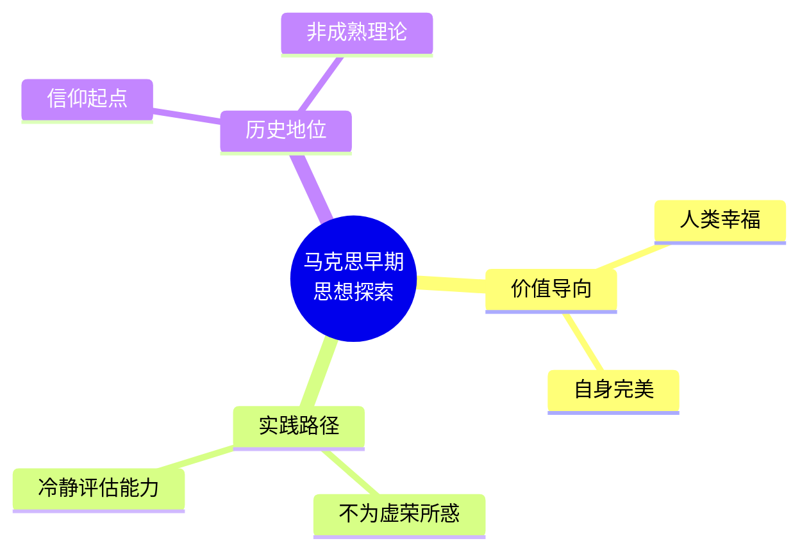

# 马克思《青年在选择职业时的考虑》与马恩的早期探索

## 《青年在选择职业时的考虑》与早期探索

1835年秋，17岁的马克思在特里尔中学毕业之际写下《青年在选择职业时的考虑》。这不仅是其人生第一篇重要文献，更是马克思主义信仰的==原点==。文章并未直接阐述唯物史观，但确立了“为人类幸福而工作”的价值坐标，标志着马克思从唯心主义向唯物主义、从革命民主主义向共产主义转变的萌芽。

> [!IMPORTANT]
> 核心结论：选择职业的指针是**人类的幸福**和**我们自身的完美**。二者并非对立，人只有为同时代人的完美、为他们的幸福而工作，自己才能达到完美。

### 为什么需要理解这篇早期文献？

许多同学容易将马恩思想视为冰冷的理论体系，却忽视了其背后炽热的人文关怀。理解此文有助于厘清两个关键问题：
1. **动机溯源**：马克思主义并非书斋里的逻辑游戏，而是源于对底层民众苦难的深切同情与改变世界的实践冲动。
2. **个人与社会的关系**：在“躺平”与“内卷”的当下，马克思早在17岁就给出了答案——==个人的自我实现必须融入社会进步之中==。

### 怎么做：职业选择的理性框架

马克思在文中提出了严谨的选择逻辑，可概括为以下三步：

| 步骤 | 关键动作 | 常见误区 |
| :--- | :--- | :--- |
| **审视内心** | 辨别是“虚荣”还是“使命” | 被名利光环迷惑，忽视内在热情 |
| **评估能力** | 冷静分析自身体质与才智 | 盲目自信或妄自菲薄 |
| **定位社会** | 寻找个人价值与社会需求的结合点 | 脱离社会现实，空谈理想 |

> [!TIP]
> 记忆口诀：**一辨虚荣，二估能力，三求统一**。即辨别动机真伪，评估自身条件，追求个人与社会的统一。

### 常见的坑与辨析

在学习“社会主义发展史”时，极易混淆马克思的**早期人道主义思想**与**成熟的历史唯物主义**。

- **早期（如本文）**：侧重伦理道德、理想主义，强调“精神完美”。
- **成熟期（如《德意志意识形态》）**：侧重经济基础、阶级斗争，提出==人民群众是历史的创造者==。

> [!WARNING]
> 易错点：不要认为马克思一开始就提出了“唯物史观”。《青年在选择职业时的考虑》仍带有黑格尔唯心主义色彩，但其**价值立场**已坚定指向人民。

### 算对了的例子

结合课件中的考题，我们可以验证这一逻辑的延伸：

**题目**：历史唯物主义认为“历史的创造者”是谁？
- A. 知识分子
- B. 时代英雄
- C. 人民群众
- D. 帝王诸侯

**解析**：虽然17岁的马克思强调的是个体通过服务人类来实现完美，但随着研究深入，他发现真正推动历史前进的不是少数英雄（B/D），而是广大的==人民群众==（C）。这与早期“为人类幸福工作”的初心一脉相承，只是从伦理呼吁上升到了科学规律。因此，答案选 **C**。

赫拉克利特作为辩证法奠基人（课件另一考点），其“万物皆流”的思想也为马克思后来的辩证唯物主义提供了哲学养分，但马克思的贡献在于将其应用于**社会历史领域**。
