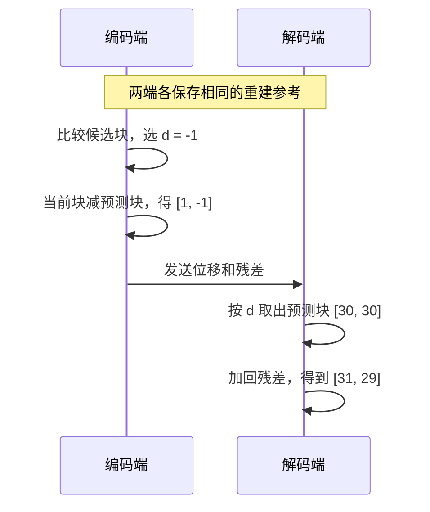

# 帧间预测与运动补偿

摄像机拍到小物体向右平移。逐像素相减时，物体原位置和新位置都可能留下一条明显的差值，即使物体本身并没有变。既然参考帧里已有近似相同的像素块，何不先在参考帧上找它，再只描述剩下的差异？

编码器为当前块寻找参考块，这一步叫**运动估计**；按运动矢量从参考帧取出像素来组成预测块，这一步叫**运动补偿**。对每个候选位移，可以先算绝对差之和（SAD），数值越小表示像素越接近。真实编码还要比较信令与残差的比特成本，SAD 最小不等于总码率最低。当前块减去预测块得到**预测残差**；解码端用自己已有的参考帧和收到的运动信息重做预测，再加上解码出的残差。若编码端用了原始参考图而解码端只有重建参考图，两侧的预测可能不同，误差会随引用传播。

**自编例。** 用一维块简化计算。参考帧一行为 $[9,30,30,9,9]$。当前块位于索引 $2,3$（从 0 开始），像素是 $[31,29]$。定义位移 $d$ 为「当前坐标加 $d$ 得到参考坐标」，只比较以下三个候选：

| $d$ | 参考块 | SAD |
|---:|---|---:|
| $-1$ | $[30,30]$ | $2$ |
| $0$ | $[30,9]$ | $21$ |
| $+1$ | $[9,9]$ | $42$ |

选择 $d=-1$，残差是 $[1,-1]$。下面省去码流的封装步骤，并假定残差无损。注意编码端和解码端各持有一份重建参考；解码端没有原始当前块，不会再搜索一次。

> [!TIP]
> 看见运动矢量的正负，先问 ==从哪一个坐标找哪一个坐标==。本题是从当前坐标回到参考坐标，物体在画面上向右走一格，查找位移却是 $-1$。

如果画面切换，新图的相似块可能根本不在旧帧里；如果整片都是均匀灰度，不同位移又可能给出同样的预测。前者提示改用不依赖旧帧的帧内预测，后者提醒不要把编码运动矢量当作物体真实速度。

参考：[ITU-T H.264 规范](https://www.itu.int/rec/T-REC-H.264/en)。
