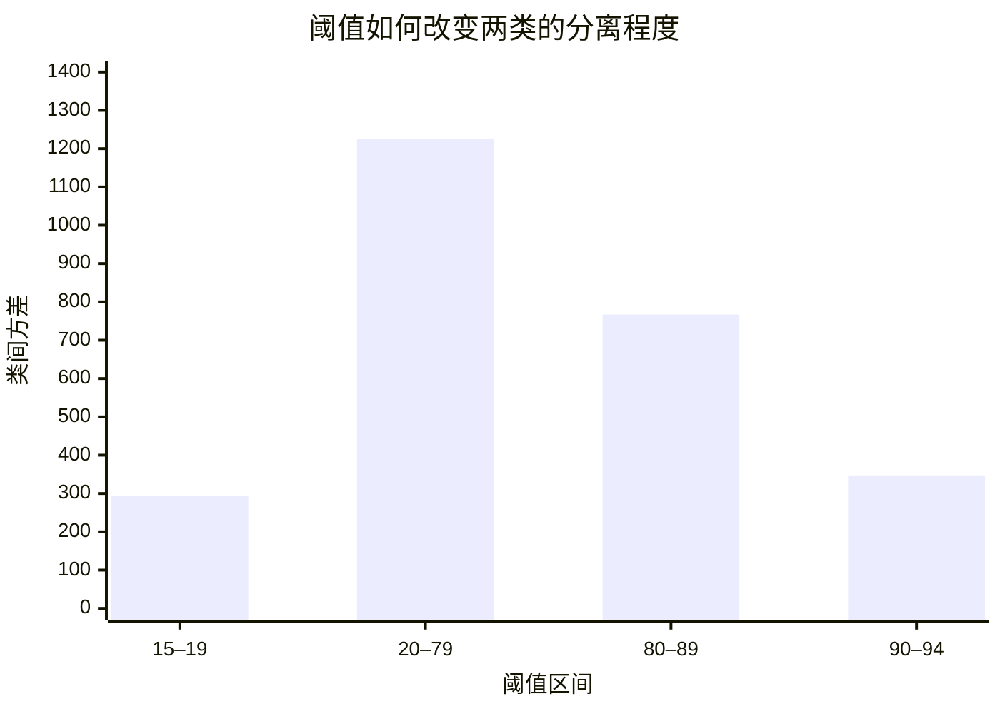

# 灰度阈值分割与最大类间方差法

平滑后得到的仍是灰度图，不是目标掩膜。如果目标比背景亮，且两者的灰度分布可以分开，就可以把像素划分为 $g\leq t$ 与 $g>t$ 两类。问题是：不逐张图手调，怎样从直方图选择 $t$？

最大类间方差法（大津法，Otsu）比较每一个能产生两个非空类的阈值。用 $w_0,w_1$ 表示两类的像素比例，用 $\mu_0,\mu_1$ 表示各类平均灰度，选使
$$
\sigma_B^2(t)=w_0w_1(\mu_0-\mu_1)^2
$$
最大的阈值。为什么不只让均值差尽可能大？把一个离群点独自分成一类也可能拉大均值差；$w_0w_1$ 会给极小的类别较低权重。另一方面，这也意味着面积很小的真实目标未必被选出来。总方差固定，类间方差最大等价于两类的加权类内方差最小。

**自编例。** 一行灰度为 $[15,20,20,80,90,95]$，规定灰度大于 $t$ 的像素标为 1。==先找阈值何时跨过一个已出现的灰度==，而不是把每个整数都重算一遍。下图每根柱对应一种非空分法，柱下标的是能产生该分法的整数阈值范围；柱宽不表示范围大小。

| $t$ | 类间方差（约） |
|---:|---:|
| 15 | 293.89 |
| 20 | 1225.00 |
| 80 | 767.01 |
| 90 | 347.22 |

例如 $t=20$ 时两类各占一半，均值分别为 $55/3$ 和 $265/3$，所以 $\sigma_B^2=(1/4)\times70^2=1225$。任何整数 $20\le t<80$ 都得到同样的掩膜 $[0,0,0,1,1,1]$；不同阈值可以实现同一个最佳分法。阈值小于 15 或大于等于 95 时，有一类为空，不参与比较。

> [!WARNING]
> 若阴影中的纸比亮处的字还暗，一个全局阈值就无法按亮暗将它们同时分对。最大化类间方差并不会验证前景与背景真的能按灰度分开；可先校正背景亮度，或用局部邻域和其他特征。

参考：[Otsu 原始论文](https://doi.org/10.1109/TSMC.1979.4310076)、[OpenCV 的图像阈值文档](https://docs.opencv.org/4.5.3/d7/d4d/tutorial_py_thresholding.html)。
