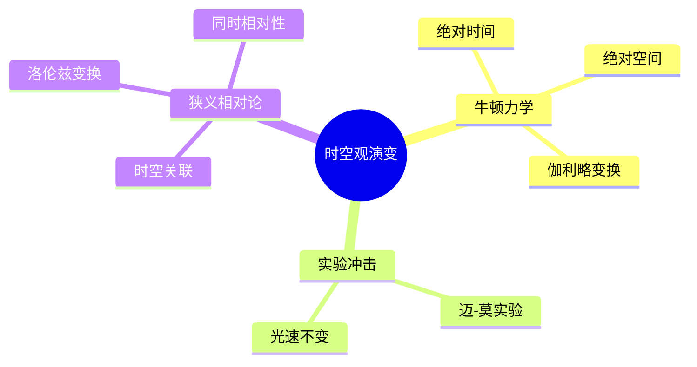

# 伽利略变换与牛顿绝对时空观的局限性

# 伽利略变换与牛顿绝对时空观的局限性

## 经典力学的基石：绝对时空观

在狭义相对论建立之前，物理学建立在牛顿的**绝对时空观**之上。其核心观点认为：
1. **时间是绝对的**：全宇宙共用同一个时钟，$\Delta t = \Delta t'$。
2. **空间是绝对的**：长度测量与参考系运动状态无关，$\Delta x = \Delta x'$。
3. **时空相互独立**：时间与空间互不干扰。

> [!IMPORTANT]
> ==牛顿绝对时空观认为时间和空间是相互独立的==。

基于此，不同惯性系之间的坐标变换遵循**伽利略变换**。若 $S'$ 系相对于 $S$ 系以速度 $u$ 沿 $x$ 轴正向运动，则：
$$
\begin{cases}
x' = x - ut \\
t' = t
\end{cases}
$$
由此导出的速度变换法则为 $v' = v - u$。这意味着，如果光速在 $S$ 系中为 $c$，那么在运动的 $S'$ 系中光速应为 $c-u$ 或 $c+u$。

## 危机与突破：迈克尔逊-莫雷实验

然而，麦克斯韦方程组预言光速 $c$ 是一个常数，这与伽利略速度变换矛盾。为了寻找“以太”并验证光速是否随参考系变化，**迈克尔逊-莫雷实验**应运而生。

> [!NOTE]
> 该实验结果为零（未检测到干涉条纹移动），否定了以太的存在，证实了==光速不变原理==和==相对性原理==（物理规律的协变性）。

这一实验事实直接揭示了伽利略变换在高速（接近光速）情况下的失效，也宣告了牛顿绝对时空观的局限性。

## 核心差异对比

| 特性 | 牛顿绝对时空观 (伽利略变换) | 狭义相对论 (洛伦兹变换) |
| :--- | :--- | :--- |
| **时间** | 绝对，同时性是绝对的 | 相对，==同时性是相对的== |
| **空间** | 绝对，长度不变 | 相对，尺缩效应 |
| **光速** | 服从速度叠加，可变 | ==光速不变==，最大速度极限 |
| **适用范围** | 低速 ($v \ll c$) | 任意速度 |

## 典型误区与计算实例

> [!WARNING]
> 常见陷阱：在低速下习惯认为“同时发生的事件在任何参考系都同时”。但在相对论中，==异地事件的同时性是相对的==。

**例题解析**：
北京（A）与天津（B）相距 $\Delta x = 120 \text{ km}$。地面系中，北京断电（$t_A=0$）后 $\Delta t = 3 \times 10^{-4} \text{ s}$，天津发生事故（$t_B$）。飞船以 $u=0.8c$ 从北京飞向天津。求飞船系中的时间间隔及先后顺序。

**解题步骤**：
1. **确定参数**：$\gamma = \frac{1}{\sqrt{1-0.8^2}} = \frac{5}{3}$。
2. **应用洛伦兹变换**：
   $$ \Delta t' = \gamma (\Delta t - \frac{u \Delta x}{c^2}) $$
3. **代入计算**：
   $$ \frac{u \Delta x}{c^2} = \frac{0.8 \times 3 \times 10^8 \times 1.2 \times 10^5}{(3 \times 10^8)^2} = 3.2 \times 10^{-4} \text{ s} $$
   $$ \Delta t' = \frac{5}{3} (3 \times 10^{-4} - 3.2 \times 10^{-4}) = -3.33 \times 10^{-5} \text{ s} $$
4. **结论判断**：
   因 $\Delta t' = t'_B - t'_A < 0$，即 $t'_B < t'_A$。
   ==在飞船参考系中，天津的事故先发生==。

> [!TIP]
> 记忆技巧：当 $u \Delta x / c^2 > \Delta t$ 时，时序可能反转。这体现了时空的统一性，时间不再是独立于空间的背景。
