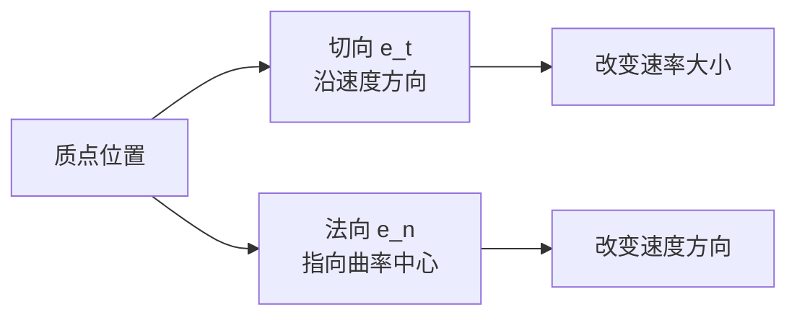

# 位矢及其坐标表示（直角坐标与自然坐标）

## 位矢是什么

质点的位置用**位矢** $\boldsymbol{r}$ 表示：从坐标原点指向质点所在位置的矢量。它同时告诉我们两件事——质点在哪里，以及离原点多远。

> [!IMPORTANT]
> 位矢是矢量，既有大小也有方向；只说"距离原点 3 m"不是位矢。

## 直角坐标表示

在平面直角坐标系中，位矢分解为

$$
\boldsymbol{r}(t) = x(t)\,\boldsymbol{i} + y(t)\,\boldsymbol{j}
$$

其中 $x(t), y(t)$ 是坐标分量，$\boldsymbol{i}, \boldsymbol{j}$ 是沿坐标轴的单位矢量。一旦知道了 $x(t)$ 和 $y(t)$，质点的运动就完全确定——速度、加速度都可由它们求导得到。

## 自然坐标系

直角坐标系"钉死"在空间里，但质点沿曲线运动时，我们更想知道：**速度朝哪？加速度怎样改变速率、怎样改变方向？**

> [!TIP]
> 想一想：开车过弯道时，你感受到的"推背感"和"被甩向门外"，分别对应加速度的哪个分量？

自然坐标系是"跟着质点跑"的活动坐标系：

- **切向轴** $\boldsymbol{e}_t$：沿速度方向，指向运动前方
- **法向轴** $\boldsymbol{e}_n$：垂直于速度，指向曲线凹侧（圆心方向）

## 切向与法向加速度

在自然坐标系中，加速度分解为

$$
\boldsymbol{a} = a_t\,\boldsymbol{e}_t + a_n\,\boldsymbol{e}_n = \frac{dv}{dt}\,\boldsymbol{e}_t + \frac{v^2}{\rho}\,\boldsymbol{e}_n
$$

| 分量 | 表达式 | 物理意义 |
|------|--------|----------|
| 切向加速度 $a_t$ | $\dfrac{dv}{dt}$ | 改变**速率**大小 |
| 法向加速度 $a_n$ | $\dfrac{v^2}{\rho}$ | 改变速度**方向**，$\rho$ 为曲率半径 |

> [!WARNING]
> 匀速圆周运动 $a_t = 0$，但 $a_n \neq 0$——速率不变不代表加速度为零！

## 两种坐标系的对比

| | 直角坐标系 | 自然坐标系 |
|---|---|---|
| 原点 | 固定不动 | 随质点移动 |
| 基矢方向 | 恒定不变 | 随运动不断转动 |
| 适用场景 | 抛体运动等轨迹已知 | 圆周运动、曲率问题 |
| 加速度分量 | $a_x, a_y$ | $a_t, a_n$ |

## 算例：心脏线曲率半径

求极坐标方程 $r = A(1 - \cos\theta)$ 在心底 $P$（$\theta = \pi$）处的曲率半径。

把 $\theta$ 看作参数，位矢 $\boldsymbol{r}(\theta) = A(1-\cos\theta)\,\boldsymbol{e}_r$，求导得

$$
\boldsymbol{v}(\theta) = \frac{d\boldsymbol{r}}{d\theta} = A\sin\theta\,\boldsymbol{e}_r + A(1-\cos\theta)\,\boldsymbol{e}_\theta
$$

$$
\boldsymbol{a}(\theta) = \frac{d\boldsymbol{v}}{d\theta} = A(2\cos\theta - 1)\,\boldsymbol{e}_r + 2A\sin\theta\,\boldsymbol{e}_\theta
$$

在 $\theta = \pi$ 处：$\boldsymbol{v} = 2A\,\boldsymbol{e}_\theta$，$\boldsymbol{a} = -3A\,\boldsymbol{e}_r$，二者恰好垂直，故法向加速度大小 $|\boldsymbol{a}_n| = |\boldsymbol{a}| = 3A$。

$$
\rho = \frac{v^2}{|\boldsymbol{a}_n|} = \frac{(2A)^2}{3A} = \boxed{\frac{4A}{3}}
$$

> [!NOTE]
> 此题若硬用直角坐标求二阶导再找曲率公式，计算量会大得多——选对坐标系是简化问题的关键。
