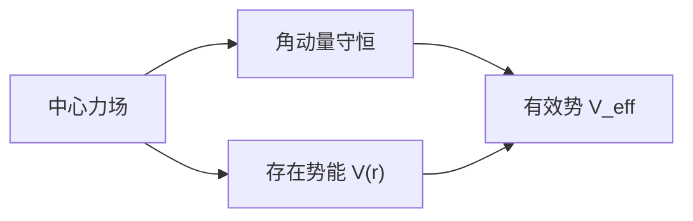

# 保守力及其势能、中心力场与有效势

## 它是什么

在“第 3 章 守恒定律”里，==保守力==是指做功只与起点和终点位置有关、与路径无关的力：$\oint \mathbf{F}\cdot d\mathbf{r}=0$。因为路径无关，才能唯一地引入**势能** $V(\mathbf{r})$，满足

$$
V(\mathbf{r}) = V(\mathbf{r}_0) - \int_{\mathbf{r}_0}^{\mathbf{r}} \mathbf{F}\cdot d\mathbf{r}'
$$

即 $\mathbf{F} = -\nabla V$。重力、弹簧弹力、万有引力都是保守力；摩擦力不是。

> [!IMPORTANT]
> 势能零点可以任意选；选不同零点只差一个常数，不影响力和运动。

## 怎么做：从保守力求势能

照着考题来一遍：对 $\mathbf{F}=(x-1)\mathbf{i}+(y-2)\mathbf{j}$，

$$
\begin{aligned}
V(x,y) &= V(x_0,y_0)-\int (x'-1)dx'+(y'-2)dy'\\
&= V(x_0,y_0)+\frac{(x_0-1)^2+(y_0-2)^2}{2}-\frac{(x-1)^2+(y-2)^2}{2}
\end{aligned}
$$

取零点 $\mathbf{r}_0=(1,2)$、$V(\mathbf{r}_0)=0$，则

$$
V(\mathbf{r}) = -\frac{(x-1)^2+(y-2)^2}{2}
$$

> [!TIP]
> 解题套路：凑全微分 $d[\frac12(x-a)^2]$；令括号内为零的位置就是自然零点。

## 中心力场与有效势

若力始终指向或背离固定力心 $\mathbf{F}=f(r)\mathbf{e}_r$，则是**中心力场**，它也是保守力，且角动量 $L$ 守恒。用极坐标把动能拆开：

$$
E=\frac12 m\dot r^2+\underbrace{\frac{L^2}{2mr^2}+V(r)}_{\text{有效势 }V_{\text{eff}}(r)}
$$

于是径向运动像“一维运动在有效势中”。库仑/引力问题中，$V(r)=-k/r$ 或 $+k/r$，$L^2/2mr^2$ 这一项给出“离心势垒”。

## 相近概念辨析

| 概念 | 关键性质 | 例子 |
|---|---|---|
| 保守力 | 环路积分为零，有势能 | 重力、弹簧力 |
| 非保守力 | 做功依赖路径 | 摩擦力 |
| 中心力 | 方向沿 $r$，力矩为零 | 万有引力 |
| 有效势 | $=V(r)+L^2/2mr^2$ | 径向一维化 |

## 常见坑

> [!WARNING]
> 别把“势能函数”和“势能零点”分开答：题目常同时问 $V(\mathbf{r})$ 与零点位置。另一个坑是在中心力里忘了写 $L^2/2mr^2$ 这一项，只用 $V(r)$ 算径向运动。

用竖直圆轨道那题也能检查守恒用法：支持力不做功，只有重力保守，故 $\frac12 mv^2+mgR\sin\varphi=\text{const}$，最高点才决定 $v_{\min}=\sqrt{5Rg}$。
