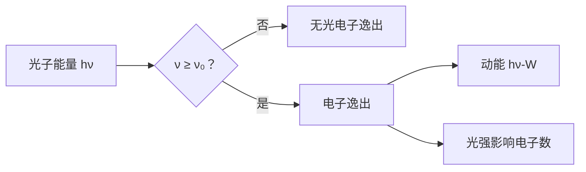

# 光电效应的实验规律与爱因斯坦光子理论

光电效应是光照射金属表面时，电子吸收光能逸出金属的现象，逸出的电子称为光电子。经典波动理论难以解释其实验规律，爱因斯坦提出光子理论：光由一份份光子组成，每个光子的能量为
$$\varepsilon=h\nu,$$
其中 $h$ 为普朗克常量，$\nu$ 为入射光频率。电子一次吸收一个光子的能量，一部分用于克服逸出功 $W$，其余转化为最大初动能：
$$E_{\mathrm{km}}=\frac12mv_{\mathrm m}^2=h\nu-W.$$
这就是==爱因斯坦光电效应方程==。

## 实验规律与物理解释

| 实验规律 | 光子理论的解释 |
|---|---|
| 存在红限频率 $\nu_0$，只有 $\nu\geq\nu_0$ 才能发生光电效应 | $\nu_0=W/h$，光子能量不足时电子无法逸出 |
| 光电效应几乎瞬时发生 | 电子直接吸收一个光子的能量，无需长时间积累 |
| 最大初动能随频率线性增大，与光强无关 | $E_{\mathrm{km}}=h\nu-W$ |
| 频率不变时，饱和光电流与光强成正比 | 光强增大意味着单位时间入射光子数增多 |

> [!IMPORTANT]
> ==频率决定单个光电子的最大初动能，光强主要决定光电子数目==。频率不变且能产生光电效应时，光强加倍，单位时间入射光子数加倍，饱和光电流也加倍。

## 解题时怎么做

先判断金属和入射光条件，再选用对应关系：

- 比较同一金属：$W$ 相同，频率越高，$E_{\mathrm{km}}$ 越大。
- 比较不同金属：必须同时考虑 $h\nu$ 和 $W$，不能只看最大初动能。
- 求红限或逸出功：$W=h\nu_0=hc/\lambda_0$。
- 求遏止电压：$eU_{\mathrm a}=E_{\mathrm{km}}$。
- 讨论光电流：先看频率是否超过红限，再看光子数；饱和光电流还与收集条件有关。

例如，用频率为 $\nu_1$ 的光照射金属 1，测得最大动能为 $E_{K1}$；用频率为 $\nu_2$ 的光照射金属 2，测得最大动能为 $E_{K2}$。若 $E_{K1}>E_{K2}$，能否断定 $\nu_1>\nu_2$？

由
$$h\nu_1-W_1>h\nu_2-W_2$$
只能得到 $h\nu_1-h\nu_2>W_1-W_2$。由于两种金属的逸出功未知，$\nu_1$ 可能大于、等于或小于 $\nu_2$，故应选“$\nu_1$ 可能大于也可能小于 $\nu_2$”。

> [!WARNING]
> “不同频率、光强相等”不代表光子数相等。光强满足 $I\propto Nh\nu$，频率不同，单位时间入射光子数 $N$ 一般不同，因此单位时间逸出的光电子数不一定相等。

## 与康普顿效应的区别

| 对比项 | 光电效应 | 康普顿效应 |
|---|---|---|
| 主要过程 | 电子吸收光子能量 | 光子与近似自由电子散射 |
| 典型对象 | 金属中的束缚电子 | 近似自由电子 |
| 常见波段 | 可见光、紫外光等 | X 射线等 |
| 核心结论 | $E_{\mathrm{km}}=h\nu-W$ | 散射光波长增大 |

两者都体现光的粒子性，但不能把光电效应简单说成光子与电子的弹性碰撞。
