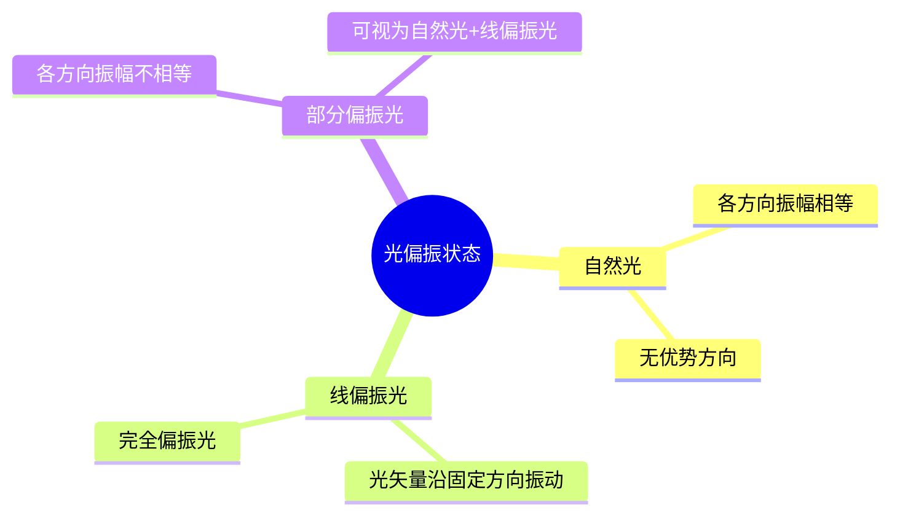
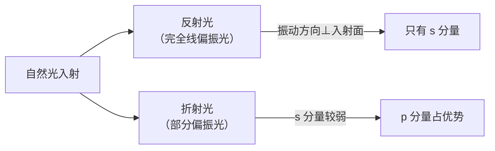

# 自然光与偏振光、马吕斯定律与布儒斯特定律

## 自然光与偏振光

光是一种电磁波。电磁波中，电场强度 $\vec{E}$ 与磁场强度 $\vec{H}$ 相互垂直，且都与传播方向垂直。一般把电场强度 $\vec{E}$ 的振动方向定义为==光的振动方向==。

为什么需要关注光的振动方向？
因为光与物质相互作用时（如反射、折射、散射），往往对振动方向有“偏好”。有些现象，比如屏幕的眩光通过偏振镜消除，正是利用了这些规律。

**自然光**

普通光源（太阳、白炽灯）内大量原子同时发光，每个原子发光的振动方向随机、互不相关。在垂直于传播方向的平面内，==各个方向的振动振幅均相等，没有哪个方向占优势==，这种光叫**自然光**。

自然光可以用任意两个相互垂直、振幅相等、相位关系随机的线偏振光来表示。

**线偏振光**

如果光矢量 $\vec{E}$ 始终沿某个固定方向振动，就叫**线偏振光**（完全偏振光）。这个固定方向与其传播方向构成的平面叫**振动面**。自然光通过偏振片后，就变成了线偏振光。

**部分偏振光**

介于两者之间，==各个方向振动都有，但某个方向振幅更大==，叫部分偏振光。可以用自然光与线偏振光的混合来理解。

[!IMPORTANT]
> 光的偏振现象最核心的意义在于：它证实了光是横波。纵波振动方向与传播方向平行，不存在“垂直于传播方向的平面内哪个方向振动”的问题，因此纵波无偏振。

---

## 马吕斯定律

一束强度为 $I_0$ 的==线偏振光==垂直入射到偏振片上，其振动方向与偏振片**偏振化方向**（透振方向）夹角为 $\theta$，则透射光强为：

$$ I = I_0 \cos^2 \theta $$

这是马吕斯定律的核心公式。

[!WARNING]
> 马吕斯定律的起点必须是**线偏振光**。如果入射光本身是自然光或部分偏振光，需要先分解，再分别处理。

**常见的坑：自然光先过第一片偏振片**

自然光透过第一片偏振片后，光强变为原来的一半：$I = I_0/2$。这是因为它包含了各个方向的振动，平均投影到透振方向后，能量剩下一半。这一步不涉及角度，也不存在“把自然光分解”的说法。

透过第一片后的光已经是线偏振光，再遇到第二片偏振片时，==才真正开始用马吕斯定律==。

### 算对例子：两偏振片叠放

**题**：自然光垂直入射两块叠放的偏振片，不计吸收。两偏振化方向夹角 $\theta$ 多大时，透射光强为入射自然光强 $I_0$ 的 $1/3$？

**分步求解**：

1. 过第一片：光强变为 $\displaystyle I_1 = \frac{I_0}{2}$
2. 过第二片（余弦平方衰减）：$I_2 = I_1 \cos^2 \theta$
3. 连列方程：$\displaystyle \frac{I_0}{2} \cos^2 \theta = \frac{I_0}{3}$
4. 解得：$\cos^2 \theta = \dfrac{2}{3}$，$\theta = \arccos\sqrt{\frac{2}{3}} \approx 35.3^\circ$

[!TIP]
> **“最大透射光强”是啥？**  
> 如果题目说“透射光强为最大透射光强的 $1/3$”，这个“最大透射光强”指两块偏振片**平行时（$\theta=0$）**得到的最大强度 $I_{\max}=I_0/2$。  
> 此时方程变为：$\frac{I_0}{2}\cos^2\theta = \frac{1}{3}\cdot\frac{I_0}{2}$，得 $\cos^2\theta = 1/3$，$\theta \approx 54.7^\circ$。  
> 与上一问的差别在于：一个相对于入射总光强，一个相对于系统极限光强。

---

## 布儒斯特定律

自然光照射到两种介质的分界面时，反射光和折射光都会变成==部分偏振光==（折射光偏振度较低）。但在一个特殊入射角下，反射光会变成==完全线偏振光==，这个角就是**布儒斯特角** $i_\mathrm{B}$。

规律（布儒斯特定律）：

$$ \tan i_\mathrm{B} = \frac{n_2}{n_1} $$

$n_1$ 为入射介质折射率，$n_2$ 为折射介质折射率。当入射角满足这一关系时：

- ==反射光只含垂直于入射面的振动分量（s 分量）==，是线偏振光
- 折射光为部分偏振光，含较强的平行于入射面的振动分量（p 分量）
- 反射光线与折射光线互相垂直：$i_\mathrm{B} + \gamma = 90^\circ$

[!IMPORTANT]
> 选择题高频考点：自然光以布儒斯特角入射玻璃表面，反射光是“==垂直于入射面振动的完全线偏振光==”，折射光是“平行于入射面振动占优势的部分偏振光”。

[!CAUTION]
> 布儒斯特定律给出的是**反射光**全偏振的条件，折射光始终是部分偏振光（不管入射角怎么变）。如果说明“以布儒斯特角入射的折射光是线偏振光”，那是错的。

**对比表格**：马吕斯定律 vs 布儒斯特定律

| 定律 | 研究什么 | 核心公式 | 产物 |
|:---|:---|:---|:---|
| 马吕斯定律 | 线偏振光通过偏振片 | $I=I_0\cos^2\theta$ | 光强随角度变化 |
| 布儒斯特定律 | 自然光在界面反射 | $\tan i_\mathrm{B}=n_2/n_1$ | 反射光完全线偏振 |

---

## 双折射（补充辨析）

某些晶体（如方解石）会将一束入射光分成两束：**寻常光（o 光）**和**非寻常光（e 光）**。

[!NOTE]
> - o 光和 e 光**都是线偏振光**，振动方向通常互相垂直  
> - o 光遵守折射定律，折射率各方向相同  
> - e 光一般不遵守常规折射定律，折射率随方向变化  
> 常考题干里，“o 光是自然光”或“e 光是自然光”，都是错误说法。二者全是偏振光。
