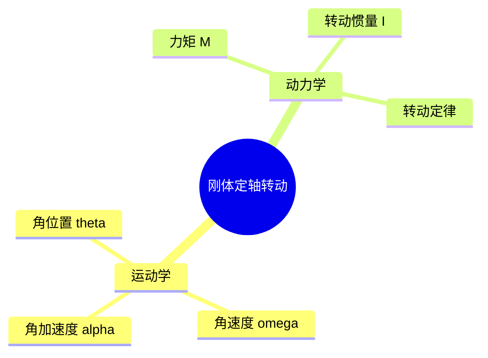

# 刚体定轴转动的角量描述

## 什么是角量描述

刚体定轴转动时，所有质点绕同一轴做圆周运动。用**角位置** $\theta$、**角速度** $\omega$ 和**角加速度** $\alpha$ 描述整体运动状态，比单独分析每个质点的线量更简洁。

$$
\omega = \frac{d\theta}{dt}, \quad \alpha = \frac{d\omega}{dt} = \frac{d^2\theta}{dt^2}
$$

> [!IMPORTANT]
> ==核心联系==：线量与角量通过半径 $r$ 关联：$v = r\omega$，$a_t = r\alpha$，$a_n = r\omega^2$。

## 为什么需要角量

若用线速度描述转盘，边缘快、中心慢，变量繁多。引入角量后，刚体上任意点（除轴上）的 $\omega$ 和 $\alpha$ **完全相同**。这将复杂的质点系问题简化为单变量问题，便于应用转动定律 $M_z = I\alpha$。

## 匀变速转动公式

当 $\alpha = \text{const}$ 时，角量运动学与质点直线运动公式形式完全一致，只需将 $x, v, a$ 替换为 $\theta, \omega, \alpha$。

| 物理过程 | 线量公式 (直线运动) | 角量公式 (定轴转动) |
| :--- | :--- | :--- |
| 速度/角速度变化 | $v = v_0 + at$ | $\omega = \omega_0 + \alpha t$ |
| 位移/转角 | $x - x_0 = v_0 t + \frac{1}{2}at^2$ | $\theta - \theta_0 = \omega_0 t + \frac{1}{2}\alpha t^2$ |
| 速度位移关系 | $v^2 - v_0^2 = 2a(x-x_0)$ | $\omega^2 - \omega_0^2 = 2\alpha(\theta-\theta_0)$ |

> [!TIP]
> **记忆技巧**：记住直线运动公式，直接“换皮”即可得到转动公式。注意角度单位必须用**弧度 (rad)**。

## 常见误区与辨析

1.  **矢量方向**：$\vec{\omega}$ 和 $\vec{\alpha}$ 沿转轴方向，服从右手螺旋定则。在定轴转动中，通常只关心其代数值（正负代表转向）。
2.  **合力矩为零**：合力矩为零意味着 $\alpha=0$（匀速转动或静止），**不代表**合力为零，也不代表物体不动。
3.  **参考点**：角量描述依赖于转轴的选择。同一刚体绕不同轴转动，$I$ 和 $\omega$ 可能不同。

> [!WARNING]
> **易错坑**：计算转角 $\Delta \theta$ 时，若题目给出“转数 $N$”，务必转换为弧度：$\Delta \theta = 2\pi N$。切勿直接代入圈数计算。

## 典型例题解析

**题目**：圆盘以恒定角加速度转动，某时刻角速度为 $\omega_1$，再转 10 转后角速度为 $\omega_2$。求 $\alpha$ 和时间 $\Delta t$。

**解析**：
1.  **单位换算**：$\Delta \theta = 10 \times 2\pi = 20\pi \, \text{rad}$。
2.  **求 $\alpha$**：利用不含时间的公式 $\omega_2^2 - \omega_1^2 = 2\alpha \Delta \theta$。
    $$
    \alpha = \frac{\omega_2^2 - \omega_1^2}{40\pi}
    $$
3.  **求 $\Delta t$**：利用平均角速度公式（类比匀变速直线运动 $\bar{v} = \frac{v_0+v}{2}$）。
    $$
    \Delta \theta = \frac{\omega_1 + \omega_2}{2} \Delta t \implies \Delta t = \frac{40\pi}{\omega_1 + \omega_2}
    $$

> [!NOTE]
> 此题展示了角量描述的优越性：无需知道圆盘半径 $R$ 或具体质点的位置，仅凭整体角量即可求解。
