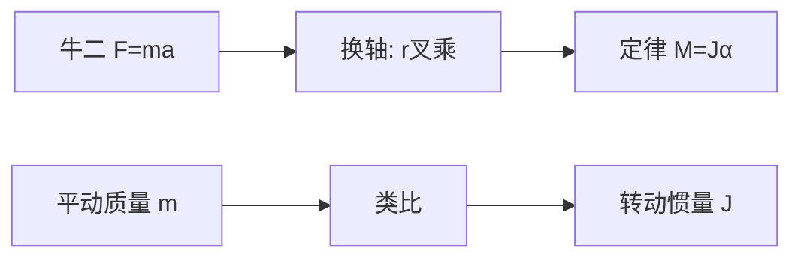

# 刚体定轴转动定律（M=Jα）

刚体绕固定轴转动时，合外力矩怎样改变它的运动？牛顿第二定律 $F=ma$ 给出了平动的答案，但对转动问题，需要一个"转动物体版本"的定律——**刚体定轴转动定律**。

> [!IMPORTANT]
> **刚体定轴转动定律**：绕固定轴转动的刚体，所受合外力矩 $M_z$ 与角加速度 $\alpha = \ddot\theta$ 成正比：
> $$M_z = J\alpha = J\ddot\theta$$
> ==其中 $J$ 是刚体对固定轴的转动惯量，是转动问题里的"惯性质量"。==

## 为什么需要它

牛顿第二定律写的是 $F = ma$。但定轴转动时，各质点做圆周运动，用 $F=ma$ 逐个写方程再求和既繁琐又难以处理约束力（转轴的反作用力不做事、不出现在 $M_z$ 里）。引入转动惯量 $J = \sum_i \Delta m_i r_i^2$（连续体则是 $\int r^2 dm$）之后，==一整根刚体的转动就可以压缩成一个标量方程==，约束力自动消失。

## 怎么用

- **找轴**：明确固定轴 $O$，所有力矩、转动惯量都对它算。
- **算 $J$**：查表 + 平行轴定理 $J = J_C + md^2$（$J_C$ 是过质心的轴，$d$ 为两轴距离）。
- **算合外力矩**：$M_z = \sum_i (\boldsymbol{r}_i \times \boldsymbol{F}_i)\cdot \boldsymbol{k}$，注意==重力等价于作用在质心==。
- **列方程**：$M_z = J\ddot\theta$，结合边界条件解出 $\theta(t)$；小角度问题常近似 $\sin\theta \approx \theta$，化为简谐方程 $\ddot\theta + \omega^2\theta = 0$。

## 和相近概念的区别

| 概念 | 公式 | 描述什么 |
|---|---|---|
| 转动惯量 $J$ | $\int r^2 dm$ | 转动的"惯性"，由质量分布决定 |
| 角动量 $J_z$（书上也写 $L$） | $J_z = J\omega$ | 转动的"运动状态" |
| 定轴转动定律 | $M_z = J\ddot\theta$ | 力矩改变转动状态的**因果律** |
| 角动量定理 | $\dot J_z = M_z$ | $M_z = J\alpha$ 的等价积分形式 |

> [!WARNING]
> - $M_z = J\alpha$ 只在==**轴固定**==（$J$ 不变）时写成 $J\ddot\theta$；若 $J$ 随时间变（如甩出质量、弹簧卷开），要用 $\dot J_z = M_z$ 展开。
> - 力矩是矢量，绕轴投影后才用标量式；顺时针/逆时针要统一正方向。
> - 转动惯量随轴而变，套错轴 = 全错。

## 算对了的例子

图示（教材习题 4-26）：细杆两端各挂质量 $m$，距轴 $O$ 为 $l_1$、$l_2$，在铅垂面内小幅摆动。

1. **转动惯量**：$J = ml_1^2 + ml_2^2$。
2. **重力力矩**：设偏角 $\theta$，两质点重力反向力矩相减，$M_z = -(l_2-l_1)mg\sin\theta$。
3. **列定律**：$-(l_2-l_1)mg\sin\theta = (ml_1^2+ml_2^2)\ddot\theta$。
4. **小角度**：$\sin\theta \approx \theta$，得 $\ddot\theta + \dfrac{(l_2-l_1)g}{l_1^2+l_2^2}\theta = 0$。
5. **周期**：$T = 2\pi\sqrt{\dfrac{l_1^2+l_2^2}{(l_2-l_1)g}}$，==等值摆长 $l = \dfrac{l_1^2+l_2^2}{l_2-l_1}$==。

> [!TIP]
> 小角度下凡是 $M_z \propto -\theta$，一律可套 $\ddot\theta + \omega^2\theta = 0$ 直接读 $\omega$，不必再解微分方程；对应弹簧回复力矩 $M = -\kappa\theta$ 里 $\kappa = kr^2$（弹力 $kr\theta$ 乘力臂 $r$）。
