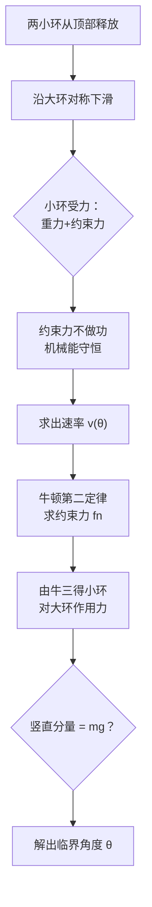

# 功能原理与机械能守恒定律

## 从功能原理到机械能守恒

在质点动力学中，动能定理告诉我们：合力做的功等于质点动能的增量。当我们研究的对象从**单个质点**扩展到**质点系**时，就需要一个新的工具——功能原理。它最大的好处是让我们能避开复杂的内力分析，直接通过能量变化来求解运动问题。

### 什么是功能原理

首先把质点系受到的力分为两类：

- **保守内力**：如重力、弹簧弹力、万有引力等，它们的功可以用势能变化来描述：$W_{\text{保内}} = -(E_p - E_{p0})$
- **非保守力**：包括一切外力和非保守内力（如摩擦力、爆炸力等），记作 $W_{\text{非保}}$

将质点系的动能定理 $W_{\text{总}} = \Delta E_k$ 展开：

$$
W_{\text{保内}} + W_{\text{非保}} = E_k - E_{k0}
$$

把保守内力的功用势能差替换，整理得到：

> [!IMPORTANT]
> **功能原理**：系统机械能的增量等于非保守力做的总功。
>
> $$W_{\text{非保}} = E - E_0 = \Delta E$$

其中机械能 $E = E_k + E_p$，是动能与系统势能之和。

这个式子的物理意义很清晰：==只有非保守力才会改变系统的机械能==。保守内力（如重力）只是让动能和势能相互转换，不影响总机械能。

### 机械能守恒定律

当 $W_{\text{非保}} = 0$ 时，系统与外界没有非保守力做功，内部也没有摩擦等耗散，机械能就守恒了：

> [!IMPORTANT]
> **机械能守恒定律**：若系统只有保守内力做功，则机械能保持不变。
>
> $$E_k + E_p = \text{常量}$$

### 功能原理 vs 机械能守恒

| 对比点 | 功能原理 | 机械能守恒定律 |
|:---|:---|:---|
| 适用条件 | 无条件，普适 | $W_{\text{非保}} = 0$（无摩擦、无外力做功等）|
| 本质 | 能量变化的**量度关系** | 功能原理的**特例** |
| 方程形式 | $W_{\text{非保}} = \Delta E$ | $E_1 = E_2$（$E_k+E_p$ 不变）|

### 解题思路（四步法）

1. **选系统**：把研究对象和与之有保守力作用的物体归入系统（如物体+地球+弹簧）
2. **分清楚力**：画出系统内所有力，标出哪些是保守内力、哪些是非保力（外力、摩擦力）
3. **确认条件**：如果 $W_{\text{非保}} = 0$，直接用机械能守恒；否则用功能原理
4. **列方程**：选定势能零点，写出初末状态机械能，代入公式

> [!TIP]
> 口诀：**“先选系统再分力，非保守功零才守恒。势能零点要找准，初末能量列等式。”**

### 常见坑点

> [!WARNING]
> **张力/支持力不做功？不一定！**
> 只有作用点无位移时它们才不做功。滑轮上的绳子拉力可以做正功或负功，必须具体分析。

> [!CAUTION]
> 机械能守恒只要求 $W_{\text{非保}} = 0$，**不要求没有非保守力**！如静摩擦力存在但不做功，系统机械能仍守恒。

> [!NOTE]
> 如果外力做功不为零或存在滑动摩擦力，机械能必不守恒，必须用功能原理处理 $W_{\text{非保}}$。

### 典型例题：大圆环升起问题

**题意**：质量为 $m$ 的大圆环用细线悬挂。两质量为 $M$ 的小环从大环顶部静止释放，沿相反方向无摩擦滑动。问 $\theta$ 多大时大环刚好被抬起？

**求解关键**：

1. **选系统**：小环 + 大环 + 地球。约束力是系统内力且不做功，满足机械能守恒。
2. **机械能守恒**（取最高点为势能零点，$v_0 = 0$）：

   $$\frac12 M v^2 + MgR(\cos\theta - 1) = 0 \;\Rightarrow\; v^2 = 2gR(1-\cos\theta)$$

3. **受力分析求约束力**：在法向列牛顿方程

   $$M\frac{v^2}{R} = Mg\cos\theta + f_n \;\Rightarrow\; f_n = Mg(2 - 3\cos\theta)$$

4. **临界条件**：小环对大环压力的竖直分量刚好等于大环重力：

   $$2f_n\cos\theta = mg \;\Rightarrow\; 2Mg(2-3\cos\theta)\cos\theta = mg$$

   解得 $\cos\theta = \frac13 \pm \frac13\sqrt{1 - \frac{3m}{2M}}$，取较小角度对应的 $\theta_+$（先出现），且要求 $2M > 3m$。

> [!IMPORTANT]
> ==机械能守恒处理的是“速率-位置”关系，约束力需要结合牛顿定律单独求==。能量只能给出运动的快慢，要给受力“搭桥”才能求力。
