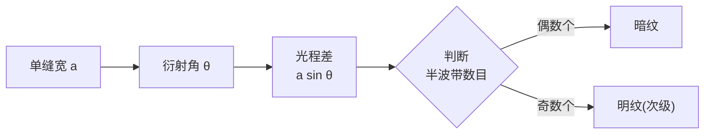
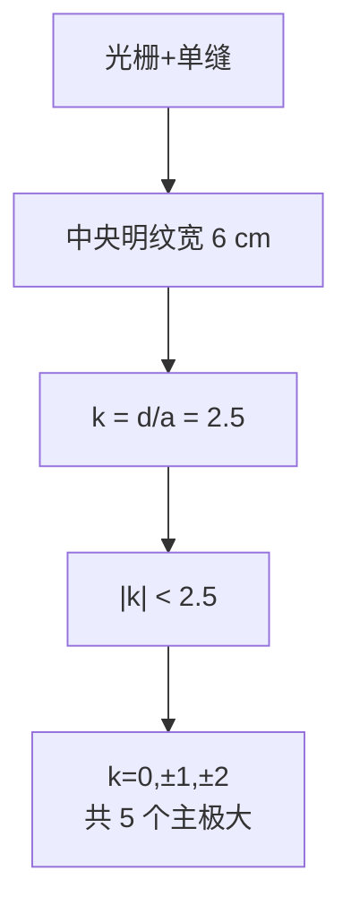

# 单缝衍射的暗纹条件与中央明纹宽度

## 单缝衍射的暗纹条件

单缝衍射要解决的核心问题是：**平行光垂直照射单缝后，在透镜焦平面的屏幕上，哪些位置是暗的？暗纹之间的中央明纹又有多宽？**

先看暗纹条件。如图，单缝宽度为 $a$，波长为 $\lambda$ 的平行光垂直入射。考虑衍射角为 $\theta$ 的方向，单缝两端出射光线之间的光程差为 $a\sin\theta$。

关键想法是**半波带法**：把单缝处的波阵面沿缝宽方向分成若干条带，使相邻条带到屏幕上某点的光程差恰好为 $\lambda/2$。这样相邻半波带的光振动两两相消。

若波阵面恰好能分成 **偶数个** 半波带，则屏幕上对应点出现暗纹。设半波带数目为 $N$，则

$$ N=\frac{a\sin\theta}{\lambda/2}=\frac{2a\sin\theta}{\lambda} $$

当 $N=2k$（$k=\pm 1,\pm 2,\dots$）时，为暗纹。代入得

$$ \boxed{a\sin\theta = k\lambda,\quad k=\pm 1,\pm 2,\dots} $$

> [!IMPORTANT]
> 单缝衍射暗纹条件为 $a\sin\theta = k\lambda$，其中 $k$ 取非零整数。$k$ 表示第 $k$ 级暗纹，正负号对应明纹关于中央对称分布。

这里特别容易与**双缝干涉明纹**条件 $d\sin\theta=k\lambda$ 混淆：双缝中 $k$ 对应明纹，单缝中 $k$ 对应暗纹，一明一暗恰好相反。

> [!WARNING]
> 半波带数目的判断公式是 $N=2a\sin\theta/\lambda$。若 $a=4\lambda$、$\theta=30^\circ$，则 $N=2\times 4\lambda\times 0.5/\lambda=4$，对应**第二级暗纹**（$k=2$），不是第一级。

## 中央明纹宽度

中央明纹位于 $k=\pm 1$ 两条第一级暗纹之间。其半角宽度由 $a\sin\theta_1=\lambda$ 确定。通常 $\theta_1$ 很小，$\sin\theta_1\approx \theta_1\approx \lambda/a$。

屏幕上中央明纹的线宽度为

$$ \Delta x = 2f\tan\theta_1 \approx \frac{2f\lambda}{a} $$

其中 $f$ 是透镜焦距。这个公式说明：**缝越窄（$a$ 越小），中央明纹越宽**——衍射现象越显著。

## 一个算对了的例子

一衍射光栅，每厘米 200 条透光缝，透光缝宽 $a=2\times10^{-3}\ \mathrm{cm}$，透镜焦距 $f=1\ \mathrm{m}$，入射光波长 $\lambda=600\ \mathrm{nm}$。求单缝衍射中央明纹宽度及该宽度内光栅衍射主极大的数目。

**解：** 中央明纹线宽度

$$ \Delta x = \frac{2f\lambda}{a}=\frac{2\times 1\times 600\times 10^{-9}}{2\times 10^{-5}}=6\times 10^{-2}\ \mathrm{m}=6\ \mathrm{cm} $$

光栅常数 $d=1/200\ \mathrm{cm}=5\times 10^{-5}\ \mathrm{m}$。单缝第一暗纹位置对应光栅干涉级次

$$ k = \frac{d}{a}=\frac{5\times 10^{-5}}{2\times 10^{-5}}=2.5 $$

中央明纹内允许 $|k|<2.5$，故主极大级次为 $k=0,\pm 1,\pm 2$，共 **5 个**。

> [!TIP]
> 遇到“单缝衍射范围内有多少个光栅主极大”这类题，直接算 $d/a$。若为整数 $m$，则第 $m$ 级主极大恰好缺级，中央明纹内有 $2m-1$ 个主极大；若为非整数，取小于它的最大整数 $m'$，主极大数为 $2m'+1$。

## 常见坑

1. **混淆半波带数目与暗纹级次**：先算 $N=2a\sin\theta/\lambda$，再判断 $\theta$ 对应明暗。例如 $N=4$ 是第二级暗纹。
2. **线宽度忘记乘 2**：$\Delta x$ 是两侧第一暗纹之间的宽度，必须用 $2f\lambda/a$，不是单独一边。
3. **缝宽与波长关系不清**：当 $a$ 接近 $\lambda$ 时中央明纹几乎铺满半屏；当 $a\gg\lambda$ 时衍射效应可忽略，接近几何光学。
