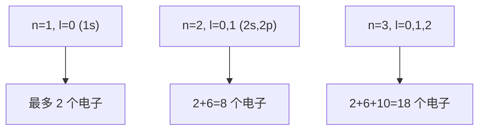

# 四个量子数、泡利不相容原理与电子排布

## 四个量子数

电子在原子中的状态并不是行星绕太阳那样的轨道，而是由波函数描述的“量子态”。要唯一确定一个量子态，需要==四个量子数==，它们是在求解薛定谔方程时自然出现的。

| 量子数 | 符号 | 可取值 | 决定什么 |
|--------|------|--------|----------|
| 主量子数 | $n$ | $1, 2, 3, \dots$ | 能级（电子层） |
| 角量子数 | $l$ | $0, 1, \dots, n-1$ | 轨道角动量（亚层形状） |
| 磁量子数 | $m_l$ | $-l, \dots, 0, \dots, +l$ | 轨道空间取向 |
| 自旋磁量子数 | $m_s$ | $+\frac{1}{2}$ 或 $-\frac{1}{2}$ | 电子自旋方向 |

### 为什么需要四个数？

- **$n$** 决定了电子能量的主要部分。$n=1$ 是基态，$n=2,3,\dots$ 是激发态。
- **$l$** 决定轨道的角动量大小 $L = \sqrt{l(l+1)}\hbar$，也用光谱符号标记：$l=0 \rightarrow s$，$l=1 \rightarrow p$，$l=2 \rightarrow d$，$l=3 \rightarrow f$。
- **$m_l$** 决定角动量在外磁场方向的投影，取值受 $l$ 限制。
- **$m_s$** 是电子固有的“自旋”角动量投影，只有两个可能值。

> [!TIP]
> 记忆口诀：**n**定能级，**l**定形状，**m_l**定走向，**m_s**定自旋。

### 常见坑：为什么 $l$ 不能等于 $n$？

由方程解出的约束条件：$l = 0, 1, \dots, n-1$。$n=3$ 时，$l$ 只能取 $0, 1, 2$（也就是 $s, p, d$），不能取 $3$。所以 $(n=3, l=3)$ 是==不存在==的量子态。

---

## 泡利不相容原理

> [!IMPORTANT]
> 在一个原子中，==不能有两个电子处于完全相同的量子态==，即不可能有两个电子具有完全相同的四个量子数 $(n, l, m_l, m_s)$。

这个原理不是人为规定，而是电子作为费米子必须服从的统计规律。它直接决定了多电子原子中电子的排布方式：

- 同一个轨道（$n, l, m_l$ 都相同）最多只能容纳两个电子，且它们 $m_s$ 必须相反（一个 $+\frac{1}{2}$，一个 $-\frac{1}{2}$）。
- 以此为基础，可以逐层填充元素周期表。

---

## 电子排布

电子优先占据能量最低的轨道，同时每层最多容纳电子数受量子数限制：

- $n$ 层轨道总数：$\sum_{l=0}^{n-1} (2l+1) = n^2$
- $n$ 层最多电子数：$2n^2$

---

## 经典考题示例

**题目**：下列四组量子数中，哪几组可以描述原子中电子的状态？
(1) $n=3, l=2, m_l=0, m_s=+\frac{1}{2}$
(2) $n=3, l=3, m_l=1, m_s=+\frac{1}{2}$
(3) $n=3, l=1, m_l=-1, m_s=-\frac{1}{2}$
(4) $n=3, l=0, m_l=0, m_s=-\frac{1}{2}$

**检查思路**：

| 组 | 条件检查 | 结果 |
|----|----------|------|
| (1) | $n=3$，$l=2$ 满足 $l \leq n-1$；$m_l=0$ 满足 $|m_l| \leq l$ | ✅ |
| (2) | $l=3$ 但 $n=3$，$l$ 必须 $\leq 2$ | ❌ |
| (3) | $n=3$，$l=1$ 满足；$m_l=-1$ 满足；$m_s$ 合法 | ✅ |
| (4) | $n=3$，$l=0$ 满足；$m_l$ 只能为 $0$ 满足 | ✅ |

答案为 C：只有 (1)、(3) 和 (4)。

> [!WARNING]
> 判断量子数是否合法时，最容易出错的是 $l$ 的取值范围：务必确认 $0 \leq l \leq n-1$，而不是 $l \leq n$！

再如氢原子 3d 电子：$n=3$，$d$ 对应 $l=2$，所以 $(3, 2, 0, +\frac{1}{2})$ 合法；而 A 中 $l=0$ 对应的是 $s$ 态，B 中 $n=1$ 根本到不了 3d，C 中 $m_l=2$ 超出 $l=1$ 的范围，都是非法的。
