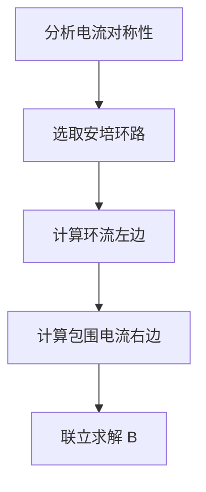

# 安培环路定理及其应用

## 定理内容与适用条件

安培环路定理描述了稳恒磁场中磁感应强度 $\vec{B}$ 沿任意闭合路径 $L$ 的环流与路径所包围电流的关系：

$$
\oint_L \vec{B} \cdot \mathrm{d}\vec{l} = \mu_0 \sum I_{\text{内}}
$$

其中，$\mu_0$ 为真空磁导率，$\sum I_{\text{内}}$ 是穿过以 $L$ 为边界的任意曲面的净电流（代数和）。电流正负由右手定则判定：右手四指沿积分路径方向弯曲，拇指指向电流方向则为正，反之为负。

> [!IMPORTANT]
> 该定理仅适用于**稳恒电流**（闭合回路或无限延伸的电流）。它表明 $\vec{B}$ 的环流只取决于**包围的净电流**，与回路形状、外部电流无关；但 $\vec{B}$ 本身是**所有电流**（包括外部电流）共同产生的。

## 对称性与解题步骤

安培环路定理主要用于计算具有**高度对称性**的磁场分布，如无限长直导线、无限长圆柱（管）、螺线管等。解题时遵循以下流程：

- **选环路**：要求环路上 $B$ 大小恒定且方向与 $\mathrm{d}\vec{l}$ 平行（或垂直），使 $\oint \vec{B} \cdot \mathrm{d}\vec{l}$ 简化为 $B \cdot l$。
- **算电流**：明确哪些电流被环路包围，注意代数和。
- **分段讨论**：对不同区域（如圆柱内外）分别建立环路方程。

## 典型应用与公式

| 载流体 | 磁场分布 | 磁感应强度 |
| :--- | :--- | :--- |
| 无限长直导线 | 同心圆环绕 | $B = \dfrac{\mu_0 I}{2\pi r}$ |
| 无限长圆柱导体（半径 $R$） | 内部随 $r$ 增大，外部衰减 | $B_{\text{内}} = \dfrac{\mu_0 I r}{2\pi R^2}$，$B_{\text{外}} = \dfrac{\mu_0 I}{2\pi r}$ |
| 无限长空心圆柱管 | 空腔内为零，导体内线性增，外部衰减 | $r<R_1$ 时 $B=0$；$R_1<r<R_2$ 时 $B=\dfrac{\mu_0 I(r^2-R_1^2)}{2\pi r(R_2^2-R_1^2)}$；$r>R_2$ 时 $B=\dfrac{\mu_0 I}{2\pi r}$ |
| 长直螺线管 | 内部匀强，外部近似为零 | $B = \mu_0 n I$ |

## 常见误区辨析

> [!WARNING]
> **环流相等 $\neq$ 场强相等**。回路 $L_1$、$L_2$ 包围相同的电流分布，则环流 $\oint \vec{B} \cdot \mathrm{d}\vec{l}$ 必相等；但若 $L_2$ 外部存在额外电流 $I_3$，该电流虽不改变环流，却会影响 $L_2$ 上各点的 $\vec{B}$，导致对应点场强不同。

> [!CAUTION]
> **$B=0$ 与环流为零的区别**。环路积分为零只说明净包围电流为零或路径特殊，不代表路径上各点 $\vec{B}$ 为零。例如空心圆柱导体的空腔内部，$B=0$ 是由对称性和定理共同决定的。

## 例题：割缝薄壁管的轴线磁场

将半径为 $R$ 的无限长薄壁管沿轴向割去宽 $h$（$h \ll R$）的狭缝，管壁通有轴向面电流密度 $i$。求轴线处磁感强度。

**补偿法思路**：完整圆筒在轴线处产生的磁场为零（由对称性，或安培环路定理易证）。因此，**割缝后的管**与**狭缝处的电流**在轴线产生的磁场必须等大反向。

$$
\vec{B}_{\text{管}} + \vec{B}_{\text{缝}} = 0 \implies |\vec{B}_{\text{管}}| = |\vec{B}_{\text{缝}}|
$$

将狭缝视为无限长直导线，其电流 $I_{\text{缝}} = i h$，在距离 $R$ 处产生的磁场大小为：

$$
B_{\text{缝}} = \frac{\mu_0 I_{\text{缝}}}{2\pi R} = \frac{\mu_0 i h}{2\pi R}
$$

故管轴线处磁感强度大小为：

$$
B = \frac{\mu_0 i h}{2\pi R}
$$

方向垂直于轴线与狭缝中心连线，具体指向由右手定则判定。
