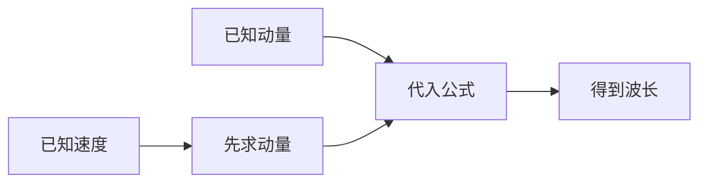

# 德布罗意物质波假设

## 物质波假设

德布罗意提出：==一切微观粒子都具有波动性==。粒子本身仍是具有质量和电荷的粒子，但它在传播与干涉过程中表现得像波，这称为**波粒二象性**。电子、中子、原子等都可被视为“物质波”，其波长由德布罗意关系给出：

$$
\lambda=\frac{h}{p}=\frac{h}{mv}
$$

其中 $h$ 为普朗克常量，$p$ 为粒子动量。动量越大，物质波波长越短。

> [!IMPORTANT]
> 德布罗意波不是普通的机械波或电磁波，而是描述微观粒子量子状态的概率波。

## 为什么要提出物质波

经典理论把光解释为电磁波，把电子看作带电粒子。但电子束在晶体表面发生衍射、干涉时，会出现明暗相间条纹，说明电子也具有波动性。

德布罗意将这种波动性推广到所有微观粒子，并假定自由粒子的频率与动量满足

$$
\nu=\frac{E}{h},\qquad E=h\nu
$$

将自由粒子的动能写成 $E=p^2/(2m)$，便得到

$$
\nu=\frac{p^2}{2mh},\qquad \lambda=\frac{h}{p}
$$

因此，==电子显微镜采用更短波长，并非因为电子“穿透力强”，而是因为电子的德布罗意波长短==。根据瑞利判据

$$
\Delta\theta=1.22\frac{\lambda}{D}
$$

在孔径 $D$ 相同时，波长越短，最小分辨角越小，分辨本领越大。

## 怎样计算物质波波长

计算时通常遵循以下步骤：

若粒子在匀强磁场中做圆周运动，由洛伦兹力提供向心力：

$$
qvB=\frac{mv^2}{R}
$$

因此

$$
p=mv=qBR,\qquad \lambda=\frac{h}{qBR}
$$

例如，$\alpha$ 粒子在 $B=0.025\,\mathrm T$ 的磁场中沿 $R=0.83\,\mathrm{cm}$ 的轨道运动，有

$$
\lambda=\frac{h}{2eBR}\approx1.0\times10^{-11}\,\mathrm m
$$

这属于原子尺度，说明用经典粒子轨道模型得到的 $\alpha$ 粒子具有很短的物质波波长。

## 与光子波长的区别

电子和光子的波长都可以由 $\lambda=h/p$ 求得，但二者的动量—能量关系不同：

| 粒子 | 动量 | 能量关系 | 相同波长下的典型结果 |
|---|---|---|---|
| 光子 | $p=h/\lambda$ | $E=pc$ | 能量较大 |
| 电子 | $p=h/\lambda$ | $E_k=p^2/(2m_e)$ | 动能较小 |

例如，电子和光子的波长均为 $0.20\,\mathrm{nm}$ 时，动量相同：

$$
p=\frac{h}{\lambda}=3.32\times10^{-24}\,\mathrm{kg\,m/s}
$$

光子能量为

$$
E=pc\approx6.22\,\mathrm{keV}
$$

电子动能则为

$$
E_k=\frac{p^2}{2m_e}\approx37.8\,\mathrm{eV}
$$

> [!TIP]
> 记忆口诀：波长相同，粒子动量相同；能量关系不同，不能把光子与电子混为一谈。

## 不确定关系中的应用

若粒子位置的不确定量满足 $\Delta x=\lambda$，结合

$$
\Delta x\,\Delta p\geq\frac{h}{4\pi}
$$

以及 $\Delta p=m\Delta v$、$p=mv=h/\lambda$，可得

$$
\Delta v\geq v
$$

因此题目中的速度不确定量应填“==大于等于==”。

> [!WARNING]
> 普朗克常量 $h$ 与约化普朗克常量 $\hbar=h/(2\pi)$ 不可混用。若直接采用 $\Delta x\Delta p\geq h$，结论形式虽相同，但推导中的常数会不同。

## 常见误区

1. **把物质波当成真实机械波**：它不是介质中的弹性振动，而是概率波。
2. **认为高速粒子波长更长**：由 $\lambda=h/p$ 可知，动量越大，波长越短。
3. **认为电子波长由速度决定而不考虑质量**：应先求动量 $p=mv$。
4. **混淆光子和电子的能量公式**：光子用 $E=pc$，非相对论电子用 $E_k=p^2/(2m)$。
