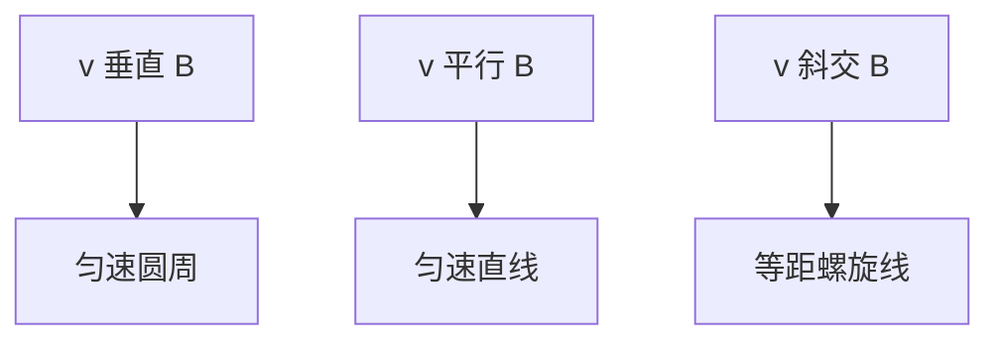

# 洛伦兹力与带电粒子在电场和磁场中的运动

洛伦兹力描述运动电荷在电磁场中的受力情况，是把电场力与磁场力统一起来的核心公式，也是分析霍尔效应、回旋加速器、载流导体受力等一切"磁场对运动电荷作用"问题的出发点。

## 洛伦兹力公式

电荷量为 $q$、速度为 $\vec{v}$ 的粒子，处在电场 $\vec{E}$、磁场 $\vec{B}$ 中时所受的力为

$$
\vec{F}=q\vec{E}+q\vec{v}\times\vec{B}
$$

其中 $q\vec{E}$ 是电场力，$q\vec{v}\times\vec{B}$ 是磁场力（狭义的洛伦兹力）。其大小为 $F_B=qvB\sin\theta$，$\theta$ 是 $\vec{v}$ 与 $\vec{B}$ 的夹角。

> [!IMPORTANT]
> ==磁场力永远垂直于 $\vec{v}$，对电荷不做功==，只改变速度方向、不改变速率；电场力才会改变动能。这是与电场力最根本的区别。

方向判断可用左手定则：磁感线穿手心，四指指向正电荷运动方向，拇指指向力的方向。若 $q<0$（电子），==力方向取反==，或等价地把四指指向电流方向（电子运动的反向）。

## 带电粒子在均匀场中的运动

在均匀磁场中，$\vec{v}\perp\vec{B}$ 时粒子做匀速圆周运动，半径与周期为

$$
R=\frac{mv}{qB},\qquad T=\frac{2\pi m}{qB}
$$

$T$ 与速率无关，这正是回旋加速器的原理。若 $\vec{v}$ 与 $\vec{B}$ 斜交，则分解出平行分量 $v_\parallel$（匀速）与垂直分量（圆周），合成==螺旋线==。

## 霍尔效应：判断载流子电性的利器

载流导体放在垂直于电流的磁场中，==运动载流子受洛伦兹力向侧面积累==，两侧产生电势差 $U_H$，称为霍尔电压：

$$
U_H=\frac{IB}{nqd}
$$

$n$ 为载流子浓度，$d$ 为沿磁场方向的厚度。积累电荷的极性由载流子电性决定，因此测 $U_H$ 可判断是 p 型还是 n 型。

> [!TIP]
> 求 $U_{AB}$ 高低时，先用左手定则判断**正电荷**所受洛伦兹力指向哪侧；若载流子是电子，实际积累在反侧，该侧带负电、电势低。

> [!WARNING]
> 电子流方向 ≠ 电流方向。用左手定则时四指应指向==电流方向==；若直接用电子速度方向，结果必须反号。这是最常丢分的坑。

## 算对了的例子

半导体样品 $a=0.10\,\mathrm{cm}$（沿 $z$ 即 $B$ 方向），$I=1.0\,\mathrm{mA}$ 沿 $x$，$B=0.3\,\mathrm{T}$ 沿 $z$，测得 $U_{AA'}=6.55\,\mathrm{mV}>0$，即 $V_A>V_{A'}$。

对正电荷 $\vec{v}\parallel+\vec{e}_x$，$q\vec{v}\times\vec{B}\propto \vec{e}_x\times\vec{e}_z=-\vec{e}_y$，力指向 $A'$；若载流子为电子，$\vec{v}\parallel-\vec{e}_x$、$q<0$，仍指向 $A'$。实测 $A'$ 侧电势低（带负电），说明积累的是电子，故为==n 型==。

$$
n=\frac{IB}{U_H q d}=\frac{1.0\times10^{-3}\times0.3}{6.55\times10^{-3}\times1.6\times10^{-19}\times1.0\times10^{-3}}
\approx 2.86\times10^{20}\,\mathrm{m^{-3}}
$$

## 与相近概念的区别

| 概念 | 受力对象 | 大小 | 是否做功 |
|---|---|---|---|
| 电场力 | 静止或运动电荷 | $qE$ | 可做功 |
| 洛伦兹力（磁场） | 运动电荷 | $qvB\sin\theta$ | ==永不做功== |
| 安培力 | 电流元 $I\mathrm{d}\vec{l}$ | $I\mathrm{d}\vec{l}\times\vec{B}$ | 是洛伦兹力的宏观表现 |

> [!NOTE]
> 安培力本质上是导体内所有载流子所受洛伦兹力的宏观合力，所以两者用同一套方向判断规则。
