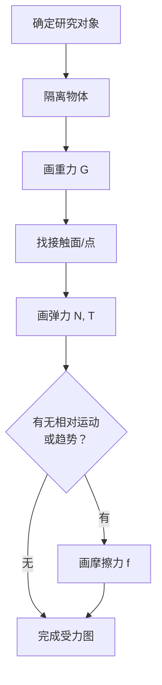

# 常见力（重力、弹力、摩擦力）的受力分析

> [!IMPORTANT]
> 受力分析是应用牛顿定律求解动力学问题的==唯一入口==。画错一个力，后续方程全盘皆输。

## 三种常见力的本质与特征

在宏观力学中，我们打交道的力归根结底只有两类基本相互作用：重力源于万有引力，而相互接触物体之间的弹力、摩擦力本质上都是原子或分子间电磁力的宏观表现。

- **重力**：通常把地球对地面附近物体的万有引力称为重力 $\vec{G}$（或 $\vec{P}$）。严格来说，$\vec{G} = \vec{P}_{\text{引}} + \vec{F}_{\text{惯}}$，其大小和方向与纬度有关；但在地球表面附近，近似认为 $G=mg$，方向垂直指向地面。
- **弹性力**：包括弹簧的弹力、绳子的张力 $\vec{T}$ 以及接触面的正压力（支持力） $\vec{N}$。它们都因物体发生形变而产生。
- **摩擦力**：阻碍相对运动或相对运动趋势。分为静摩擦力与滑动摩擦力。

| 力的类型 | 产生条件 | 方向判定 | 大小计算 |
| :--- | :--- | :--- | :--- |
| 重力 | 处于地球附近 | 竖直向下 | $G=mg$ |
| 弹力 | 接触且发生形变 | 垂直接触面或沿绳/杆 | 胡克定律或平衡/动力学方程 |
| 静摩擦力 | 接触、挤压且有相对运动趋势 | 与相对运动趋势相反 | $0 \le f_s \le \mu N$，由外力决定 |
| 滑动摩擦力 | 接触、挤压且有相对运动 | 与相对运动方向相反 | $f_k = \mu N$ |

> [!NOTE]
> 静摩擦力的大小不是定值！它在方向上与外力方向相反，在数值上与外力俱增，直到物体开始滑动才达到最大值。

## 受力分析的规范步骤

拿到题目后先问自己两个问题：研究对象是谁？它和谁接触了？

> [!TIP]
> 画图口诀：**一重、二弹、三摩擦**。按此顺序排查，绝不漏力、不添力。

## 易错坑辨析

> [!WARNING]
> - **正压力 $N$ 不一定等于 $mg$**。例如在倾斜弯道上，支持力还要提供向心加速度的分量。
> - **静摩擦力方向不一定与运动方向相反**，它只与“相对运动趋势”相反（如传送带上的加速物块）。
> - 不要把“惯性力”当成真实存在的施力源画在惯性系的受力图中。

## 算对了的例子

以南邮教材习题 2.2 为例：质量为 $m$ 的小球用细线挂在倾角为 $\theta$ 的光滑斜面上，斜面以加速度 $a$ 沿水平方向运动。求细线张力 $T$ 及小球对斜面的正压力 $N$。

**第一步：选对象并建系。** 建立与斜面固连的动坐标系（非惯性系），此时需引入平移惯性力 $\boldsymbol{F}_t = -m\boldsymbol{a}$。

**第二步：按顺序画力并写矢量式。**
- 重力：$\boldsymbol{G} = mg(\sin\theta\boldsymbol{i} - \cos\theta\boldsymbol{j})$
- 支持力：$\boldsymbol{N} = N\boldsymbol{j}$
- 张力：$\boldsymbol{T} = -T\boldsymbol{i}$
- 惯性力：$\boldsymbol{F}_t = ma(\cos\theta\boldsymbol{i} + \sin\theta\boldsymbol{j})$

**第三步：列平衡方程。** 在动坐标系中小球静止，合力为零，即 $\boldsymbol{G} + \boldsymbol{N} + \boldsymbol{T} + \boldsymbol{F}_t = 0$。分别投影到 $\boldsymbol{i}$ 和 $\boldsymbol{j}$ 方向：

$$
\begin{cases}
-T + mg\sin\theta + ma\cos\theta = 0 \\
N - mg\cos\theta + ma\sin\theta = 0
\end{cases}
$$

解得：
$$
T = mg\sin\theta + ma\cos\theta, \quad N = mg\cos\theta - ma\sin\theta
$$

> [!CAUTION]
> 当求“小球刚离开斜面”的临界条件时，物理含义是接触面间的挤压消失，即 ==$N = 0$==。代入上式立得临界加速度 $a = g/\tan\theta$。切忌凭直觉乱猜脱离条件。
