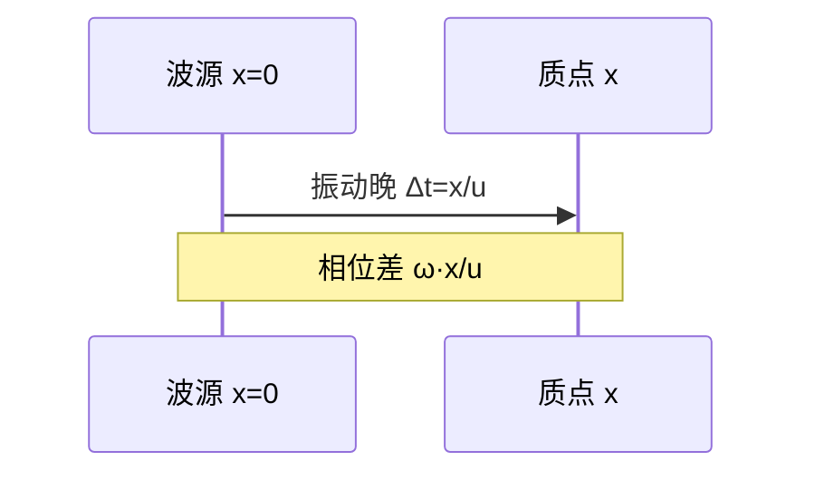

# 平面简谐波的波函数 y=Acos(ω(t±x/u)+φ)

## 波函数：从“一个点振动”到“一片波传播”

机械波产生的条件有两个：==波源（作振动的质点）==与==弹性媒质（能传播振动）==。波函数 $y=A\cos\left[\omega\left(t\mp\dfrac{x}{u}\right)+\varphi\right]$ 就是把波源处质点的简谐振动方程，推广到波线上任意一点 $x$ 处质点的振动方程。

> [!IMPORTANT]
> 波函数描述的是：**在 $t$ 时刻、位置 $x$ 处质点相对平衡位置的位移**。$x$ 与 $t$ 都是变量，这正是它与单个质点振动方程的本质区别。

## 推导：振动如何“传染”给下游质点

设波源（$x=0$ 处）的振动方程为 $y_0=A\cos(\omega t+\varphi)$。波以速度 $u$ 传播，$x$ 处质点的振动要**晚** $\Delta t=\dfrac{x}{u}$ 才到达，即 $x$ 处质点在 $t$ 时刻的位移等于波源在 $t-\dfrac{x}{u}$ 时刻的位移：

$$y=A\cos\left[\omega\left(t-\frac{x}{u}\right)+\varphi\right]$$

> [!TIP]
> 记“**左加右减**”：括号内 $t-\dfrac{x}{u}$，波沿 $x$ 轴**正**向传播；$t+\dfrac{x}{u}$，沿 $x$ 轴**负**向传播。符号只影响传播方向，不影响振幅、周期、波速的数值。

## 五个基本参数：一图锁定

将波函数与标准形式 $y=A\cos\left[\omega\left(t\mp\dfrac{x}{u}\right)+\varphi\right]$ 对比，可读出：

| 物理量 | 符号 | 由波函数读出 | 与 $\omega,u$ 的关系 |
| :--- | :---: | :--- | :--- |
| 振幅 | $A$ | 余弦前系数 | — |
| 角频率 | $\omega$ | $t$ 的系数 | $\omega=2\pi\nu$ |
| 周期 | $T$ | $T=\dfrac{2\pi}{\omega}$ | — |
| 波速 | $u$ | $x$ 系数 $=\dfrac{\omega}{u}$ | $u=\dfrac{\lambda}{T}=\lambda\nu$ |
| 波长 | $\lambda$ | $\lambda=uT$ | $\lambda=\dfrac{2\pi u}{\omega}$ |

> [!WARNING]
> 常见陷阱：$y=0.03\cos[6\pi(t+0.01x)]$ 中，$x$ 的系数是 $6\pi\times0.01=0.06\pi=\dfrac{\omega}{u}$，故 $u=\dfrac{6\pi}{0.06\pi}=100\ \mathrm{m/s}$，而非 $10\ \mathrm{m/s}$；括号内为“$+$”号，波沿 $x$ 轴**负**向传播。振幅是 $0.03\ \mathrm{m}$，不是 $3\ \mathrm{m}$。只有 $T=\dfrac{2\pi}{\omega}=\dfrac{1}{3}\ \mathrm{s}$ 正确。

## 相位差：相距半波长的两点为何“唱反调”

沿传播方向相距 $\Delta x$ 的两点，相位差为

$$\Delta\varphi=\frac{\omega}{u}\Delta x=\frac{2\pi}{\lambda}\Delta x$$

- $\Delta x=\lambda$：$\Delta\varphi=2\pi$，两点**同相**（振动状态完全相同）；
- $\Delta x=\dfrac{\lambda}{2}$：$\Delta\varphi=\pi$，两点**反相**（位移、速度大小相等、方向相反）。

> [!IMPORTANT]
> 沿传播方向，相位**依次滞后**。相距 $\dfrac{\lambda}{2}$ 的两点振动速度必定==大小相同、方向相反==。

## 算对了的例子

已知波源周期 $T=4.00\times10^{-2}\ \mathrm{s}$，波速 $u=300\ \mathrm{m/s}$，沿 $x$ 轴正向传播。求 $x_1=10.0\ \mathrm{m}$ 与 $x_2=16.0\ \mathrm{m}$ 两点的相位差。

**解：** 先求波长
$$\lambda=uT=300\times0.04=12\ \mathrm{m}$$

两点间距 $\Delta x=16.0-10.0=6.0\ \mathrm{m}=\dfrac{\lambda}{2}$，故
$$\Delta\varphi=\frac{2\pi}{\lambda}\Delta x=\frac{2\pi}{12}\times6=\pi$$

两点反相，与选择 2 的结论一致。

## 波形图与能量：两个易混点

**波形图**是 $y-x$ 曲线（某时刻的“快照”），而振动曲线是 $y-t$ 曲线（某质点的“录像”）。由 $t=0$ 波形图求 $O$ 点初相 $\varphi$ 时，用**旋转矢量法**：看 $O$ 点位移 $y_0$ 的正负及下一时刻的运动趋势（由波速方向判断）定象限。

> [!CAUTION]
> 波的能量与孤立弹簧振子不同！媒质质元的动能与势能**同相变化**：质元经过平衡位置时形变最大、速度也最大，故==动能最大、势能也最大==；在最大位移处两者同时为零。不要套用“动能最大时势能最小”的旧结论。
