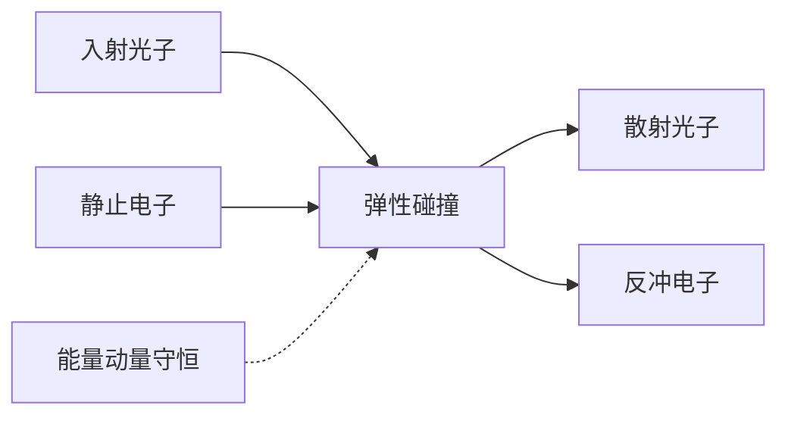

# 康普顿散射实验与光子动量

## 康普顿散射：光子动量的直接证据

如果光仅仅是一种电磁波，当它照射到物质上时，散射光的波长应该与入射光完全相同。然而实验发现，X 射线被石墨散射后，除了原波长成分外，还出现了==波长变长==的新成分。这说明了什么？这说明光在与电子相互作用时，表现得像一个个具有能量和动量的“粒子”。康普顿散射正是证实光子具有动量、确立光量子理论的关键实验。

## 物理图像与核心公式

如何将这一现象量化？我们可以把单个光子与自由电子的相互作用看作一次==完全弹性碰撞==。在此过程中，系统严格遵循能量守恒与动量守恒定律。

> [!IMPORTANT]
> 康普顿散射的本质是光子与自由电子的弹性碰撞，散射光波长改变量 $\Delta\lambda$ 仅取决于散射角 $\theta$，与散射体材料无关。

波长偏移公式为：
$$ \Delta\lambda = \lambda - \lambda_0 = \frac{h}{m_0 c}(1 - \cos\theta) $$
其中 $\lambda_c = \frac{h}{m_0 c} \approx 0.00243 \text{ nm}$ 称为电子的康普顿波长。注意：散射光中既有波长不变的成分（光子与束缚紧密的内层电子或原子核整体碰撞），也有波长变长的成分（光子与外层自由电子碰撞）。

## 与光电效应的辨析

两者都体现了光的粒子性，但机制截然不同：

| 比较维度 | 光电效应 | 康普顿散射 |
| :--- | :--- | :--- |
| 作用对象 | 束缚电子 | 自由/弱束缚电子 |
| 光子命运 | 被完全吸收 | 发生弹性散射 |
| 适用光源 | 可见光/紫外光 | X 射线 / $\gamma$ 射线 |
| 守恒律 | 仅能量守恒 | 能量与动量均守恒 |

> [!NOTE]
> 为什么康普顿效应必须用 X 射线？因为 $\Delta\lambda$ 的数量级为 $10^{-3} \text{ nm}$，只有当入射光波长本身也在该量级时，相对变化才显著可见。可见光波长太大，$\Delta\lambda/\lambda_0$ 微乎其微。

## 计算实战与避坑指南

以真题为例：光子能量 $0.5 \text{ MeV}$ 的 X 射线发生康普顿散射，反冲电子动能 $E_k = 0.1 \text{ MeV}$，求 $\Delta\lambda / \lambda_0$。

**解题思路**：不要死套波长公式，优先利用==能量守恒==建立联系。
1.  散射光子能量：$h\nu = h\nu_0 - E_k = 0.5 - 0.1 = 0.4 \text{ MeV}$
2.  由 $E = hc/\lambda$ 知 $\lambda \propto 1/E$，故 $\frac{\lambda}{\lambda_0} = \frac{h\nu_0}{h\nu} = \frac{0.5}{0.4} = \frac{5}{4}$
3.  $\frac{\Delta\lambda}{\lambda_0} = \frac{\lambda - \lambda_0}{\lambda_0} = \frac{5}{4} - 1 = 0.25$

> [!WARNING]
> 常见误区：误认为散射光波长比入射光短。记住：光子在碰撞中损失能量传给电子，自身频率降低，==波长必然变长==（或不变），绝不会变短。

> [!TIP]
> 涉及能量比值计算时，直接用 $E=hc/\lambda$ 的比例关系求解，避免代入 $h$、$c$ 的具体数值，可大幅减少运算错误。
