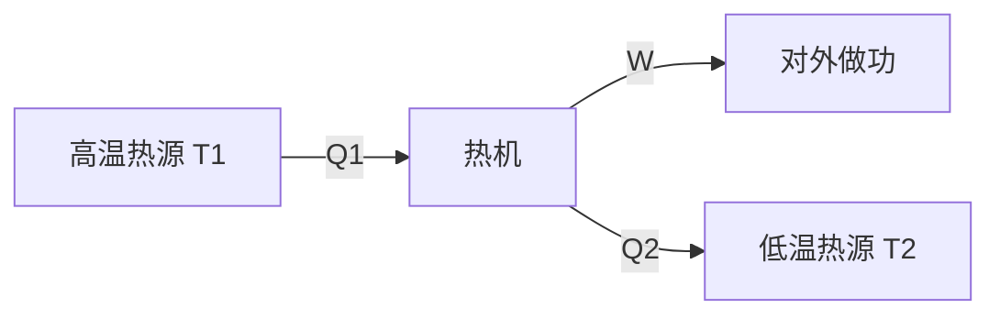

# 一般热机循环过程的效率

## 循环过程的效率

上一节我们学了热力学第一定律，知道热量和功可以相互转化。但在实际应用中，我们关心的往往不是单次变化，而是**连续不断地将热量转化为功**——这就需要一个**循环过程**。

### 什么是热机循环？

想象一个气缸里的气体：它吸热膨胀对外做功，但如果不让它回到起点，活塞飞出去就结束了，无法持续发电。要让机器持续转动，**工质（气体）必须经历一系列过程后回到初始状态**，这个闭合过程就是循环。

在 $p-V$ 图上，循环表现为一条闭合曲线。工质从高温热源吸热 $Q_1$，对外做净功 $W$，并向低温热源放出热量 $Q_2$。

### 一般热机效率：衡量“回本”的能力

热机“吃”进热量 $Q_1$，能吐出多少有用的功 $W$？我们定义循环效率 $\eta$：

$$
\eta = \frac{W}{Q_1} = \frac{Q_1 - Q_2}{Q_1} = 1 - \frac{Q_2}{Q_1}
$$

> [!IMPORTANT]
> 这里的 $Q_1$ 和 $Q_2$ 均指**绝对值**——$Q_1$ 是整轮循环中总吸热，$Q_2$ 是总放热，$W$ 是净功（闭环包围的面积代数和）。

### 关键计算步骤

1. **拆解循环**：将闭合作 $p-V$ 线拆为若干分过程（等温、等压、等容、绝热）。
2. **计算吸放热**：对每个过程用热一律或摩尔热容，判别 $Q$ 的正负；将所有 $Q>0$ 累加得 $Q_1$，所有 $Q<0$ 累加绝对值得 $Q_2$。
3. **算净功**：封闭曲线所围面积 $W$（顺时针为正，逆时针为负），或由 $W = Q_1 - Q_2$ 校验。
4. **代入效率公式**。

> [!WARNING]
> 常犯错误：把某一分过程的吸热当成总 $Q_1$ 直接入公式；多条路径时要**按正负号“分开全部吸、全部放”再求和**。$Q_1$ 仅包含所有吸热过程的热量！

### 卡诺循环给我们的启示

一切实际热机效率均 $\le$ 同温限下的卡诺热机： $\eta_C = 1 - \frac{T_2}{T_1}$。卡诺循环说明：==提高高温热源温度 $T_1$、降低低温热源温度 $T_2$ 是提升效率的根本方向。==

### 一个算对了的例子

> **题干** 某理想气体循环：$a\to b$ 等温膨胀吸热 $800\,\text{J}$，$b\to c$ 绝热膨胀做功 $300\,\text{J}$，$c\to a$ 等压压缩放热 $600\,\text{J}$。求循环效率。

**解**
1. 吸热只在 $a\to b$：$Q_1 = 800\,\text{J}$
2. 放热只在 $c\to a$：$Q_2 = 600\,\text{J}$
3. 净功：$W = Q_1 - Q_2 = 200\,\text{J}$
4. 效率：$\eta = \frac{200}{800} = 0.25 = 25\%$

> [!TIP]
> 若图中无法直接给出 $Q$，可借助**绝热 $Q=0$** 和热一律 $\Delta E = Q - W$，填出所有过程的能量流转。$p-V$ 曲线围成的面积同时也是净功 $W$ 的直接几何量——看到阴影面积就等同于净功。

| 对比项 | 一般热机效率 $\eta$ | 卡诺效率 $\eta_C$ |
|--------|------------------------|------------------------|
| 来源 | 实际过程 $Q_1, Q_2$ | 两恒温热源间可逆循环 |
| 表达式 | $1 - \frac{Q_2}{Q_1}$ | $1 - \frac{T_2}{T_1}$ |
| 意义 | 某具体热机的效费比 | 同温限的理论上限 |

通过本节，你就能读懂 $p-V$ 图里任何一个顺时针大圈代表怎样的能量账本，并算出‘吃进去的热’有多少真正干了活。
