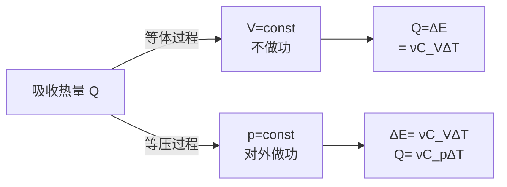

# 热容与理想气体的摩尔热容（Cv与Cp）

## 热容与理想气体的摩尔热容

### 为什么需要热容？

在热力学中，当我们给气体加热时，气体的温度会升高。但同样吸收 1 J 热量，不同气体温度升高不同；同一种气体，在体积不变和压强不变两种条件下，温度升高也不同。为了定量描述这种差异，引入了**热容**的概念。

> [!IMPORTANT]
> 热容的定义：系统吸收的热量 $dQ$ 与温度变化 $dT$ 的比值，即 $C = \frac{dQ}{dT}$。
> 热容与过程有关，==同一个系统在不同过程中热容不同==。

### 两种最基本的摩尔热容

为了方便比较不同物质的吸热能力，通常取 1 mol 气体来讨论，这就是**摩尔热容** $C_m$。

最常用的是两个极限过程的热容：

| 物理量 | 定体摩尔热容 $C_{V}$ | 定压摩尔热容 $C_p$ |
| :--- | :--- | :--- |
| 条件 | 体积不变 ($V = \text{const}$) | 压强不变 ($p = \text{const}$) |
| 含义 | 1 mol 气体在等体过程中升温 1 K 吸收的热量 | 1 mol 气体在等压过程中升温 1 K 吸收的热量 |
| 用途 | 计算任何过程的内能变化 | 计算等压过程的吸热量 |

### 理想气体的摩尔热容公式

利用理想气体状态方程和能量均分定理，可以得到非常简洁的结果。

设分子自由度为 $i$（单原子 $i=3$，刚性双原子 $i=5$，刚性多原子 $i=6$）：

- **定体摩尔热容**：等体过程不做功，热量全部转化为内能增加，所以
  $$C_V = \frac{i}{2}R$$

- **定压摩尔热容**：等压过程气体膨胀对外做功，升温 1 K 除了增加内能 $\frac{i}{2}R$，还要多吸收 $R$ 的热量用来对外做功，因此
  $$C_p = C_V + R = \left(\frac{i}{2} + 1\right)R$$

- **比热容比**：
  $$\gamma = \frac{C_p}{C_V} = \frac{i+2}{i}$$

> [!TIP]
> 记忆口诀："等体只涨内能，等压还需做功"。
> 对于常见理想气体：单原子 $\gamma=1.67$，刚性双原子 $\gamma=1.40$。

### 热容与过程的关系

> [!WARNING]
> 无论什么过程，理想气体的内能增量都可以用 **$\Delta E = \nu C_V \Delta T$** 计算，因为内能只取决于温度。但过程吸热 $Q$ 必须使用对应过程的热容。

### 例题精讲

**题目**：两个相同的刚性容器，分别盛有氢气 ($H_2$, 刚性双原子分子) 和氦气 ($He$, 单原子分子)，初始压强温度都相同。现将 $6 \mathrm{~J}$ 热量传给氦气使之升温 $\Delta T$。若使氢气也升高相同的温度 $\Delta T$，需向氢气传递多少热量？

**分析逻辑**：
1. "刚性容器" $\to$ 等体过程，用 $Q = \nu C_V \Delta T$。
2. 压强、温度、体积相同 $\to$ 气体物质的量 $\nu$ 相同（由 $pV = \nu RT$）。
3. 升温 $\Delta T$ 相同 $\to$ 吸热之比等于 $C_V$ 之比。

**求解过程**：

- $He$：单原子分子，$i=3$，$C_V = \frac{3}{2}R$
- $H_2$：刚性双原子分子，$i=5$，$C_V = \frac{5}{2}R$

设氦气吸热 $Q_{He} = \nu \cdot \frac{3}{2}R \cdot \Delta T = 6 \ \mathrm{J}$。

氢气升高相同 $\Delta T$ 需吸热：
$$Q_{H_2} = \nu \cdot \frac{5}{2}R \cdot \Delta T$$

比值：
$$\frac{Q_{H_2}}{Q_{He}} = \frac{5/2}{3/2} = \frac{5}{3}$$

得：$Q_{H_2} = \frac{5}{3} \times 6 = 10 \ \mathrm{J}$。

> [!CAUTION]
> 常见错误是直接将 $6 \ \mathrm{J}$ 当作用 $C_p$ 计算，或未判断出容器刚性意味着等体过程。题目中"刚性容器"和"升高相同温度"是两个关键条件。
