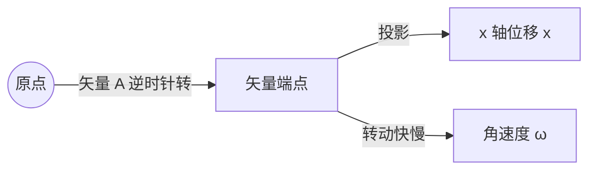

# 用旋转矢量法确定初相与运动状态

## 什么是旋转矢量法

在机械振动里，简谐振动写成 $x(t)=A\cos(\omega t+\phi)$。如果我们直接盯着公式想“$t=0$ 时质点在哪、往哪走”，很容易绕晕。

旋转矢量法就是把==简谐振动==变成一个半径为 $A$ 的矢量，以角速度 $\omega$ 逆时针转：矢量端点在 $x$ 轴上的投影就是位移，转动方向就决定了速度方向。

## 为什么需要它

因为初相 $\phi$ 和“某一时刻的运动状态”（位移、速度正负）关系紧密。初相看不见摸不着，但旋转矢量图一画，象限立刻清楚。

## 怎么做：三步确定初相

先记住南邮课件里的标准式：$x=A\cos(\omega t+\phi)$，速度 $v=-A\omega\sin(\omega t+\phi)$。

第一步，看 $t=0$ 的位移 $x_0$，得 $\cos\phi = x_0/A$；
第二步，看往哪边动：若 $v<0$（向负方向），则 $v(0)=-A\omega\sin\phi<0$，所以 $\sin\phi>0$；
第三步，用 $\cos\phi$ 和 $\sin\phi$ 的正负号定 $\phi$ 在第几象限。

> [!TIP]
> 向负方向动 $\Rightarrow \sin\phi>0$（矢量在第一或第二象限）；向正方向动 $\Rightarrow \sin\phi<0$（第三或第四象限）。

## 常见的坑

很多同学把“通过某位置”和“同方向再次通过”混为一谈。比如题里 $t=0$ 在 $x=-2\text{ cm}$ 且 $v<0$（向左），第一次通过就是此刻；下一次再到同一空间点，不是等一圈，而是转到对称相位。

> [!WARNING]
> 矢量逆时针转，但 $x$ 变小不代表一定向左？要用 $v=-A\omega\sin\phi$ 判速度方向，别只看图感觉。

## 算对了的例子

取选择 4：振幅 $A=4\text{ cm}$，周期 $T=2\text{ s}$，所以 $\omega=2\pi/T=\pi$。已知 $t=0$ 时 $x=-2\text{ cm}$ 且向 $x$ 负方向运动。

由 $-2=4\cos\phi$ 得 $\cos\phi=-1/2$；又 $v<0\Rightarrow \sin\phi>0$，故 $\phi=2\pi/3$（第二象限）。下一次再到 $x=-2$（向右通过）对应相位 $4\pi/3$，相位差 $\Delta\Phi=4\pi/3-2\pi/3=2\pi/3$，于是

$$\Delta t=\frac{\Delta\Phi}{\omega}=\frac{2\pi/3}{\pi}=\frac{2}{3}\text{ s}$$

> [!IMPORTANT]
> 核心结论：初相由 $\cos\phi=x_0/A$ 与运动方向（定 $\sin\phi$ 符号）共同决定；再次到达同一位置用相位差除以 $\omega$ 算时间。
