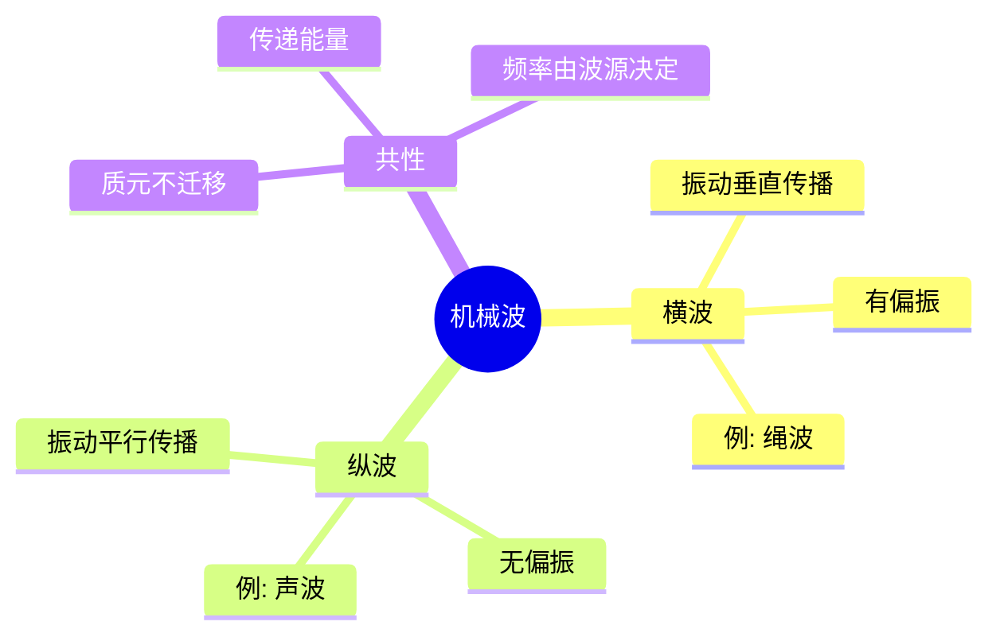

# 机械波的形成、横波与纵波

## 机械波的形成与分类

机械波是**振动在弹性媒质中的传播**。要形成机械波，必须同时具备两个条件：==波源==（提供初始振动）和==弹性媒质==（传递相互作用）。注意，波传播的是**振动形式**和**能量**，而媒质中的质元仅在平衡位置附近振动，==不随波迁移==。

根据质元振动方向与波传播方向的关系，机械波分为两类：

| 类型 | 振动方向 vs 传播方向 | 典型实例 | 偏振性 |
| :--- | :--- | :--- | :--- |
| **横波** | 相互垂直 ($\perp$) | 绳波、电磁波* | 有偏振现象 |
| **纵波** | 相互平行 ($\parallel$) | 声波、弹簧疏密波 | 无偏振现象 |

> [!NOTE]
> 课件中提到的 $\vec{E}, \vec{H}, \vec{u}$ 右手螺旋关系属于**电磁波**（横波）特性。在纯机械波章节，重点在于区分质元振动方向与波速 $\vec{u}$ 的几何关系。机械横波才有偏振性，纵波没有。

## 核心物理量的制约关系

在处理波的传播问题时，最容易混淆的是频率、波速和波长的决定因素。请记住以下铁律：

1.  **频率 $f$ (或 $\omega$)**：由==波源==决定。波从一种介质进入另一种介质时，频率保持不变。
2.  **波速 $u$**：由==媒质性质==（如密度、弹性模量）决定。
3.  **波长 $\lambda$**：由波源和媒质共同决定，满足关系式 $u = \lambda f$。

> [!TIP]
> **解题口诀**：跨介质，频不变；换媒质，速改变；波长随之自适应。

以**填空 6**为例：声波在空气中 $\lambda_1=0.25\mathrm{m}, u_1=340\mathrm{m/s}$。
首先求频率：$f = \frac{u_1}{\lambda_1} = \frac{340}{0.25} = 1360 \mathrm{Hz}$。
进入新介质后，$f$ 不变，$\lambda_2=0.37\mathrm{m}$，则新波速：
$$ u_2 = f \lambda_2 = 1360 \times 0.37 = 503.2 \mathrm{~m/s} $$

## 能量分布的常见误区

在简谐波中，质元的动能和势能变化是==同相==的，这与单个弹簧振子（动能势能互补）完全不同。

> [!WARNING]
> **高危误区**：认为质元在平衡位置时势能为零。
> **正解**：在行波中，质元在**平衡位置**时，形变率最大（拉伸/压缩最剧烈），因此==动能最大，势能也最大==；在最大位移处，速度为零，形变率为零，动能和势能均为零。

参考**选择 4**：质元处于平衡位置时，振动速度最大（动能最大），同时媒质形变最大（势能最大）。故选 **C**。

## 波动方程与振动速度

已知波形图求某点振动速度，需先写出波函数 $y(x,t)$，再对时间 $t$ 求偏导：$v = \frac{\partial y}{\partial t}$。

以**选择 5**为例，$A=0.1\mathrm{m}, u=200\mathrm{m/s}$。由图知 $\lambda=200\mathrm{m}$（假设图示一个完整波长为200m，结合选项反推 $\omega$）。
若 $\lambda = 200 \mathrm{m}$，则 $T = \lambda/u = 1 \mathrm{s}$，$\omega = 2\pi$。
$P$ 点在 $t=0$ 时位于平衡位置且向下运动（根据波形平移法判断），其振动方程应为余弦形式带初相或正弦形式。
振动速度表达式需对位移求导。若位移 $y_P = A\cos(\omega t + \phi)$，则 $v_P = -A\omega\sin(\omega t + \phi)$ 或转化为余弦形式。
选项 A 中 $\nu = -0.2\pi \cos(2\pi t - \pi)$，振幅项 $A\omega = 0.1 \times 2\pi = 0.2\pi$，符合量纲与数值逻辑。
