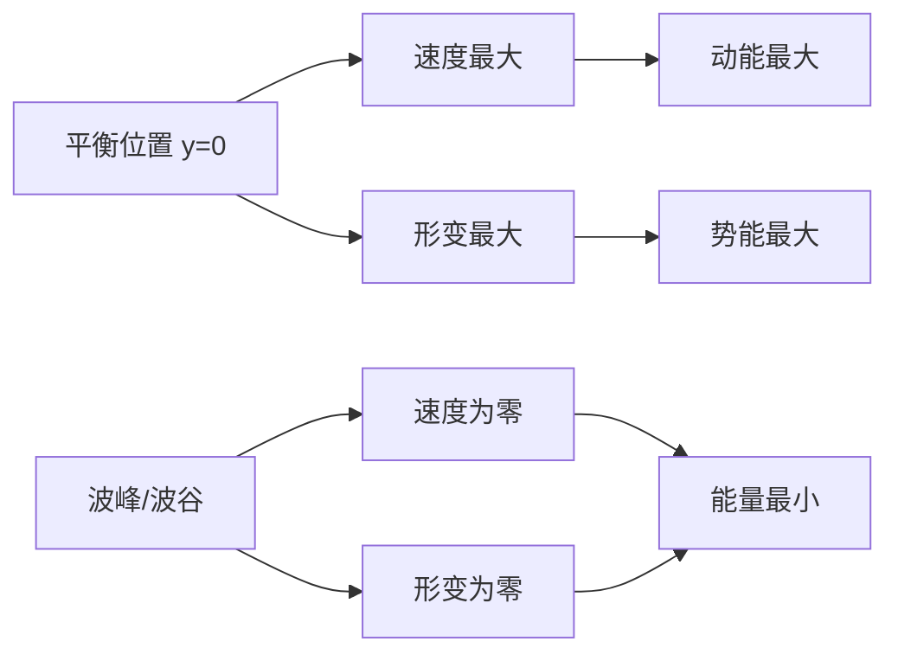

# 波动过程中的能量传播与能流密度

机械波在介质中传播时，能量也随之"搬家"。和单个质点的简谐振动不同，==机械波中某质元的动能和势能并不"此消彼长"，而是时刻相等、同步起伏==——这是机械波能量最反直觉、也最常考的一点。

## 质元的能量：动能与势能同步

设平面简谐波为
$$
y = A\cos\omega\!\left(t - \frac{x}{u}\right),
$$
在坐标 $x$ 处取一小质元（质量 $\mathrm{d}m = \rho\,\mathrm{d}V$），它相当于以角频率 $\omega$ 做简谐振动。于是

$$
\mathrm{d}E_k = \tfrac{1}{2}\,\mathrm{d}m\;v^2,\qquad
\mathrm{d}E_p = \tfrac{1}{2}\,\mathrm{d}m\;\omega^2 y^2 .
$$

代入 $y,\;v = \partial y/\partial t$ 可得 ==$\mathrm{d}E_k = \mathrm{d}E_p$ 恒成立==。

- 当质元处在 ==平衡位置==（$y=0$）时，速度最大、==形变也最大==（相邻质元相对位移最大），故 $E_k$、$E_p$ 同时达到最大；
- 当质元处在 ==最大位移==（波峰/波谷）时，速度为零、形变为零，故两者同时为零。

> [!WARNING]
> 常见坑：把"势能最大在最大位移处"这条**振动**规律直接套到**波动**上。波动里势能由**形变**决定，平衡位置才是形变最大处。

## 能量密度与能流密度

能量密度是单位体积的能量，其时间平均值（==平均能量密度==）为

$$
\overline{w} = \frac{1}{2}\rho A^2 \omega^2 .
$$

能量沿波速方向流动，单位时间通过垂直于传播方向单位面积的能量称为 ==能流密度（波的强度）==：

$$
I = \overline{w}\,u = \frac{1}{2}\rho A^2 \omega^2 u .
$$

| 概念 | 单位 | 含义 |
| --- | --- | --- |
| $\overline{w}$ | $\mathrm{J/m^3}$ | 单位体积平均能量 |
| $I$ | $\mathrm{W/m^2}$ | 单位面积单位时间通过的能量 |
| $P = I S$ | $\mathrm{W}$ | 通过面积 $S$ 的平均能流 |

> [!NOTE]
> 对球面波，能量均匀分布在半径为 $r$ 的球面上，$I \cdot 4\pi r^2 = P_{\text{源}}$，故 $I \propto 1/r^2$，$A \propto 1/r$。

## 算一个

球面波源功率 $P = 100\ \mathrm{W}$，介质不吸收能量，求 $r = 10\ \mathrm{m}$ 处的平均能流密度：

$$
I = \frac{P}{4\pi r^2} = \frac{100}{4\pi \times 10^2} = \frac{1}{4\pi} \approx 7.96\times 10^{-2}\ \mathrm{W/m^2}.
$$

> [!TIP]
> 遇到"某质元处于平衡位置时能量如何"，一律选 ==动能、势能均最大==；看到球面波求强度，先写 $I = P/(4\pi r^2)$。
