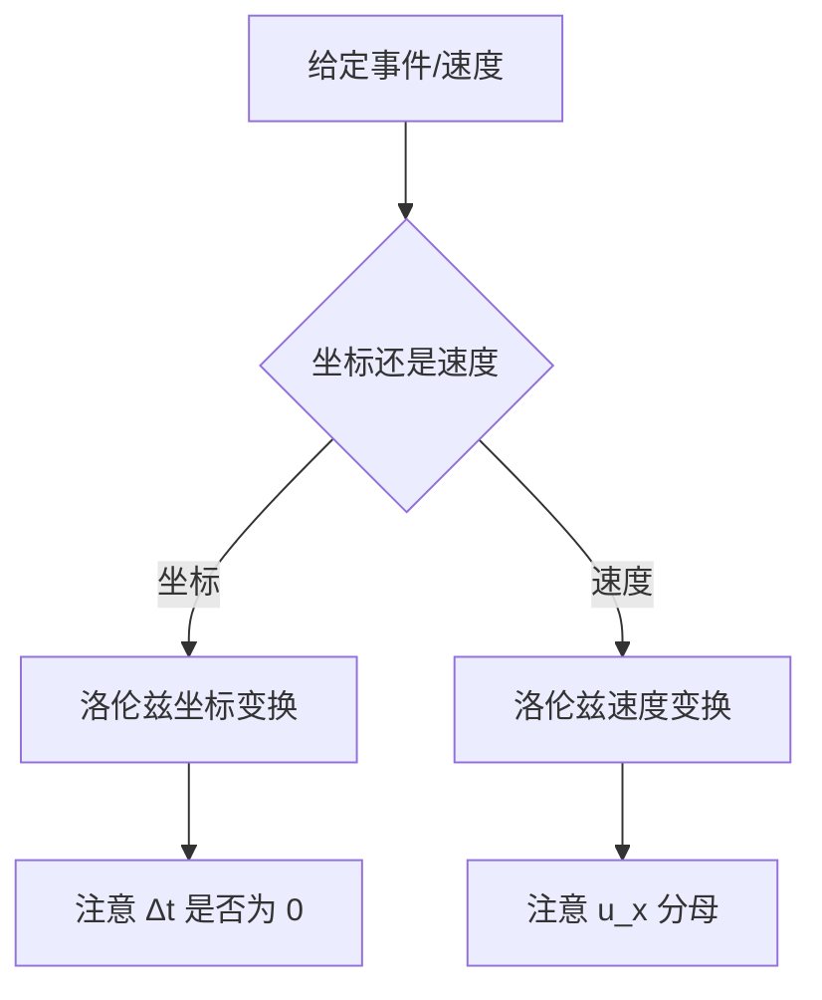

# 洛伦兹坐标变换与速度变换

## 这是什么、为什么需要

伽利略变换下时间绝对、空间绝对，速度直接相加；可一旦出现光速，这套做法就会撞墙。洛伦兹变换给出两个惯性系之间的**正确坐标换算**，是狭义相对论的数学骨架；==洛伦兹速度变换==则是它对速度量的推论，保证任何速度合成结果都小于 $c$。

两个惯性系 $K'$ 相对 $K$ 以速度 $v$ 沿 $x$ 轴正向运动时，坐标变换为

$$
x'=\frac{x-vt}{\sqrt{1-v^2/c^2}},\quad y'=y,\quad z'=z,\quad t'=\frac{t-vx/c^2}{\sqrt{1-v^2/c^2}}.
$$

> [!NOTE]
> $y'=y,\;z'=z$ 表明 ==运动只发生在相对速度方向==，垂直方向长度与坐标都不变。

对坐标变换求微分，就得到速度变换：

$$
u_x'=\frac{u_x-v}{1-vu_x/c^2},\quad u_y'=\frac{u_y\sqrt{1-v^2/c^2}}{1-vu_x/c^2},\quad u_z'=\frac{u_z\sqrt{1-v^2/c^2}}{1-vu_x/c^2},
$$

反向只需把 $v\to -v$ 与撇号互换。

## 怎么用

先问一句：两个系之间是"坐标"还是"速度"要换算？坐标问题套洛伦兹坐标变换，速度问题套洛伦兹速度变换，二者别混。

> [!TIP]
> 记住：==$t$ 方向的变换里含 $x$，$x$ 方向的变换里含 $t$==，"你中有我"才是相对论的关键特征；低速时 $v/c\to 0$，公式自动退化为伽利略变换。

## 和相近概念的区别

| 概念 | 描述对象 | 典型结论 |
| --- | --- | --- |
| 伽利略变换 | 低速力学 | 时间、长度绝对 |
| 洛伦兹坐标变换 | 事件时空坐标 | $\Delta t' \neq \Delta t$ |
| 洛伦兹速度变换 | 速度矢量 | 合成速度 $<c$ |
| 时间膨胀/长度收缩 | 单个时空间隔 | 特例化的推论 |

## 常见的坑

> [!WARNING]
> - 速度变换分母是 $1-vu_x/c^2$，==只有 $x$ 分量进分母==，$u_y,u_z$ 不要写进分母。
> - "同时"是相对的：$\Delta t=0$ 不代表 $\Delta t'=0$。
> - 长度收缩只沿运动方向，求斜尺长度必须先分解分量。

## 一个算对了的例子

惯性系 $K'$ 相对 $K$ 以 $v=\frac{\sqrt{8}}{3}c$ 沿 $x$ 运动；$K$ 中两事件同时、$\Delta x=1\,\mathrm{m}$，则 $K'$ 中

$$
\Delta x' = \frac{\Delta x}{\sqrt{1-v^2/c^2}} = \frac{1}{\sqrt{1-8/9}} = 3\,\mathrm{m},
\quad
|\Delta t'| = \frac{v\Delta x/c^2}{\sqrt{1-v^2/c^2}} = \frac{\sqrt{8}}{c} \approx 0.94\times 10^{-8}\,\mathrm{s}.
$$

空间拉长、时间不再为零，与"同时的相对性"完全自洽。
