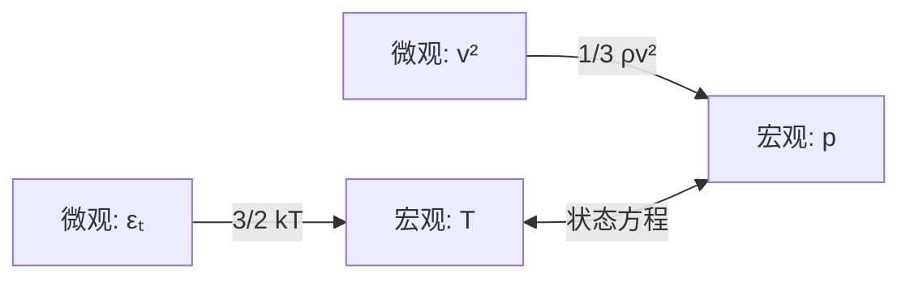

# 温度的微观本质与分子平均平动动能

## 温度的微观本质是什么

宏观上我们用温度计测量冷热，但在微观层面，温度究竟对应什么物理量？对于理想气体而言，温度并非描述单个分子的属性，而是==大量分子平均平动动能的量度==。其核心公式为：

$$
\overline{\varepsilon}_t = \frac{3}{2}kT
$$

其中 $k$ 为玻尔兹曼常数，$T$ 为热力学温度。该式表明，只要温度相同，无论气体种类（氦气、氧气或氢气），其分子的平均平动动能必然相等。

> [!IMPORTANT]
> 温度是统计概念，具有集体表现意义。
> 它只适用于大量分子组成的系统，谈论“单个分子的温度”在物理上是没有意义的。

## 为什么需要区分平动动能与总动能

既然温度只决定平均平动动能，那分子的转动和振动呢？这正是解题时最容易混淆的地方。

| 物理量 | 决定因素 | 公式 | 适用对象 |
| :--- | :--- | :--- | :--- |
| 平均平动动能 | 仅温度 $T$ | $\frac{3}{2}kT$ | 所有理想气体 |
| 平均总动能 | 温度 $T$ + 自由度 $i$ | $\frac{i}{2}kT$ | 特定分子结构 |
| 方均根速率 | 温度 $T$ + 分子质量 $m$ | $\sqrt{\frac{3kT}{m}}$ | 特定气体种类 |

> [!WARNING]
> 同温下不同气体的平均平动动能相同，但平均速率、平均总动能通常不同。
> 例如 $127^\circ\mathrm{C}$ 的氢气与氦气，$\overline{\varepsilon}_t$ 相等，但因自由度不同（$H_2$ 为5，$He$ 为3），平均总动能不等；因质量不同，方均根速率也不等。

## 如何关联压强与密度

当题目同时给出压强、密度或方均根速率时，需将微观量与宏观状态方程桥接。由 $p=nkT$ 和 $\overline{\varepsilon}_t=\frac{3}{2}kT$ 可推导出：

$$
p = \frac{2}{3}n\overline{\varepsilon}_t = \frac{1}{3}\rho \overline{v^2}
$$

> [!TIP]
> 若已知方均根速率 $\sqrt{\overline{v^2}}$ 和压强 $p$ 求密度 $\rho$，直接使用 $\rho = \frac{3p}{\overline{v^2}}$，无需先求温度再代入状态方程，可减少计算步骤与误差。

## 典型例题解析

**题目**：封闭容器中装有 $2\ \mathrm{g}$ 氢气，温度为 $127^\circ\mathrm{C}$，求分子的平均平动动能。

**解**：首先将摄氏温度转换为热力学温度 $T = 273 + 127 = 400\ \mathrm{K}$。注意题目问的是“平均平动动能”，与氢气是双原子分子无关，直接套用平动动能公式：

$$
\overline{\varepsilon}_t = \frac{3}{2}kT = \frac{3}{2} \times 1.38 \times 10^{-23} \times 400\ \mathrm{J} = 8.28 \times 10^{-21}\ \mathrm{J}
$$

> [!CAUTION]
> 切勿看到“氢气”就习惯性乘以 $\frac{5}{2}kT$。
> 只有当题目明确询问“平均动能”或“内能”时，才需考虑自由度 $i=5$；问“平动动能”则永远只用 $\frac{3}{2}kT$。
