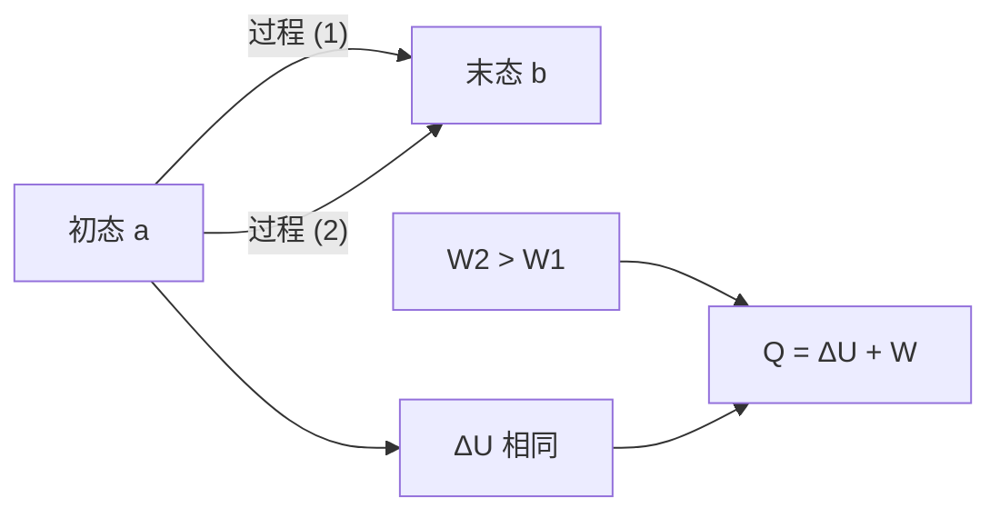

# 热力学第一定律及过程量与状态量的区别

## 热力学第一定律与过程量、状态量的区别

### 先想清楚一个问题

气体从状态 a 变到状态 b，走直线和走曲线，吸热一样吗？

直觉上“终点一样所以变化一样”，但热量不是由状态决定的。压力—体积图中，==做功与路径有关==，而内能只由初末状态决定。于是热量必须跟着路径一起变——这正是热力学第一定律要管的事。

### 热力学第一定律

对任一微小过程：

$$
dQ = dU + dW
$$

其中：

| 量 | 类型 | 含义 | 是否由状态唯一决定 |
|---|---|---|---|
| $U$（内能） | 状态量 | 气体分子热运动能量的总和 | ✅ 是 |
| $W$（做功） | 过程量 | 气体体积变化时对外做功 | ❌ 否，与路径有关 |
| $Q$（热量） | 过程量 | 传热 | ❌ 否，与路径有关 |

对理想气体，内能只与温度有关。1 mol 理想气体内能变化：

$$
\Delta U = \frac{i}{2} R \, \Delta T
$$

单原子分子 $i=3$，双原子分子 $i=5$。题中往往用 $\Delta U$ 直接比较两个过程的内能变化。

> [!IMPORTANT]
> 内能是状态量，$\Delta U$ 只看初末态；而 $W$ 和 $Q$ 都是过程量，同一初末态走不同路径，$W$ 不同，$Q$ 也不同。

### 怎么判断 Q 的大小

遇到“同一初末态、两个过程，比较 $Q_1$ 与 $Q_2$”的题，步骤是固定的：

1. 判断 $\Delta U$：初末温度相同，$\Delta U$ 就相同。
2. 看 $p$–$V$ 图中过程曲线下的面积：面积代表 $W$。
3. 用第一定律：

$$
Q = \Delta U + W
$$

下面这道南邮选择题正是如此：初态 a 到末态 b，$T_b > T_a$，所以 $\Delta U > 0$。过程 (2) 的曲线始终在过程 (1) 上方，说明 $W_2 > W_1$。于是 $Q_2 > Q_1$，且两者都大于 0，答案选 **A**。

### 热机效率的坑

卡诺热机给出理论最高效率：

$$
\eta = 1 - \frac{T_2}{T_1}
$$

给 $T_1 = 400~\text{K}$、$T_2 = 300~\text{K}$ 时，$\eta_{\max} = 25\%$。若有人设计的热机效率超过这个值，即使能量守恒也==不能实现==——这考的是第二定律与第一定律的配合。

> [!WARNING]
> 只验证 $Q_1 = W + Q_2$ 还不够！热机设计还要看效率有没有超过卡诺效率。一个过程可以满足第一定律但违反第二定律。

### 状态量与过程量的区分小结

判断一个量是状态量还是过程量，问一句即可：

> 初末状态相同，但路径不同，它的值一定一样吗？

- 内能：一样 ✅
- 压强、体积、温度：一样 ✅
- 功：不一定 ❌
- 热量：不一定 ❌

`p-V` 图中，$\Delta U$ 只依赖初末点，$W$ 依赖曲线，$Q$ 是两者的差。记住这个链条：

$$
\boxed{\,Q = \Delta U + W\,}
$$

其中 $\Delta U$ 由状态决定，$W$ 由过程曲线下的面积决定，$Q$ 随两者而变。这一条就能应对大多数判断题与选择题。
