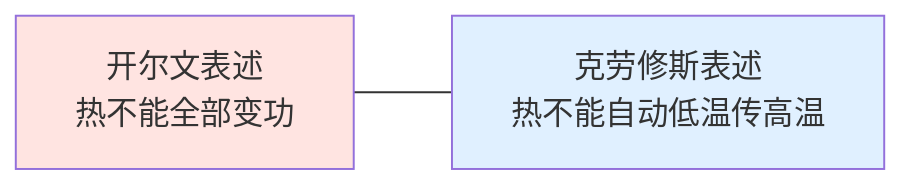

# 热力学第二定律的两种表述
### 为什么需要第二定律

热力学第一定律只告诉我们"能量要守恒"，它管不了一件怪事：一杯热水放在桌上，热量自发传给空气直到温度相同，但从没见过空气把热量自发还给热水、让水重新沸腾。能量守恒没被破坏，可这个过程偏偏只朝一个方向走。热力学第二定律要回答的正是：**自然过程沿哪个方向进行，以及热和功、传热有什么不可逾越的限制。**

### 两种表述

**开尔文表述**：不可能制成一种循环动作的热机，只从单一热源吸取热量，使之完全变为有用功而不产生其他影响。换句话说，==热不能 100% 变成功==，热功转换必然有"代价"（向低温热源放热）。

**克劳修斯表述**：热量不可能自动地从低温物体传向高温物体。换句话说，==热传导只能自发从高温到低温==；反向传热必须借助外界做功（如冰箱耗电）。

> [!IMPORTANT]
> 两种表述**完全等价**：违反其中一个，必然能造出违反另一个的装置。所以它们说的是同一条自然规律的两个侧面。

### 可逆与不可逆

第二定律的实质是：**自然界一切与热现象有关的宏观过程都是不可逆的**。可逆过程要求"无摩擦的准静态过程"——既无限缓慢、又处处平衡、还没有耗散。注意区分：

| 命题 | 对错 | 原因 |
|---|---|---|
| 可逆过程一定是准静态过程 | ✔ | 非准静态无法逐态复原 |
| 准静态过程一定是可逆过程 | ✘ | 准静态仍可有摩擦耗散 |
| 不可逆过程就是不能反向进行 | ✘ | 可以反向，但不能自发复原 |
| 有摩擦的过程一定不可逆 | ✔ | 摩擦属耗散因素 |

### 常见误区

> [!WARNING]
> - "功可以完全变热，热不能完全变功"——**错**。热也能完全变功（等温膨胀），但必然引起其他变化（体积改变），开尔文表述限定的是"循环动作、无其他影响"。
> - "热量不能从低温传到高温"——**错**。借助外界做功（制冷机）完全可以，只是不能**自动**进行。
> - "热机效率可以接近 1"——**错**。卡诺定理给出上限 $\eta_{max}=1-\dfrac{T_2}{T_1}$，热源温差有限时效率必小于 1。

### 典型例题

某"卡诺热机"每循环从 $400\,\mathrm{K}$ 吸热 $1800\,\mathrm{J}$，向 $300\,\mathrm{K}$ 放热 $800\,\mathrm{J}$，对外做功 $1000\,\mathrm{J}$。问是否可行？

先验第一定律：$Q_1=Q_2+W=800+1000=1800\,\mathrm{J}$ ✔，能量守恒没问题。

再验第二定律。该设计效率：

$$\eta'=\frac{W}{Q_1}=\frac{1000}{1800}\approx 55.6\%$$

而同温热源间卡诺热机的理论上限：

$$\eta_{max}=1-\frac{T_2}{T_1}=1-\frac{300}{400}=25\%$$

$\eta'>\eta_{max}$，==效率超过理论值，违反热力学第二定律==，此设计不可能实现。答案选 D。

> [!TIP]
> 判断热机方案：先查能量守恒（第一定律），再算效率与卡诺上限比较（第二定律）。两步都过才算可行。
