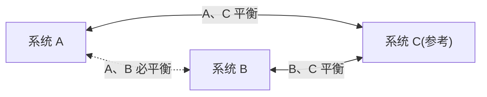

# 热力学第零定律与理想气体温标

如果两个物体分别与第三个物体处于热平衡，那这两个物体之间是否也处于热平衡？温度计测温的物理依据又是什么？

## 热力学第零定律

> [!IMPORTANT]
> 若系统 A 与 C 处于热平衡，B 与 C 也处于热平衡，则 A 与 B 必处于热平衡。

这就是**热力学第零定律**。它揭示了“温度”这一宏观状态参量存在的客观基础：处于同一热平衡态的所有系统，必然具有一个共同的宏观属性，我们将其定义为==温度==。

为什么叫“第零”定律？因为它在逻辑上先于第一、第二定律，是定义温度和建立温标的前提，但历史上提出较晚，故补编为“第零”。

## 理想气体温标

知道了温度存在，如何定量测量？我们需要选定一种物质的某个物理量随温度的变化关系来标定刻度。

> [!NOTE]
> 实际气体（如水银、酒精）的膨胀规律各不相同，导致不同温度计读数有微小差异。如何建立一种与测温物质无关的客观温标？

答案是**理想气体温标**。实验发现，当实际气体的压强 $p \to 0$ 时，其行为趋近于理想气体，且所有气体的定容压强比（或定压体积比）趋于同一个极限值。

以**定容气体温度计**为例，保持气体体积不变，规定温度 $T$ 与压强 $p$ 成正比：

$$T = 273.16 \, \text{K} \times \lim_{p_{tr} \to 0} \frac{p}{p_{tr}}$$

其中 $p_{tr}$ 是测温泡内气体在水的三相点（严格规定为 $273.16 \, \text{K}$）时的压强。取极限 $p_{tr} \to 0$ 是为了消除实际气体分子间作用力和分子本身体积的影响。

> [!TIP]
> 记忆口诀：**定容看压强，三相点是锚，压强趋于零，温标才可靠。**

## 概念辨析与常见坑

| 比较维度 | 热力学第零定律 | 理想气体温标 |
| :--- | :--- | :--- |
| **本质** | 物理定律（理论基础） | 测量标准（操作定义） |
| **解决的问题** | 证明温度存在、传递性 | 给出温度的具体数值刻度 |
| **依赖条件** | 仅需热平衡事实 | 需气体在低压下的极限行为 |

> [!WARNING]
> 水的三相点温度是 $273.16 \, \text{K}$，而冰点（标准大气压下冰水混合物）约为 $273.15 \, \text{K}$。两者相差 $0.01 \, \text{K}$，考试中极易混淆！公式中必须用 ==三相点== 作为基准。

> [!CAUTION]
> 理想气体温标只在气体不液化的范围内有效。在极低温下气体液化，该温标失效；但在其适用范围内，它与热力学温标（开尔文温标）完全一致。

## 计算示例

**题目**：用定容气体温度计测量某恒温槽的温度。测温泡在水的三相点时，经多次抽气外推得到极限压强 $p_{tr} = 4.00 \times 10^3 \, \text{Pa}$；将该温度计放入恒温槽达到热平衡后，测得对应极限压强 $p = 5.46 \times 10^3 \, \text{Pa}$。求恒温槽的热力学温度。

**解析**：
直接代入理想气体温标的定容公式：

$$T = 273.16 \times \frac{p}{p_{tr}}$$

$$T = 273.16 \times \frac{5.46 \times 10^3}{4.00 \times 10^3} \, \text{K}$$

$$T = 273.16 \times 1.365 \, \text{K} \approx 372.86 \, \text{K}$$

> [!TIP]
> 解题关键：题目给出的已经是“极限压强”，说明已经做过 $p_{tr} \to 0$ 的外推处理，直接代入比值即可，无需再做极限运算。
