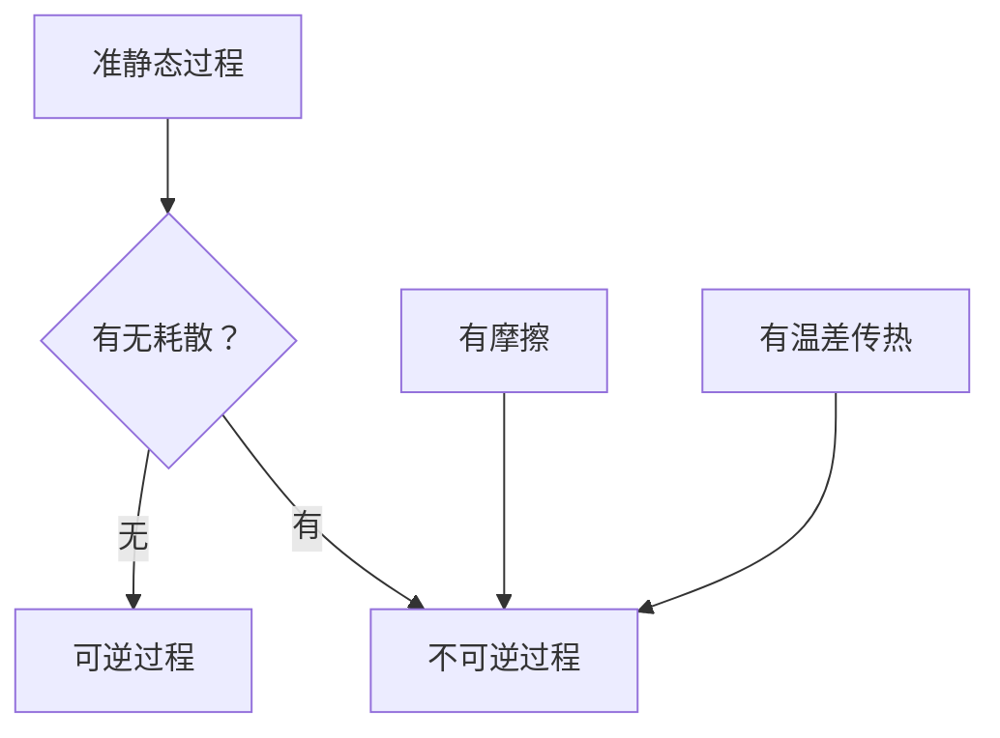

# 熵的概念、克劳修斯不等式与熵的计算

## 它是什么：熵与不可逆程度的度量

熵 $S$ 是状态函数，描述系统的无序程度，也衡量==过程的不可逆程度==。玻尔兹曼给出微观定义 $S = k \ln \Omega$，其中 $\Omega$ 是系统微观态数，$k = 1.38 \times 10^{-23}\ \mathrm{J/K}$ 为玻尔兹曼常量。热力学中用克劳修斯积分定义熵变：

$$
\Delta S = S_B - S_A = \int_A^B \frac{\mathrm{d}Q_{\text{rev}}}{T}
$$

注意这里积分只对**可逆路径**取值——熵是状态量，路径任选，通常挑一条最容易算的可逆路径。

## 克劳修斯不等式与熵增原理

对任意过程，克劳修斯不等式给出：

$$
\oint \frac{\mathrm{d}Q}{T} \leq 0
$$

其中可逆取 $=$，不可逆取 $<$。由此得到系统熵变与熵流的关系：

$$
\Delta S \geq \int_A^B \frac{\mathrm{d}Q}{T}
$$

孤立系统的 $\mathrm{d}Q = 0$，于是直接得到**熵增原理**：

$$
\Delta S_{\text{孤立}} \geq 0
$$

==不可逆过程熵增（$\Delta S > 0$），可逆过程熵不变（$\Delta S = 0$）==。这一条是判断过程方向性的通用判据，比热力学第二定律的开尔文/克劳修斯表述更普适。

## 可逆与不可逆过程的辨析

判断题高频考点，请记住下面四条：

| 论断 | 对错 | 理由 |
|------|------|------|
| 可逆过程一定是准静态 | ✅ | 中间态必须无限接近平衡 |
| 准静态过程一定可逆 | ❌ | 有摩擦或温差传热就不可逆 |
| 不可逆过程不能反向进行 | ❌ | 反向可以，但系统+环境不能同时复原 |
| 有摩擦的过程必不可逆 | ✅ | 摩擦生热是典型耗散 |

> [!CAUTION]
> "不可逆"不是"反着做不行"，而是==反着做无法让系统和外界同时复原==。气体自由膨胀后可以压缩回去，但外界熵增了，整体仍不可逆。

## 几个典型过程的熵变

- **等温可逆**：$\Delta S = \dfrac{Q}{T}$
- **等容升温**：$\Delta S = \nu C_{V} \ln \dfrac{T_2}{T_1}$
- **等压升温**：$\Delta S = \nu C_{p} \ln \dfrac{T_2}{T_1}$
- **自由膨胀（理想气体）**：$\Delta S = \nu R \ln \dfrac{V_2}{V_1} > 0$，$T$ 不变
- **绝热自由膨胀**：温度不变，熵增加

> [!TIP]
> 自由膨胀虽然实际没有热交换，但算熵变时**可另选一条等温可逆路径**连接初末态，用 $\int \mathrm{d}Q_{\text{rev}}/T$ 计算，结果与路径无关。

## 例题：自由膨胀的温度与熵变

【4336】绝热容器被隔板分为两半，左半装理想气体，右半真空。撤去隔板后，气体自由膨胀达到平衡，求温度与熵变。

**解**：绝热自由膨胀 $Q = 0$、$W = 0$（向真空无对外做功），由第一定律 $\Delta E = Q - W = 0$，理想气体内能只依赖温度，故 $T$ ==不变==。

熵变可取一条可逆等温路径连接 $V \to 2V$：

$$
\Delta S = \int \frac{\mathrm{d}Q_{\text{rev}}}{T} = \frac{1}{T}\int_{V}^{2V} p\,\mathrm{d}V = \frac{\nu R T}{T}\ln 2 = \nu R \ln 2 > 0
$$

熵==增加==。这印证了熵增原理：孤立系统内自发的不可逆过程熵必增。

> [!WARNING]
> 即使温度不变，熵也可以增大。==温度不变 ≠ 熵不变==，熵还与体积、无序度相关。
