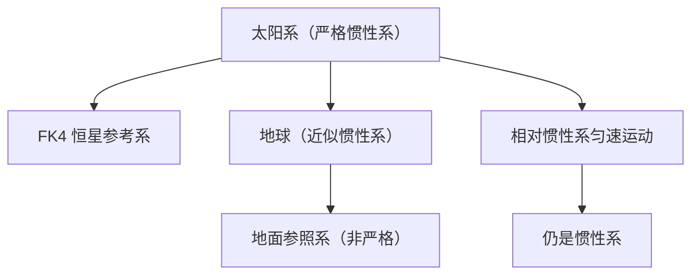

# 牛顿三定律与惯性系

## 牛顿三定律与惯性系

### 从一道题暴露的直觉漏洞

先想一个问题：你坐在一列正在加速启动的地铁里，把手机放在座椅上。手机没有相对于车厢滑动，但从站台上的人看来，手机明明在做加速运动。按牛顿第二定律，力是产生加速度的原因——那么，站台上的人会问：手机所受的合外力是谁提供的？车厢里的人却会说：手机根本没动，哪来的加速度？

同一个物体，两个参照系给出了完全不同的力学描述。牛顿定律到底听谁的？这就是惯性系与非惯性系要解决的根本问题。

### 牛顿三定律在说什么

**第一定律（惯性定律）**：不受外力作用（或合外力为零）的物体保持静止或匀速直线运动。它不只是第二定律的特例，而是==界定了惯性系==：存在一类参照系，在其中不受力的物体保持匀速直线运动。

**第二定律（动力学方程）**：
$$\vec{F} = m\vec{a}$$
其中 $\vec{F}$ 是物体所受的**合外力**，$m$ 是质点质量（不随时间变化的常量），$\vec{a}$ 是质点**相对于惯性系**的加速度。

**第三定律（作用—反作用）**：
$$\vec{F}_{A \to B} = -\vec{F}_{B \to A}$$
注意三个限定词：大小相等、方向相反、**作用在同一直线上不同物体上**——所以这两个力绝不互相抵消。

> [!IMPORTANT]
> 牛顿第二定律不是 $F = ma$ 的简单代数式，而是矢量式。实际解题时按坐标轴投影：
> $$\sum F_x = ma_x, \quad \sum F_y = ma_y, \quad \sum F_z = ma_z$$

### 惯性系与非惯性系的判据

课件里反复强调一句话：==牛顿定律严格成立的参照系称为惯性系==。具体判断标准：

- 太阳系是较好的惯性系（天文观测表明行星运动遵从牛顿定律）。
- 相对于惯性系做**匀速直线运动**的参照系也是惯性系。
- 地球有自转（角速度 $\omega \approx 7.3 \times 10^{-5}\ \text{rad/s}$）和公转，地面上物体有法向加速度，所以==地面只是一个近似的惯性系，不是严格的惯性系==。

### 非惯性系中牛顿定律怎么用

如果在加速车厢内研究手机，牛顿第二定律直接不成立。处理办法是**引入惯性力**：

$$\vec{F}_{\text{惯}} = -m\vec{a}_{\text{系}}$$

其中 $\vec{a}_{\text{系}}$ 是非惯性系相对于惯性系的加速度。引入后，牛顿第二定律变为：

$$\vec{F} + \vec{F}_{\text{惯}} = m\vec{a}'$$

这里 $\vec{a}'$ 是物体**相对于非惯性系**的加速度。

> [!CAUTION]
> 惯性力不是真实力，没有施力物体，不满足牛顿第三定律。它仅仅是为了在非惯性系里“强行”使用牛顿第二定律而引入的数学修正项。只有在非惯性系中才谈惯性力。

### 一个典型的连接体转动问题

取上面考过的滑轮题模型：质量为 $m$ 的两物块 $A$、$B$ 分别绕在半径不同的圆轮上，滑轮转动惯量为 $J$。设逆时针为角加速度 $\alpha$ 正方向，$A$ 在小轮半径 $r$ 处，$B$ 在大轮半径 $R$ 处。

**第一步，受力分析**：$A$ 受重力 $mg$ 和绳拉力 $T_A$；$B$ 受重力 $mg$ 和拉力 $T_B$。

**第二步，对滑轮用转动定律**（刚体定轴转动的牛顿第二定律）：

$$T_A r - T_B R = J\alpha \quad \text{(1)}$$

**第三步，对两物块列平动方程**。假设 $A$ 向下加速（加速度 $a_A$）、$B$ 向上加速（加速度 $a_B$）：

$$mg - T_A = m a_A \quad \text{(2)}$$
$$T_B - mg = m a_B \quad \text{(3)}$$

**第四步，绳与滑轮无滑动的几何关系**：

$$a_A = \alpha r, \quad a_B = \alpha R \quad \text{(4)}$$

联立求解：由 (2)(3) 得 $T_A = m(g-\alpha r)$，$T_B = m(g+\alpha R)$，代入 (1)：

$$m(g-\alpha r)r - m(g+\alpha R)R = J\alpha$$

整理得

$$\alpha = \frac{mg(r-R)}{J + m(r^2+R^2)}$$

于是

$$a_A = \alpha r = \frac{mgr(r-R)}{J + m(r^2+R^2)}, \quad a_B = \alpha R = \frac{mgR(r-R)}{J + m(r^2+R^2)}$$

> [!TIP]
> 解此类“滑轮+物块”问题的万能流程：①对物块列 $\sum F = ma$；②对滑轮列 $\sum M = J\alpha$；③用几何约束 $a = \alpha r$ 联立。三件事做完，剩下的只是代数消元。

若 $R>r$，则 $\alpha < 0$，即滑轮实际顺时针转动，$B$ 侧下降、$A$ 侧上升。

> [!NOTE]
> 不同惯性系下牛顿力学规律形式相同，这称为**伽利略相对性原理**：在一个惯性系内部做任何力学实验，都无法判断该惯性系相对其他惯性系是否在运动。
