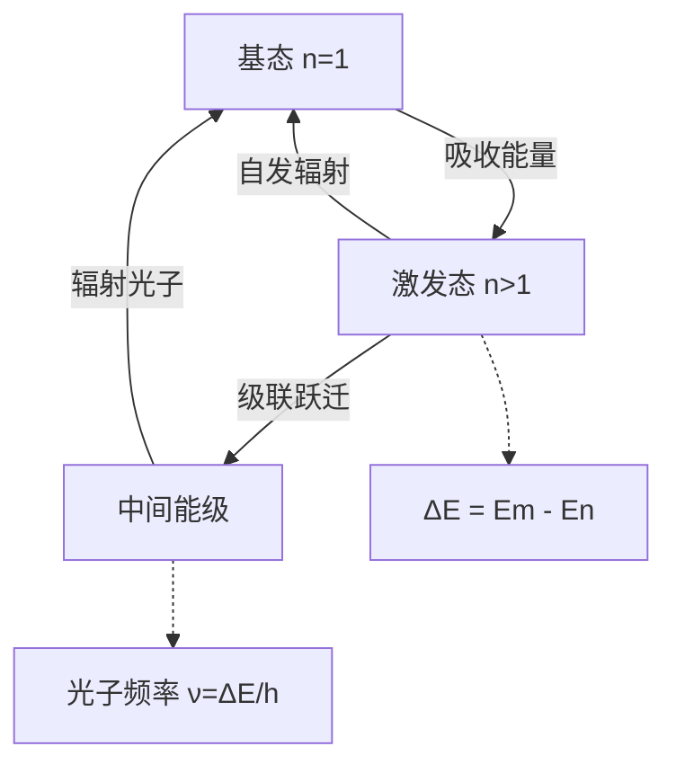

# 玻尔的氢原子理论与能级跃迁

## 玻尔氢原子理论与能级跃迁

为什么经典电磁理论无法解释原子光谱的离散性？因为电子绕核运动会辐射能量导致坍缩，且应产生连续谱。玻尔通过引入==量子化条件==解决了这一矛盾，其核心在于三条假设：定态假设、频率条件和角动量量子化。这不仅是量子物理的起点，更是南邮《大学物理》计算题与选择题的高频考点。

### 能级公式与跃迁机制

氢原子能级由主量子数 $n$ 决定，基态能量 $E_1 = -13.6\,\mathrm{eV}$ 必须熟记：

$$
E_n = \frac{E_1}{n^2} = -\frac{13.6}{n^2}\,\mathrm{eV} \quad (n=1,2,3,\dots)
$$

当电子从高能级 $E_m$ 跃迁到低能级 $E_n$ 时，发射光子能量为 $\Delta E = E_m - E_n = h\nu$。反之，吸收光子或受电子轰击时可发生向上跃迁。

> [!IMPORTANT]
> ==能级能量为负值==，表示电子处于束缚态；$n \to \infty$ 时 $E_\infty = 0$，对应电离态。计算能级差时务必注意符号，避免得出负的光子能量。

### 轨道磁矩与外磁场作用

玻尔模型中电子绕核运动等效于环形电流，产生轨道磁矩 $\vec{m}$。若已知轨道半径 $r$，可由库仑力提供向心力求出速度 $v$，进而得到等效电流 $I = e/T = ev/(2\pi r)$ 和磁矩大小：

$$
m = I \cdot S = \frac{ev}{2\pi r} \cdot \pi r^2 = \frac{e}{2m_e} L
$$

其中 $L = m_e v r$ 为轨道角动量。置于外磁场 $\vec{B}_0$ 中时，磁力矩 $\vec{M} = \vec{m} \times \vec{B}_0$，==最大力矩出现在 $\vec{m} \perp \vec{B}_0$ 时==，大小为 $M_{\max} = m B_0$。

> [!WARNING]
> 题目若给出半径 $r$ 而非量子数 $n$，需先用经典力学求 $v$，再代入磁矩公式。切勿直接套用 $m = n \mu_B$（$\mu_B$ 为玻尔磁子），该式仅适用于角动量量子化后的结果，而题干可能要求基于经典轨道推导。

### 常见误区与解题要点

| 概念 | 正确理解 | 典型错误 |
|------|----------|----------|
| 激发方式 | 电子轰击可部分转移能量 | 误认为必须精确匹配能级差 |
| 谱线数目 | $n$ 能级向下跃迁最多 $C_n^2$ 条 | 漏算级联跃迁产生的谱线 |
| 可见光范围 | 巴耳末系部分谱线（如 $3\to2$） | 将所有巴耳末系视为可见光 |

> [!TIP]
> 判断电子轰击能否激发某能级：比较入射电子动能与 $(E_n - E_1)$。若动能 $\geq E_n - E_1$ 但 $< E_{n+1} - E_1$，则最高只能激发到第 $n$ 能级。例如 $12.6\,\mathrm{eV}$ 电子轰击基态氢原子，因 $-13.6 + 12.6 = -1.0\,\mathrm{eV}$ 介于 $E_3=-1.51\,\mathrm{eV}$ 与 $E_2=-3.4\,\mathrm{eV}$ 之间，故最高激发至 $n=3$，可产生 $3\to2$、$3\to1$、$2\to1$ 三条谱线，其中仅 $3\to2$（$\lambda \approx 656\,\mathrm{nm}$）属于可见光。

> [!CAUTION]
> 计算波长时单位易错：$1\,\mathrm{eV} = 1.6\times10^{-19}\,\mathrm{J}$，普朗克常量 $h = 6.63\times10^{-34}\,\mathrm{J\cdot s}$。建议先以 $\mathrm{eV}$ 算出 $\Delta E$，再用 $\lambda (\mathrm{nm}) \approx 1240 / \Delta E (\mathrm{eV})$ 快速估算，避免指数运算失误。
