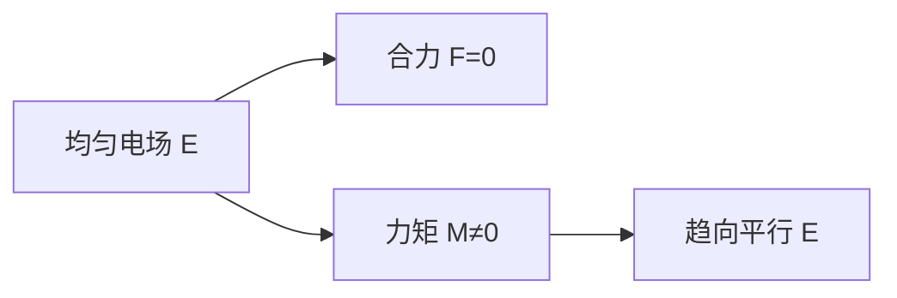

# 电偶极子的电场与受力

## 什么是电偶极子

如果两个点电荷靠得无限近，我们还能把它们看作独立的电荷吗？当观察距离 $r$ 远大于电荷间距 $l$（即 $r \gg l$）时，这对等量异号点电荷就构成了一个==电偶极子==。它是描述分子极性、介质极化及天线辐射的基础物理模型。

> [!IMPORTANT]
> 核心定义：电偶极矩 $\vec{P}_e = q\vec{l}$
> 其中 $\vec{l}$ 的方向规定为==由负电荷指向正电荷==，这是后续所有矢量运算的基准。

## 激发的电场与电势

既然不能简单套用单个点电荷公式，远处的场如何计算？利用叠加原理并做泰勒展开近似（保留 $1/r^3$ 项），可得特殊位置的场强：

| 位置 | 电场强度 $\vec{E}$ | 特征 |
| :--- | :--- | :--- |
| 延长线上 | $\frac{1}{4\pi\varepsilon_0} \frac{2\vec{P}_e}{r^3}$ | 与 $\vec{P}_e$ 同向，衰减快 |
| 中垂线上 | $-\frac{1}{4\pi\varepsilon_0} \frac{\vec{P}_e}{r^3}$ | 与 $\vec{P}_e$ 反向，大小减半 |

任意点的电势表达式更为简洁：$U = \dfrac{\vec{P}_e \cdot \vec{r}}{4\pi\varepsilon_0 r^3}$。注意这里出现的是点积，说明电势具有轴对称性且随角度变化。

## 均匀电场中的受力与力矩

把电偶极子放入外电场中会发生什么？若电场是均匀的，正负电荷受力 $\pm q\vec{E}$ 等大反向，故==合力为零==。但这两个力不共线，会产生力矩使偶极子转向。

$$ \vec{M} = \vec{P}_e \times \vec{E} $$

> [!TIP]
> 力矩效果记忆：$\vec{M}$ 总是试图将 $\vec{P}_e$ 转到与 $\vec{E}$ ==同向==的位置，该位置为稳定平衡态。

## 常见误区与辨析

- **方向搞反**：$\vec{l}$ 必须从 $-q$ 指向 $+q$，若画反会导致 $\vec{P}_e$、$\vec{M}$ 方向全部错误。
- **混淆非均匀场**：上述 $\vec{M}=\vec{P}_e\times\vec{E}$ 仅适用于==均匀电场==。在非均匀电场中，偶极子除受力矩外还会受到净力 $\vec{F}=(\vec{P}_e\cdot\nabla)\vec{E}$，会被拉向场强更强处。
- **单位混淆**：力矩单位是 $\mathrm{N\cdot m}$，切勿写成能量单位 $\mathrm{J}$，尽管量纲相同但物理意义完全不同。

## 真题实战演练

> [!NOTE]
> **题目**：$q=1.0\times10^{-6}\,\mathrm{C}$，$l=2.0\,\mathrm{cm}$ 的电偶极子置于 $E=1.0\times10^{5}\,\mathrm{N/C}$ 的均匀电场中，求最大力矩。

**解题三步走**：

1.  **算电矩**：$P_e = ql = 1.0\times10^{-6} \times 0.02 = 2.0\times10^{-8}\,\mathrm{C\cdot m}$
2.  **判极值**：由 $M=P_e E \sin\theta$，当 $\vec{P}_e \perp \vec{E}$ 时力矩最大
3.  **代数值**：$M_{\max} = P_e E = 2.0\times10^{-8} \times 1.0\times10^{5} = ==2.0\times10^{-3}\,\mathrm{N\cdot m}==$

> [!WARNING]
> 计算时务必将 $l$ 换算为国际单位 $\mathrm{m}$，且最终答案单位写 $\mathrm{N\cdot m}$ 而非 $\mathrm{J}$，这是阅卷扣分高频点。
