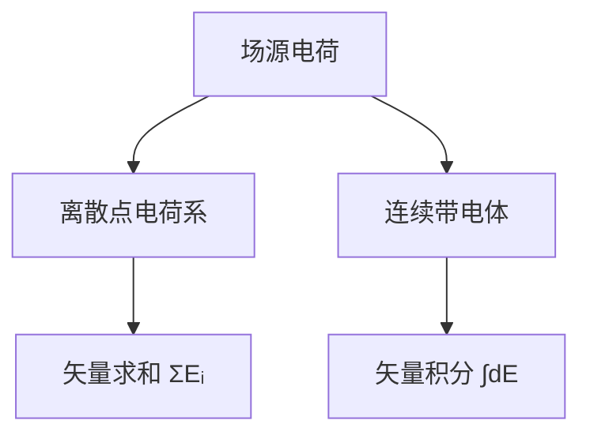

# 电场强度的定义与叠加原理

电场强度是描述静电场“力的性质”的物理量。想象空间中有一个源电荷，我们怎么定量描述它在周围激发的电场？最直接的办法是放一个试探电荷进去“感受”一下。

## 电场强度的定义

在电场中某点放置电量为 $q_0$ 的==正试探电荷==，它受到的电场力为 $\vec{F}$，则该点的电场强度定义为：

$$
\vec{E} = \frac{\vec{F}}{q_0}
$$

> [!IMPORTANT]
> $\vec{E}$ 由场源电荷决定，与试探电荷 $q_0$ 无关。$\vec{F}/q_0$ 的比值在该点是恒定的。

这里有个常见的思维陷阱：既然公式里有 $q_0$，那 $\vec{E}$ 是不是和 $q_0$ 成反比？不是。因为 $q_0$ 变大时，$\vec{F}$ 也同比例变大，比值不变。若撤去试探电荷（$q_0=0$），$\vec{F}=0$，但电场依然存在，$\vec{E}\neq 0$。同时注意，只有当 $q_0>0$ 时，$\vec{F}$ 的方向才与 $\vec{E}$ 的方向一致。

## 电场叠加原理

如果空间中有多个源电荷，某点的总电场怎么求？由于电场力满足独立作用原理，总电场强度等于各电荷单独存在时在该点激发的电场强度的==矢量和==：

$$
\vec{E} = \sum \vec{E}_i
$$

根据源电荷的分布形态，叠加方式分为两类：

- **点电荷系**：$\vec{E}=\displaystyle\sum \frac{q_i\boldsymbol{r}_i}{4\pi\varepsilon_0 r^3}$，其中 $\boldsymbol{r}_i$ 是从源电荷 $q_i$ 指向场点的位矢。
- **连续带电体**：$\vec{E}=\displaystyle\int_q \frac{\boldsymbol{r}\,\mathrm{d}q}{4\pi\varepsilon_0 r^3}$，需将带电体分割为电荷元 $\mathrm{d}q$，先写出 $\mathrm{d}\vec{E}$，再分量积分。

## 与电势叠加的区别

电场强度和电势都满足叠加原理，但本质截然不同：

| 比较项 | 电场强度叠加 | 电势叠加 |
| :--- | :--- | :--- |
| **物理量类型** | 矢量 | 标量 |
| **叠加法则** | 矢量合成（平行四边形法则） | 代数相加 |
| **公式特征** | 含方向矢量 $\boldsymbol{r}$，分母为 $r^3$ | 无方向，分母为 $r$ |
| **计算难度** | 需分解到坐标轴分别积分 | 直接对数值积分即可 |

> [!WARNING]
> 算电场必须建立坐标系，把 $\mathrm{d}\vec{E}$ 投影到 $x, y$ 轴上分别积分；算电势则直接把 $dU$ 加起来，千万别把两者搞混！

## 实战应用：补全法巧解叠加

面对不规则带电体，硬算积分往往很痛苦。此时可以反向利用叠加原理——“补全法”。

**例题**：电荷线密度为 $\lambda$ 的均匀带正电圆环（半径 $R$），截掉长度为 $l$（$l < R$）的一段，求圆心处电场强度。

**分析引导**：完整圆环在圆心处的电场是多少？由对称性可知，各个方向的 $\mathrm{d}\vec{E}$ 互相抵消，$\vec{E}_{\text{整}} = 0$。

根据叠加原理，剩余部分产生的电场 $\vec{E}$ 加上被截掉小段产生的电场 $\vec{E}'$，应该等于完整圆环的电场：

$$
\vec{E} + \vec{E}' = 0 \implies \vec{E} = -\vec{E}'
$$

因为 $l < R$，截掉的小段可视为点电荷，其电量 $q' = \lambda l$。它在圆心激发的电场大小为：

$$
E' = \frac{1}{4\pi\varepsilon_0}\frac{\lambda l}{R^2}
$$

方向沿圆心指向缺口（设该方向单位矢量为 $\vec{e}_{l0}$）。因此，剩余圆环在圆心处的电场为：

$$
\vec{E} = -\vec{E}' = -\frac{1}{4\pi\varepsilon_0}\frac{\lambda l}{R^2}\vec{e}_{l0}
$$

即大小为 $\dfrac{\lambda l}{4\pi\varepsilon_0 R^2}$，方向==背离缺口指向圆心==。

> [!TIP]
> 遇到“挖去”、“截掉”类题目，优先用“整体 − 局部 = 剩余”的矢量叠加思路，避免复杂的微积分运算。
